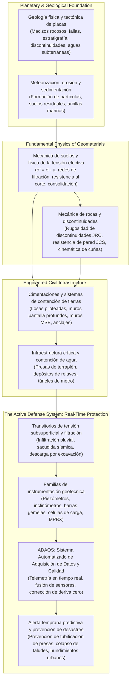
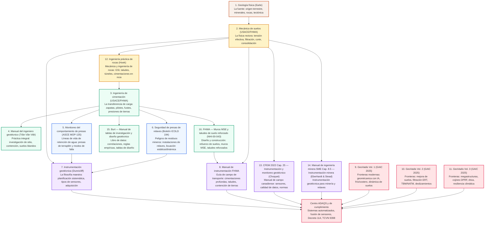
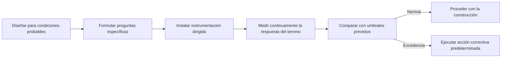
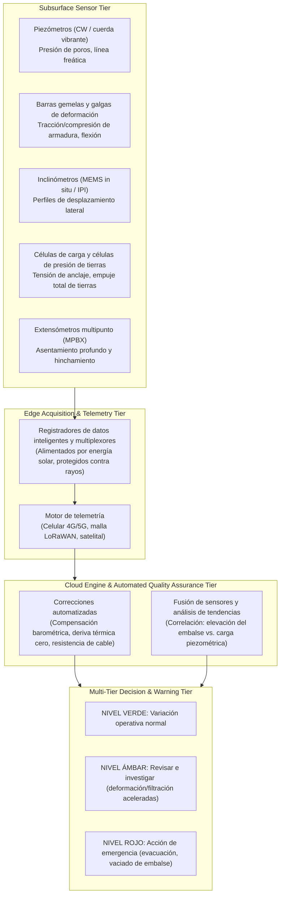
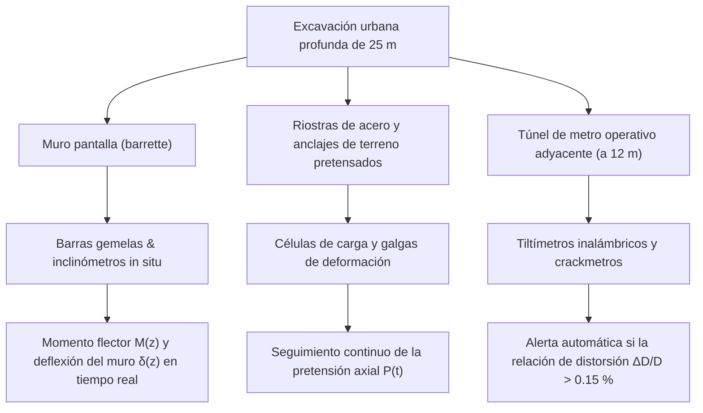
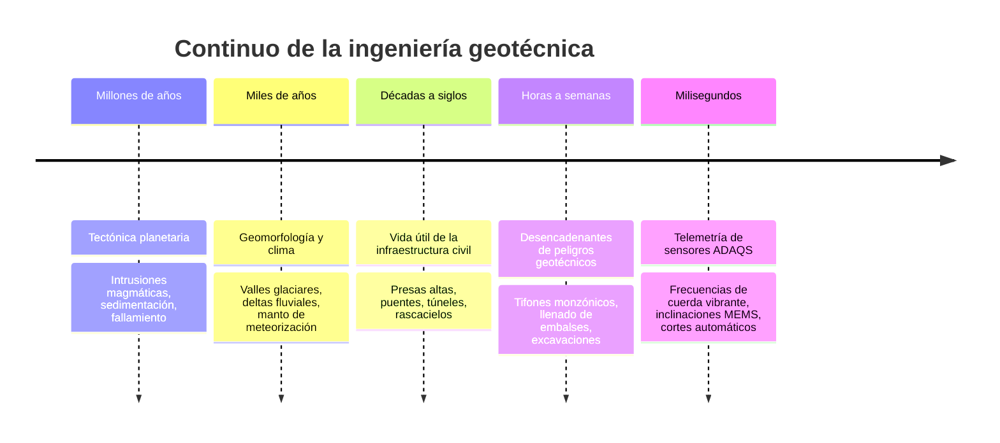

# La gran visión: De la corteza terrestre al monitoreo en tiempo real y la prevención de desastres

!!! info "Síntesis ejecutiva y marco fundacional"
    Esta guía global sintetiza todo el corpus geotécnico alojado en esta plataforma — que abarca la **Geología física**, la **Mecánica de suelos**, la **Ingeniería de cimentación**, la **Ingeniería de rocas (Hoek)**, la **Seguridad de presas y relaves**, la **Instrumentación avanzada (Dunnicliff / FHWA)**, la **CFEM 2022** y la **Instrumentación minera SME (Cap. 8.5)**, las **tablas de datos de investigación y diseño de Burt**, el **manual de diseño de muros MSE y taludes de suelo reforzado de la FHWA**, y los más recientes **Fronteras GeoVadis (Volúmenes 1–3)**. Articula la gran visión de la ingeniería que conecta los procesos terrestres planetarios con la telemetría diaria de sensores, explicando por qué la instrumentación geotécnica y el **ADAQS** son indispensables para prevenir desastres catastróficos y garantizar la resiliencia vitalicia de la infraestructura civil.

---

## 1. La gran visión: Primero la imagen global

Las estructuras de ingeniería civil no descansan sobre planos matemáticos abstractos e idealizados — están enraizadas en la **corteza dinámica de la Tierra**.

Cada rascacielos, presa alta, túnel de transporte, turbina energética offshore y excavación profunda interactúa directamente con estratos geológicos formados a lo largo de millones de años por fuerzas tectónicas, actividad volcánica, sedimentación, meteorización y ciclos glaciológicos:

### El dilema fundamental de la ingeniería geotécnica
A diferencia del acero estructural o del hormigón armado —cuyas tolerancias de fabricación, resistencias de fluencia y módulos elásticos están controlados con precisión en fábricas industriales—, **los geomateriales son naturales, no homogéneos, opacos, anisotrópicos y dependientes de la historia de tensiones**:

1. **Invisibilidad:** Los ingenieros no pueden abrir el terreno como una máquina para inspeccionar cada metro cúbico. Los sondeos muestrean menos del $0.001\%$ del volumen subterráneo.
2. **Física no lineal acoplada:** La resistencia del suelo no está dictada por la tensión total, sino por el **principio de la tensión efectiva** ($\sigma' = \sigma - u$). Un cambio mínimo en la presión de poros $u$ puede hacer caer la tensión efectiva $\sigma'$ a cero, transformando el suelo sólido en una suspensión fluidizada.
3. **Falla progresiva:** Los geomateriales fallan progresivamente a lo largo de bandas de cizalla localizadas o caminos de erosión interna que permanecen totalmente invisibles desde la superficie hasta que ocurre el colapso catastrófico.

La instrumentación geotécnica y los sistemas automatizados de adquisición de datos (**ADAQS**) proporcionan el **sistema nervioso digital** que tiende un puente sobre esta brecha fundamental entre los procesos geológicos invisibles y el control de la ingeniería humana.

---

## 2. El continuo vivo: Cómo se conectan los manuales de referencia

Cada manual de referencia de esta biblioteca representa una capa fundacional en una pirámide integrada de conocimiento de ingeniería geotécnica:

### La progresión del conocimiento:
1. **El origen y la litología (*Geología física*):** Enseña cómo los basaltos volcánicos, las fallas de milonita tectónica, los sedimentos marinos y los depósitos de till glaciar formaron sus macrofábricas y sus regímenes de aguas subterráneas.
2. **La física fundamental (*Mecánica de suelos* e *Ingeniería práctica de rocas*):** Traduce los estratos geológicos a mecánica: distribución del tamaño de grano, límites de Atterberg, permeabilidad $k$, compresibilidad $C_c$, resistencia al corte no drenada $s_u$, y el tensor de tensión efectiva. *Ingeniería práctica de rocas* (Hoek) extiende esto a la **mecánica de rocas** — GSI, cizalla de discontinuidades, tensiones in situ, y la filosofía de diseño aceptable para taludes rocosos, túneles y cimentaciones en roca.
3. **La síntesis de diseño (*Ingeniería de cimentación*, *Manual del ingeniero geotécnico* y *Burt*):** Calcula cómo distribuir las cargas de la superestructura de forma segura a través de zapatas superficiales extendidas, pilotes perforados profundos, barrettes y muros de tierra mecánicamente estabilizada (MSE) — y el *Manual de Burt de tablas de investigación y diseño geotécnico* aporta las **correlaciones y tablas de diseño** (SPT → resistencia, CPT → tipo de suelo, RQD → capacidad de carga de roca, IP → módulo) que convierten esa teoría en números listos para hoja de cálculo. El **manual de la FHWA *Muros MSE y taludes de suelo reforzado*** lleva entonces la parte de suelo reforzado de esa síntesis hasta el diseño completo — mecánica de arranque, estabilidad externa e interna, y las especificaciones e inspección de campo que hacen construible un muro MSE o un talud reforzado.
4. **Las fronteras de activos de alto riesgo (*Seguridad de presas y relaves*):** Establece los mecanismos de falla fatales de terraplenes críticos de retención de agua y de relaves mineros: tubificación, fracturamiento hidráulico, deslizamiento de cimentación y licuación de flujo.
5. **La filosofía diagnóstica (*Dunnicliff, FHWA, CFEM 2022* e *Instrumentación minera SME*):** Introduce el **método de observación** (Peck, 1969), enseñando a los ingenieros a formular preguntas geotécnicas específicas y seleccionar la familia exacta de instrumentos para responder a cada pregunta — ampliado por el manual de campo canadiense de instrumentación y monitoreo **CFEM 2022 Cap. 25** y el tratamiento del **Cap. 8.5 del Manual de ingeniería minera SME** sobre instrumentación geotécnica para minería y relaves.
6. **La frontera tecnológica (*GeoVadis Volúmenes 1–3*):** Avanza la profesión hacia modelos sustitutos de aprendizaje automático, redes neuronales informadas por la física (PINNs), estabilización con biopolímeros, biocimentación (MICP), geofísica sísmica de túneles de avance anticipado, y alineaciones viales resilientes al clima.
7. **El centro nervioso operativo (*ADAQS y cumplimiento legal*):** Conecta los sensores de campo con registradores de datos automatizados, bases de datos en la nube, disparadores por umbral y marcos normativos legales obligatorios (como el Decreto 114/2018/NĐ-CP de Vietnam y la TCVN 9398:2012).

---

## 3. Por qué la instrumentación es la línea de vida indispensable

### 3.1 Los límites de los modelos matemáticos
Los cálculos de ingeniería y las simulaciones numéricas (FEA 2D/3D, FDM, DEM) son **hipótesis**. Se basan en modelos constitutivos idealizados (Mohr–Coulomb, Modified Cam-Clay, Hardening Soil) y en sondeos discretos que representan menos de una fracción de porcentaje de la masa real del terreno.

Las sorpresas subsuperficiales son inevitables:
- Superficies de cizalla antiguas pulidas y no cartografiadas en roca meteorizada.
- Lentes de agua subpresionadas perched (perchas) atrapadas entre arcillas impermeables.
- Lentes localizadas de limo orgánico blando bajo estructuras industriales masivas.
- Migración progresiva de finos del suelo a través de núcleos internos agrietados de presas.

### 3.2 El método de observación: Gestión activa del riesgo
Pionero de Karl Terzaghi y formalizado por Ralph B. Peck, el **método de observación** no intenta sobre-diseñar un proyecto con coeficientes de seguridad exorbitantes y derrochadores para cubrir cada extremo geológico concebible. En su lugar:
1. Diseñar para las condiciones geológicas más probables.
2. Identificar todas las desviaciones adversas creíbles y los modos de falla potencial.
3. Formular preguntas de ingeniería específicas (p. ej., *"¿Se está disipando la presión de poros en el núcleo según lo previsto durante el llenado por etapas?"*).
4. Seleccionar e instalar instrumentos específicos para medir continuamente los parámetros críticos.
5. Predeterminar planes de acción correctiva específicos disparados en umbrales cuantitativos.

### 3.3 Las catástrofes nunca ocurren sin advertencia subsuperficial
Una presa nunca se rompe sin anomalías previas de filtración interna. Un talud de carretera nunca colapsa sin deformación por cizalla acelerada previa. Una excavación urbana profunda nunca se hunde sin deflexión lateral previa de la pared y destensado previo de los anclajes tirantes.

Estos precursores subsuperficiales son invisibles al ojo humano desnudo. En el momento en que aparecen grietas de tensión superficial en la coronación de una presa o se hunde el pavimento de una calle adyacente a un sótano profundo, **el fallo catastrófico suele estar a minutos de distancia**. La instrumentación detecta la firma invisible semanas o meses antes, convirtiendo un desastre inminente en una intervención de mantenimiento rutinaria.

---

## 4. El papel crítico del ADAQS: El sistema nervioso digital automatizado

Históricamente, el monitoreo geotécnico dependía de lecturas manuales: los técnicos caminaban por las coronaciones de las presas o descendían a las excavaciones con cajas de lectura portátiles una vez por semana o una vez por mes.

### Los defectos fatales del monitoreo manual:
*   **Puntos ciegos temporales:** Los desastres ocurren durante eventos extremos — tifones torrenciales, llenado rápido de embalses o sacudida sísmica — precisamente cuando el acceso manual al sitio es peligroso o imposible.
*   **Errores humanos de medición:** Errores de paralaje, torceduras de cable, equivocaciones de transcripción e informes retrasados impiden una acción oportuna.
*   **Falta de análisis de velocidad:** El colapso estructural rara vez es provocado por el desplazamiento total solo; está dictado por la **tasa de aceleración** ($\frac{d^2\delta}{dt^2}$). Las lecturas mensuales manuales pasan por alto por completo los picos abruptos de velocidad.

### La solución ADAQS: Arquitectura y funciones centrales
El **Sistema Automatizado de Adquisición de Datos y Calidad (ADAQS)** transforma los instrumentos de campo estáticos en una red de monitoreo continuo e inteligente:

---

## 5. Aplicaciones en dominios de seguridad de vidas

### 5.1 Comportamiento de presas y seguridad de presas de relaves
Las presas de terraplén y las instalaciones de almacenamiento de relaves mineros retienen miles de millones de galones de agua y lodos tóxicos fluidizados sobre comunidades aguas abajo:

| Modo de falla crítico | Mecanismo físico principal | Familia de sensores principal | Función ADAQS y prevención de desastres |
| :--- | :--- | :--- | :--- |
| **Erosión interna y tubificación** | La velocidad de filtración supera el gradiente crítico, erosionando finos del núcleo. | **Piezómetros** y vertederos en V | Detecta ascensos anómalos de la carga piezométrica y picos de turbidez antes de que ocurra el colapso de vacíos. |
| **Inestabilidad de talud (vaciado rápido)** | Altas presiones de poros residuales en el escollo aguas arriba mientras el embalse desciende. | **Piezómetros** e **inclinómetros** | Activa límites de velocidad de vaciado para mantener la relación de presión de poros $r_u \le 0.35$. |
| **Licuación estática y dinámica** | Los relaves sueltos contractivos colapsan en un fluido de resistencia nula bajo cortante. | **Piezómetros** y acelerómetros sísmicos | Identifica relaciones súbitas de presión de poros excedente $r_u > 0.8$, permitiendo el desagüe de emergencia de la coronación. |
| **Asentamiento diferencial y agrietamiento** | El asentamiento desigual entre estribos abre grietas transversales de tracción. | **Extensómetros** | Mide deformaciones longitudinales internas, previniendo caminos de fracturación hidráulica. |

### 5.2 Excavaciones urbanas profundas y cimentaciones de megastructuras
Los sistemas de metro urbanos y los sótanos comerciales excavan de 20 a 35 metros de profundidad inmediatamente adyacentes a estructuras centenarias, servicios frágiles y túneles ferroviarios en operación:

*   **Barras gemelas:** Embebidas directamente en jaulas de armadura de refuerzo para calcular tensiones de flexión internas $M(z) = \frac{E \cdot I \cdot \varepsilon(z)}{y}$, revelando si el muro se acerca al límite flector.
*   **Piezómetros:** Monitorean el vaciado fuera de la caja de contención para confirmar que el desagüe profundo dentro de la excavación no está drenando los acuíferos circundantes, lo que causaría hundimientos regionales devastadores.

### 5.3 Geotecnia minera e instrumentación de relaves
La minería a cielo abierto y en tajo empujan la misma física hacia las geometrías más extremas — muros de cientos de metros de altura y terraplenes de relaves construidos sobre cimentaciones blandas, saturadas y a veces en deshielo:

*   **Manual de ingeniería minera SME (Cap. 8.5):** Enmarca la instrumentación geotécnica específicamente para el ciclo de vida minero — movimiento de muros de tajo, vibración por voladura y vigilancia de instalaciones de relaves — extendiendo la filosofía Dunnicliff/FHWA al dominio extractivo.
*   **Ingeniería práctica de rocas (Hoek):** Aporta el respaldo de diseño de taludes rocosos y grandes cavernas (GSI, análisis cinemático, coeficientes de seguridad aceptables) detrás de los muros de tajo estables.
*   **Ejemplo resuelto — Diques de relaves en tajo, Mina Muskeg River (2013):** Un caso publicado que muestra cómo los datos de instrumentación (piezómetros, inclinómetros, medidores de asentamiento) se usaron para verificar los elevados por etapas de diques de relaves en tajo frente a los movimientos previstos por el diseño — el método de observación en un entorno minero. Véanse las páginas de aplicación de [Geotecnia minera](../applications/mining/index.md).

---

## 6. Síntesis: Del tiempo profundo geológico a la telemetría en milisegundos

La disciplina geotécnica une dos extremos extremos de tiempo y espacio:

Sin la comprensión de la **Geología**, los ingenieros no pueden anticipar la estratigrafía.  
Sin la física de la **Mecánica de suelos**, los ingenieros no pueden modelar las tensiones.  
Sin el rigor de la **Ingeniería de cimentación**, las estructuras no pueden sostenerse.  
Sin la **Instrumentación geotécnica y el ADAQS**, los ingenieros operan a ciegas, vulnerables a fallos catastróficos.

En conjunto, este corpus integrado transforma la ingeniería geotécnica de un arte incierto en una **ciencia de la seguridad de vidas predictiva, observable y resiliente**.

---

## Video destacado y recursos prácticos

  <iframe src="https://www.youtube-nocookie.com/embed/W0SGyrnaa-o" title="Introducing GEOExplorerIQ™ (Orica Digital Solutions)" frameborder="0" allow="accelerometer; autoplay; clipboard-write; encrypted-media; gyroscope; picture-in-picture" allowfullscreen style="position: absolute; top: 0; left: 0; width: 100%; height: 100%; border-radius: 6px;"></iframe>

<em>Video destacado: Presentación de GEOExplorerIQ™ — plataforma nativa de la nube de monitoreo geotécnico e inteligencia de decisión de Orica Digital Solutions.</em>

!!! tip "Recursos prácticos de campo complementarios de RST Instruments & Measurand (Terra Insights)"
    - **RST Instruments (@RSTgeotechnical):** [Recorrido rápido del panel RSTAR Affinity](https://www.youtube.com/watch?v=AQIWe60Meho){ target="_blank" }  
      *Plataforma unificada de gestión de sensores IIoT para telemetría geotécnica en tiempo real y gestión de redes multi-instrumento.*
    - **Measurand (@MeasurandVideos):** [Monitoreo de deflexión en tiempo real con ShapeArray](https://www.youtube.com/watch?v=518Mx-65rI0){ target="_blank" }  
      *Seguimiento automatizado de deformación subterránea 3D conectado a redes centralizadas ADAQS.*
