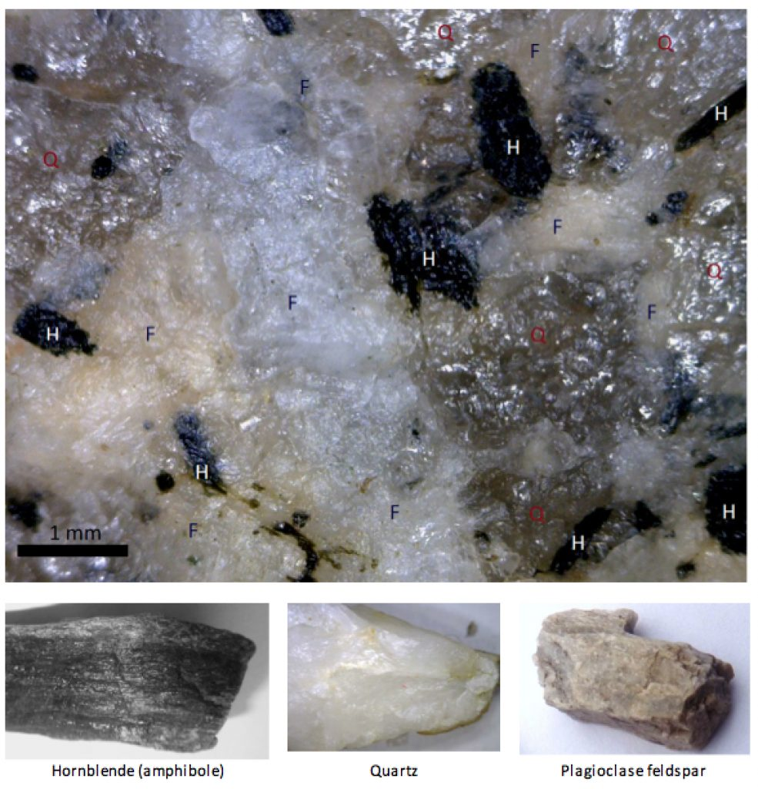

# Capítulo 1 — Introducción a la Geología

La geología es el estudio de la Tierra: sus materiales, su estructura y los procesos que
la transforman. Para el ingeniero el valor es directo: **toda cimentación, todo talud de
excavación y todo túnel son una intervención en un sistema geológico**, y la historia del
terreno explica sus propiedades actuales.

## 1.1 Qué abarca la geología

- **Materiales** — minerales, rocas y los sedimentos no consolidados derivados de ellos.
- **Estructura** — cómo se disponen los cuerpos rocosos en capas, pliegues, fracturas y
  fallas.
- **Procesos** — los internos (tectónicos, ígneos, metamórficos) y los externos
  (meteorización, erosión, sedimentación) que forman y destruyen la roca.
- **Tiempo** — el tiempo geológico es largo; el terreno que encuentra el ingeniero es el
  resultado acumulado de ese tiempo.

## 1.2 Minerales y rocas — la distinción esencial

Un **mineral** es una sustancia natural con una composición química específica y una
estructura interna ordenada. Una **roca** es una mezcla de uno o más minerales. El
feldespato, el cuarzo, la mica, la calcita y la halita son *minerales*; el granito, el
basalto, la arenisca, la caliza y el esquisto son *rocas*.

**Figura.** Primer plano del granito y sus minerales: H = hornblenda, Q = cuarzo,
F = feldespato. Los cristales miden aproximadamente entre 0,1 y 3 mm.
*© Steven Earle, CC BY 4.0 — Physical Geology, 2nd ed., Fig. 1.4.2.*

## 1.3 Las tres familias de rocas

- **Ígneas** — solidificadas a partir de magma o lava. Las *intrusivas* (granito) se
  enfrían lentamente en profundidad y son de grano grueso; las *extrusivas* (basalto) se
  enfrían rápidamente en superficie y son de grano fino.
- **Sedimentarias** — formadas a partir de sedimentos depositados y luego enterrados. Se
  clasifican en *clásticas* (por tamaño de grano) o *químicas/orgánicas*.
- **Metamórficas** — formadas a partir de rocas preexistentes bajo calor y presión;
  desarrollan foliación.

## Puntos clave para el ingeniero geotécnico

- **Mineral ≠ roca.** El comportamiento de una roca depende de su asociación mineral *y* de
  su estructura, no solo de su nombre.
- Los nombres de las rocas describen su **génesis**, no su desempeño ingenieril: dos
  granitos pueden comportarse de forma muy distinta.
- El ciclo de las rocas implica que **cualquier roca puede ser el material madre del suelo
  que tiene encima**.

## Terminología

| Español | Inglés | Vietnamita (libro) |
| --- | --- | --- |
| geología | geology | địa chất học |
| mineral | mineral | khoáng vật |
| roca | rock | đá |
| ígnea / sedimentaria / metamórfica | igneous / sedimentary / metamorphic | magma / trầm tích / biến chất |
| intrusiva / extrusiva | intrusive / extrusive | xâm nhập / phun trào |
| ciclo de las rocas | rock cycle | vòng tuần hoàn đá |

---

*Resumen del Capítulo 1, Physical Geology – 2nd Edition, de Steven Earle (CC BY 4.0).*
