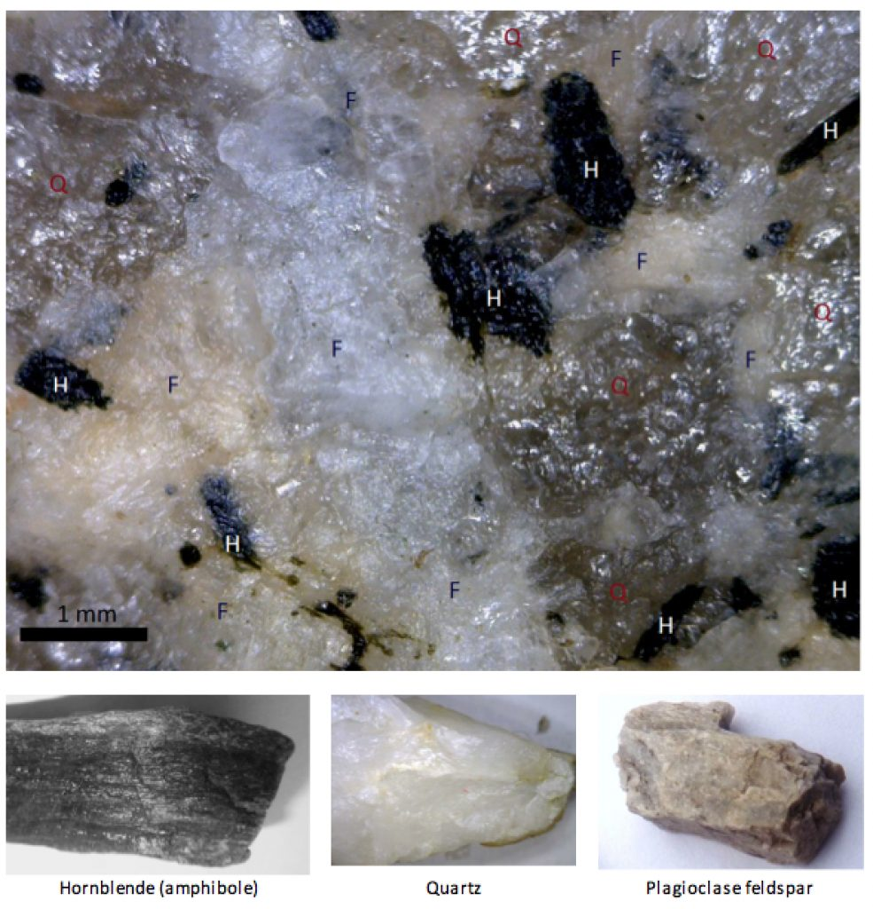

# Capítulo 3 — Rocas Ígneas Intrusivas

La roca ígnea se forma cuando el material fundido se enfría y cristaliza. El **dónde** se
enfría determina su textura y, por tanto, gran parte de su comportamiento ingenieril.

## 3.1 El ciclo de las rocas

La roca no es permanente. La roca ígnea se meteoriza y erosiona hasta convertirse en
sedimento; el sedimento se entierra y litifica en roca sedimentaria; el calor y la presión
transforman cualquiera de ellas en roca metamórfica; y todas pueden fundirse de nuevo. El
ciclo explica por qué **el suelo situado sobre una roca y la roca misma pueden tener
orígenes completamente distintos**.

## 3.2 Intrusivas frente a extrusivas

- **Intrusivas** (plutónicas) — el magma solidifica bajo tierra. Enfriamiento lento →
  **cristales gruesos y trabados** (granito, diorita, gabro). Resistentes cuando están
  intactas; son las diaclasas, no los cristales, las que controlan el macizo.
- **Extrusivas** (volcánicas) — la lava solidifica en superficie. Enfriamiento rápido →
  **grano fino o vítreo** (basalto, andesita, riolita), a menudo con vesículas y
  estructuras de flujo.

## 3.3 Cuerpos intrusivos

Batolitos, stocks, diques y sill (lacolitos tabulares). Un **dique** corta las capas
existentes; un **sill** se dispone paralelo a ellas. Ambos son discontinuidades en el
modelo del terreno, y ambos pueden ser más resistentes o más débiles que la roca
encajante.

**Figura.** Cristales gruesos y trabados en granito: la huella de un enfriamiento lento en
profundidad. Un dique o sill de esta roca intruido en un encajante más débil se convierte
en un rasgo estructural que el diseño debe tener en cuenta.
*© Steven Earle, CC BY 4.0 — Physical Geology, 2nd ed., Fig. 1.4.2.*

## Puntos clave para el ingeniero geotécnico

- **La textura revela la historia de enfriamiento**: la roca ígnea de grano grueso tiende a
  ser resistente, pero está controlada por las diaclasas.
- **Los contactos intrusivos son discontinuidades.** Un dique o un sill es un plano donde
  las propiedades cambian bruscamente y, con frecuencia, un plano de debilidad.
- **La roca extrusiva puede ser muy porosa o fracturada**: el basalto vesicular y la roca
  volcánica fracturada pueden resultar sorprendentemente permeables.
- **El basalto meteorizado se convierte en laterita**, uno de los suelos problemáticos
  característicos del Altiplano Central y del Sureste de Vietnam.

## Terminología

| Español | Inglés | Vietnamita (libro) |
| --- | --- | --- |
| intrusiva / extrusiva | intrusive / extrusive | xâm nhập / phun trào |
| magma / lava | magma / lava | magma / dung nham |
| granito / basalto | granite / basalt | granit / badan |
| dique / sill | dyke / sill | mạch cắt tầng / mạch nằm ngang |
| batolito | batholith | batholit (thể xâm nhập lớn) |
| laterita | laterite | đá ong / laterit |

---

*Resumen del Capítulo 3, Physical Geology – 2nd Edition, de Steven Earle (CC BY 4.0).*
