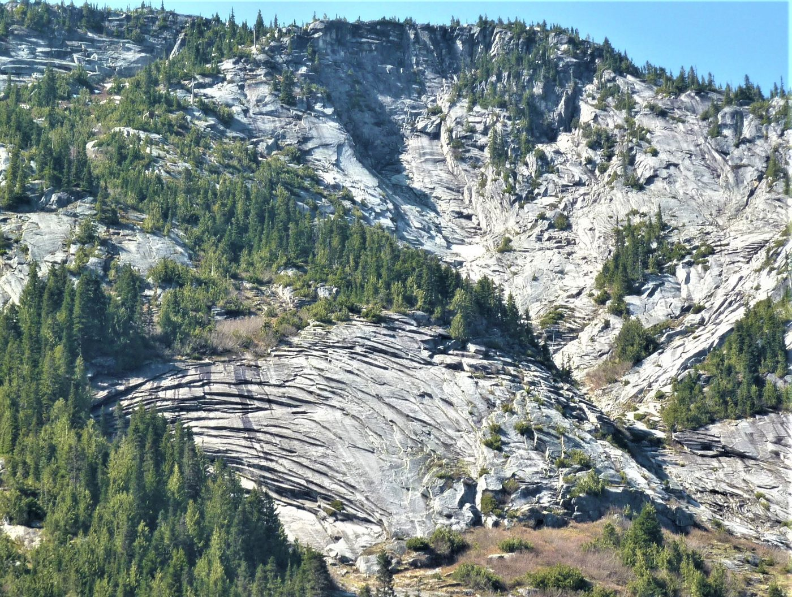
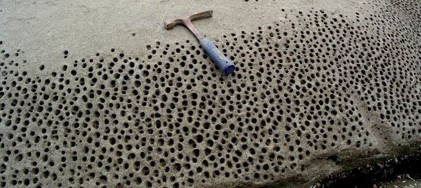
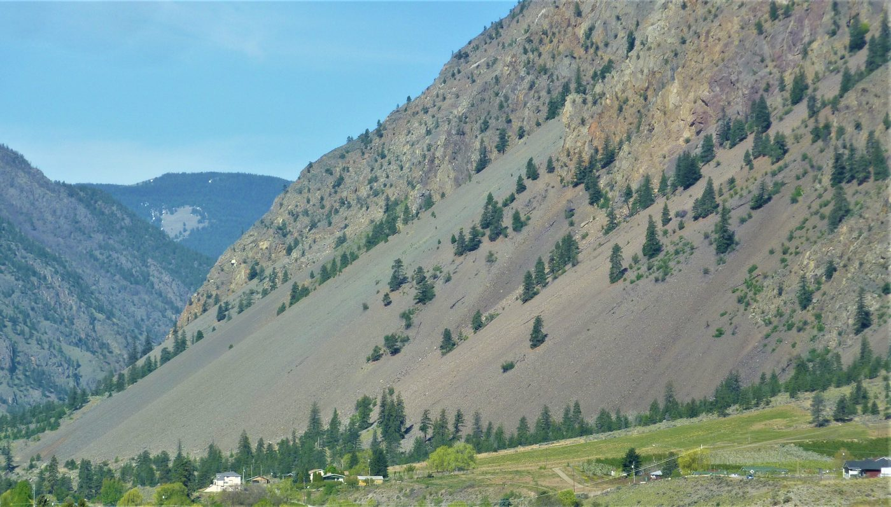
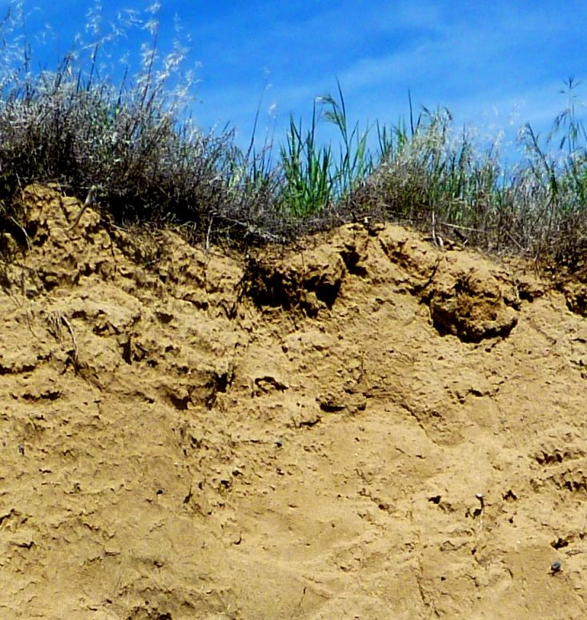

# Capítulo 5 — Meteorización y Suelo

Este es el capítulo que más importa al ingeniero geotécnico: **la meteorización es el
proceso que convierte la roca en suelo**. Todo suelo residual, todo perfil meteorizado y
toda zona «blanda» en un macizo rocoso son producto de ella.

## 5.1 Meteorización mecánica

La roca se fragmenta físicamente, sin que cambien sus minerales.

- **Descarga / exfoliación** — la retirada de la sobrecarga permite que la roca se
  expanda; se agrieta *paralelamente a la nueva superficie del terreno*.
- **Crioclasticidad (cuña de hielo)** — el agua de las grietas se congela, se expande
  aproximadamente un 9 % y separa la roca. Es más eficaz donde alternan con frecuencia el
  hielo y el deshielo.
- **Cristalización de sales** — las sales crecen en los poros y separan los granos
  (meteorización alveolar o en panal).
- **Raíces y animales excavadores** — las raíces ensanchan cada grieta en la que penetran.

**Figura.** Fracturas de exfoliación en granito puestas al descubierto por un desmonte de
carretera (Coquihalla Highway, Columbia Británica). La roca se desprende en láminas
paralelas a la nueva superficie porque se eliminó la presión de confinamiento.
*© Steven Earle, CC BY 4.0 — Physical Geology, 2nd ed., Fig. 5.1.1.*

**Figura.** Meteorización alveolar en arenisca (isla de Gabriola, Columbia Británica),
producida por sales que cristalizan en los poros.
*© Steven Earle, CC BY 4.0 — Physical Geology, 2nd ed., Fig. 5.1.5.*

**Figura.** Depósito de derrubios de fragmentación por hielo al pie de un acantilado
(Keremeos, Columbia Británica): coluvión, un material suelto y a menudo metaestable.
*© Steven Earle, CC BY 4.0 — Physical Geology, 2nd ed., Fig. 5.1.4.*

## 5.2 Meteorización química

La roca se descompone por reacción con agua, oxígeno y ácidos. Las reacciones clave son la
**hidrólisis** (feldespato → minerales de la arcilla), la **oxidación** (minerales
férricos → óxidos de color herrumbroso) y la **disolución** (carbonatos y evaporitas). La
meteorización química es más rápida en climas cálidos y húmedos, razón por la que **los
perfiles de meteorización profunda son la norma en Vietnam**.

## 5.3 Formación del suelo

El suelo es una mezcla de granos minerales, materia orgánica, aire y agua. Los factores que
controlan su desarrollo son **clima, material madre, pendiente y tiempo**: los mismos
cuatro factores que determinan si un emplazamiento presenta un suelo residual espeso o
roca desnuda.

**Figura.** Suelo poco desarrollado sobre limo eólico (loess) en una zona árida del estado
de Washington. Todo el perfil mostrado tiene aproximadamente 1 m de espesor y el «suelo»
propiamente dicho son solo los 2–3 cm superiores.
*© Steven Earle, CC BY 4.0 — Physical Geology, 2nd ed., Fig. 5.4.2.*

## 5.4 Horizonte del suelo

Un perfil de suelo maduro desarrolla horizontes diferenciados: O (orgánico), A (mezcla
orgánico-mineral), E (lavado o eluvial), B (acumulación) y C (material madre
incompletamente meteorizado). Para el ingeniero, lo relevante es que **cada horizonte
tiene distinta resistencia, permeabilidad y compresibilidad**, y que el nivel freático
suele situarse cerca de un límite entre horizontes.

## Puntos clave para el ingeniero geotécnico

- **La meteorización define el perfil del terreno.** A menudo es la profundidad de
  meteorización, y no el tipo de roca, lo que decide la cota de cimentación.
- **La meteorización mecánica y la química actúan conjuntamente**: el hielo abre las
  grietas que después hidroliza el agua.
- **La resistencia del suelo residual disminuye hacia arriba** a medida que aumenta la
  meteorización; la transición a roca sana es gradual, no brusca.
- **El karst es meteorización química a escala del paisaje.**

## Terminología

| Español | Inglés | Vietnamita (libro) |
| --- | --- | --- |
| meteorización | weathering | phong hoá |
| meteorización mecánica / química | mechanical / chemical weathering | phong hoá vật lý / hoá học |
| exfoliación (descarga) | exfoliation (unloading) | bong tróc (giảm tải) |
| cuña de hielo | frost wedging | nêm băng |
| hidrólisis | hydrolysis | thuỷ phân |
| suelo residual | residual soil | đất tàn dư |
| horizonte del suelo | soil horizon | tầng phát sinh đất |
| coluvión / derrubios de talud | colluvium / talus | taluy (tích tụ sườn) |

---

*Resumen del Capítulo 5, Physical Geology – 2nd Edition, de Steven Earle (CC BY 4.0).*
