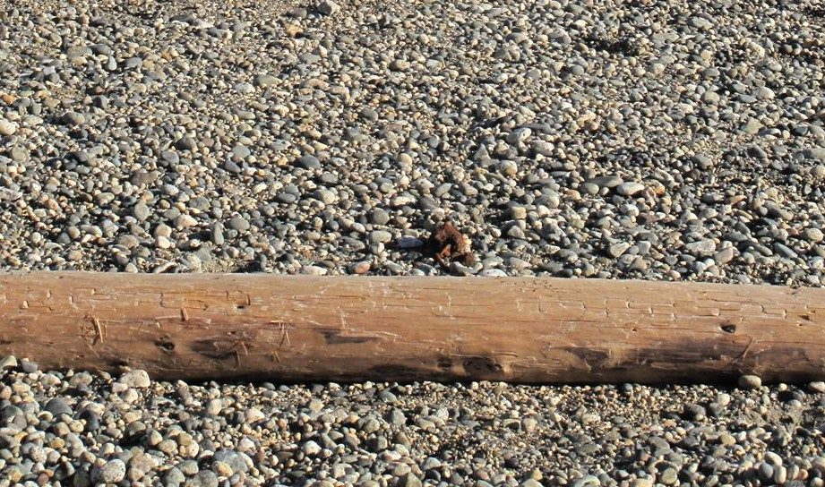
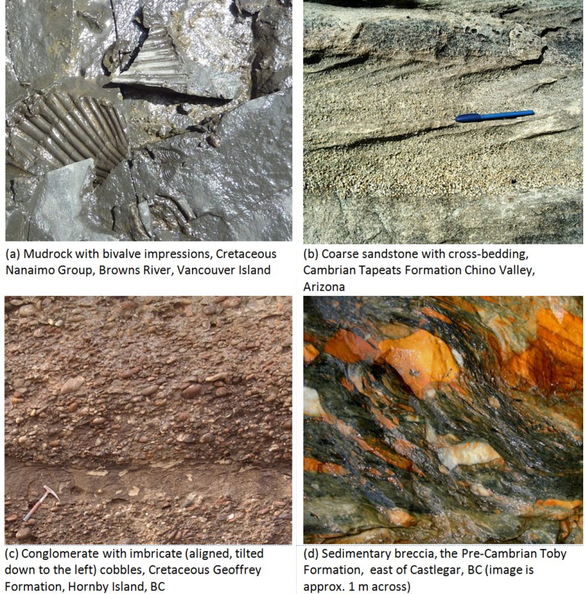

# Capítulo 6 — Sedimentos y Rocas Sedimentarias

La roca sedimentaria es el terreno donde se desarrolla la mayor parte de la ingeniería
civil. Cubre aproximadamente tres cuartas partes de la superficie continental, alberga la
mayoría de los acuíferos, y sus **planos de estratificación** son los planos de debilidad
más frecuentes con los que se encontrará un ingeniero.

## 6.1 Rocas sedimentarias clásticas

Formadas por fragmentos de rocas preexistentes, se clasifican por **tamaño de grano**:

- **Grava / conglomerado / brecha** — > 2 mm
- **Arena / arenisca** — 0,063–2 mm
- **Limo / limolita** — 0,004–0,063 mm
- **Arcilla / lutita / pizarra arcillosa** — < 0,004 mm

Más allá del tamaño de grano, tres propiedades controlan el comportamiento: la
**selección (sorting)**, la **redondez** y la **cementación**. Una arenisca bien seleccionada
y bien cementada es una buena cimentación; una lutita mal seleccionada y débilmente
cementada no lo es.

**Figura.** Cantos en una playa oceánica en Sechelt, Columbia Británica. El tamaño de
grano, la selección y la redondez —las propiedades que se leen en un registro de sondeo—
empiezan aquí.
*© Steven Earle, CC BY 4.0 — Physical Geology, 2nd ed., Fig. 6.1.1.*

**Figura.** Ejemplos de rocas sedimentarias clásticas. La textura y el grado de
cementación varían enormemente y constituyen el control dominante de la resistencia y la
deformabilidad.
*© Steven Earle, CC BY 4.0 — Physical Geology, 2nd ed., Fig. 6.1.8.*

## 6.2 Rocas sedimentarias químicas y orgánicas

Precipitadas a partir de una disolución o construidas por organismos: caliza, dolomía,
sílex, evaporitas y carbón. La **caliza** es la crítica para cimentaciones, porque se
disuelve.

## 6.3 Ambientes de sedimentación y estratificación

El sedimento se deposita en ambientes (fluvial, lacustre, marino, deltaico, eólico,
glacial) que dejan **estructuras** características: estratificación, estratificación
cruzada, gradación normal, ondulitas, grietas de desecación. No son decoración: indican al
ingeniero cómo varía lateralmente el depósito y dónde están las capas débiles.

## Puntos clave para el ingeniero geotécnico

- **El tamaño de grano por sí solo no clasifica un suelo**: la selección, la redondez y la
  cementación importan igualmente.
- **Los planos de estratificación son planos de debilidad**, y su buzamiento relativo a un
  desmonte o una cimentación gobierna la estabilidad.
- **La caliza se disuelve**: hay que prever karst, cavidades y aguas subterráneas erráticas.
- **El ambiente de sedimentación predice la variabilidad**: un delta es mucho menos
  uniforme que una arena eólica.

## Terminología

| Español | Inglés | Vietnamita (libro) |
| --- | --- | --- |
| clástico | clastic | mảnh vụn |
| arenisca / limolita / lutita | sandstone / mudstone / shale | cát kết / bột kết / sét kết |
| caliza / dolomía | limestone / dolomite | đá vôi / đôlômit |
| selección / redondez | sorting / rounding | độ chọn lọc / độ mài tròn |
| cementación | cementation | xi măng hoá (gắn kết) |
| plano de estratificación | bedding plane | mặt phân lớp |
| estratificación cruzada | cross-bedding | phân lớp xiên |

---

*Resumen del Capítulo 6, Physical Geology – 2nd Edition, de Steven Earle (CC BY 4.0).*
