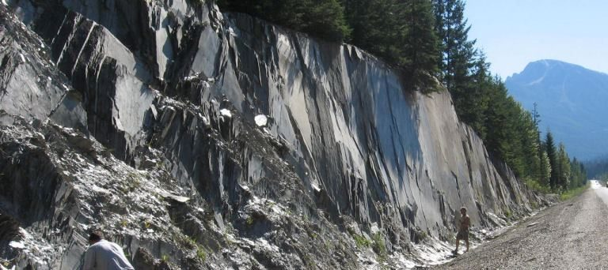

# Capítulo 7 — Metamorfismo y Rocas Metamórficas

El metamorfismo transforma la roca en estado sólido, bajo calor y presión, sin llegar a
fundirla. El resultado es una roca con una **fábrica nueva**, y esa fábrica es la causa
única más importante de anisotropía en la ingeniería de rocas.

## 7.1 Factores que controlan el metamorfismo

Los agentes son el **calor**, la **presión** (tanto de confinamiento como dirigida) y los
**fluidos químicamente activos**. El aumento de grado produce una secuencia de minerales,
razón por la que las rocas metamórficas pueden cartografiarse por su asociación mineral.

## 7.2 Foliación

La presión dirigida alinea los minerales planares (mica, clorita) en una **foliación**: una
fábrica planar. La foliación es el rasgo definitorio de la pizarra, el esquisto y el
gneis.

**Figura.** Pizarra en un desmonte de carretera en las montañas Columbia, Columbia
Británica, desprendiéndose según sus planos de foliación. Es la fábrica direccional —no la
resistencia intacta— la que gobierna el comportamiento del talud.
*© Steven Earle, CC BY 4.0 — Physical Geology, 2nd ed., Fig. 5.1.2.*

## 7.3 Tipos de metamorfismo

- **Regional** — grandes extensiones, asociado a la formación de cordilleras y a la
  colisión de placas; produce rocas foliadas.
- **De contacto** — local, alrededor de una intrusión ígnea; produce rocas no foliadas
  (cornubianita, mármol, cuarcita).
- **Hidrotermal** — alteración por fluidos calientes, que a menudo genera zonas débiles y
  ricas en arcilla.

## Puntos clave para el ingeniero geotécnico

- **La foliación crea anisotropía extrema.** El esquisto y la pizarra son mucho más débiles
  perpendicularmente a la foliación que paralelamente a ella, y la orientación de la
  foliación decide el comportamiento de taludes y cimentaciones.
- **El mármol y la cuarcita son resistentes e isótropos** cuando están frescos, pero pueden
  ser kársticos (mármol) o estar intensamente diaclasados.
- **La alteración hidrotermal produce zonas débiles**: es el mismo proceso que vuelve
  localmente inconstruible un macizo rocoso.
- Un terreno metamórfico suele implicar **pendientes pronunciadas, meteorización profunda y
  complejidad estructural**.

## Terminología

| Español | Inglés | Vietnamita (libro) |
| --- | --- | --- |
| metamorfismo | metamorphism | biến chất |
| foliación | foliation | cấu tạo phiến |
| pizarra / esquisto / gneis | slate / schist / gneiss | đá phiến sét / đá phiến / gơnai |
| mármol / cuarcita | marble / quartzite | đá hoa / quaczit |
| anisotropía | anisotropy | tính dị hướng |
| alteración hidrotermal | hydrothermal alteration | biến đổi nhiệt dịch |

---

*Resumen del Capítulo 7, Physical Geology – 2nd Edition, de Steven Earle (CC BY 4.0).*
