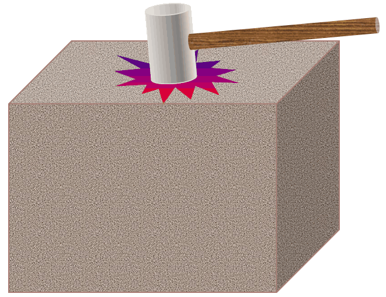
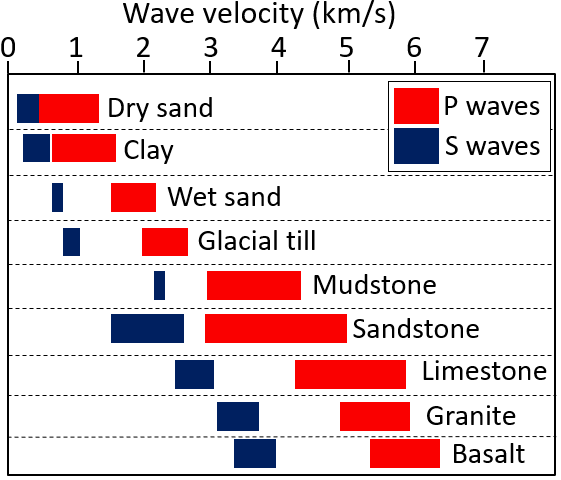
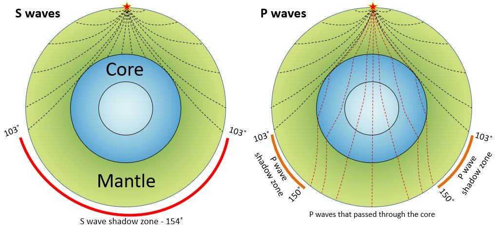

# Capítulo 9 — El Interior de la Tierra y la Sismología

Casi todo lo que se sabe del interior profundo de la Tierra proviene de las **ondas
sísmicas**. Esa misma física es la base de todos los métodos sísmicos empleados en el
reconocimiento geotécnico, de modo que este capítulo es a la vez contexto y metodología.

## 9.1 Ondas internas (de cuerpo)

Dos tipos de onda se propagan por el interior de la Tierra:

- **Ondas P (primarias)** — ondas de compresión. Las más rápidas; se propagan por sólidos,
  líquidos y gases.
- **Ondas S (secundarias)** — ondas de cizalle. Más lentas; **se propagan solo por
  sólidos**.

**Figura.** Un golpe de martillo sobre un bloque de roca genera ondas sísmicas en su
interior: el principio de los ensayos sísmicos de cross-hole, down-hole y de refracción.
*© Steven Earle, CC BY 4.0 — Physical Geology, 2nd ed., Fig. 9.1.1.*

**Figura.** Velocidades típicas de las ondas P (rojo) y S (azul) en sedimentos y en roca
cortical sólida. El gran contraste entre sedimento blando y roca es lo que hace de la
refracción sísmica una herramienta fiable para localizar la profundidad del sustrato
rocoso.
*© Steven Earle, after the US Environmental Protection Agency (public domain) — Physical Geology, 2nd ed., Fig. 9.1.3.*

## 9.2 Velocidad y propiedades de los materiales

La velocidad de propagación depende de la **rigidez elástica y la densidad**. Como la
rigidez aumenta generalmente con la profundidad, la velocidad aumenta con ella, pero cae
bruscamente allí donde el material es débil, está fracturado o se encuentra parcialmente
fundido. Un descenso local de velocidad es una **anomalía**, y cartografiar anomalías es
justamente lo que hacen los levantamientos sísmicos.

## 9.3 La Tierra estratificada

- **Corteza** — hasta unos 30–40 km bajo los continentes y 5–10 km bajo los océanos.
- **Moho** — el límite corteza–manto, detectado por el salto brusco de la velocidad de
  onda.
- **Manto** — hasta 2 890 km; resistente y denso.
- **Núcleo** — una parte externa líquida (las ondas S no pueden atravesarla) y un núcleo
  interno sólido.

**Figura.** Propagación de las ondas sísmicas a través del manto y el núcleo. Las ondas S
se detienen en el límite núcleo–manto, dejando una zona de sombra de ondas S en el lado
opuesto de la Tierra.
*© Steven Earle, CC BY 4.0 — Physical Geology, 2nd ed., Fig. 9.1.6.*

## Puntos clave para el ingeniero geotécnico

- **La velocidad de las ondas S es el parámetro dinámico clave del suelo**, utilizado en
  la respuesta sísmica del emplazamiento y en la evaluación de la licuefacción.
- **Contraste de velocidad = límite detectable.** El contraste sedimento/roca es lo que
  aprovecha la refracción sísmica para hallar la profundidad del sustrato rocoso.
- **Las ondas S no atraviesan líquidos**, razón por la que pueden detectar capas
  saturadas, blandas o licuefactibles.
- El **Moho** es la discontinuidad más profunda, pero las que importan están a metros, no
  a kilómetros, por debajo de la cimentación.

## Terminología

| Español | Inglés | Vietnamita (libro) |
| --- | --- | --- |
| onda P / onda S | P wave / S wave | sóng P / sóng S |
| velocidad sísmica | seismic velocity | vận tốc địa chấn |
| sísmica de refracción / cross-hole | refraction / cross-hole seismic | địa chấn khúc xạ / giữa các hố khoan |
| Moho (discontinuidad de Mohorovičić) | Moho (Mohorovičić discontinuity) | mặt Moho |
| anomalía | anomaly | dị thường |
| velocidad de onda de cizalle (Vs) | shear-wave velocity (Vs) | vận tốc sóng cắt (Vs) |

---

*Resumen del Capítulo 9, Physical Geology – 2nd Edition, de Steven Earle (CC BY 4.0).*
