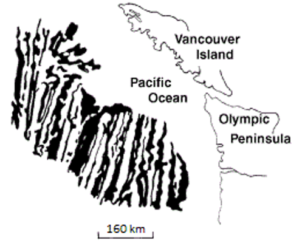
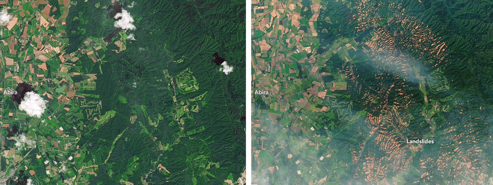

# Capítulo 11 — Sismos

Un sismo es la liberación rápida de deformación elástica acumulada a lo largo de una falla,
que irradia ondas sísmicas. Para el ingeniero las preguntas son: **¿qué magnitud, a qué
distancia y cómo responde el terreno?**

## 11.1 Conceptos básicos

- **Hipocentro (foco)** — punto del interior de la Tierra donde comienza la ruptura.
- **Epicentro** — punto de la superficie situado directamente sobre el hipocentro.
- **Falla** — la fractura a lo largo de la cual se produce el desplazamiento. Una **falla
  activa** es la que se ha movido en tiempos geológicos recientes y puede volver a hacerlo.

**Figura.** Una falla (línea discontinua blanca) en roca intrusiva en la isla de Quadra,
Columbia Británica, con unos 10 cm de desplazamiento dextral. Una falla es un plano de roca
ya rota.
*© Steven Earle, CC BY 4.0 — Physical Geology, 2nd ed., Fig. 12.3.4.*

## 11.2 Medición de los sismos

- **Magnitud $M$** — un único número que expresa el *tamaño del evento*, obtenido de la
  amplitud del movimiento del suelo o del momento sísmico.
- **Intensidad $I$** — una *descripción de los efectos en un lugar*; varía con la
  distancia, las condiciones del terreno y el tipo de construcción.

La magnitud es una propiedad del sismo; la intensidad es una propiedad del emplazamiento.

## 11.3 Sismos y tectónica de placas

La mayoría de los sismos ocurren en los límites de placa —zonas de subducción, dorsales
mediooceánicas y fallas transformantes— pero también se producen **sismos intraplaca**, y
la sismicidad de Vietnam (en particular el noroeste, a lo largo de las zonas de falla del
río Rojo y Lai Chau–Dien Bien, y partes del Altiplano Central) es de ese tipo.

## 11.4 Consecuencias y peligros secundarios

Además del sacudimiento directo, los sismos desencadenan **deslizamientos**,
**licuefacción**, **subsidencia del terreno** y **tsunamis**. La saturación seguida de
sacudimiento es el desencadenante compuesto clásico.

**Figura.** Fallos de talud cerca de Sapporo, Japón, tras un tifón (4 de septiembre de
2018) y un sismo (6 de septiembre de 2018). Imágenes Landsat 8 antes (julio de 2017,
izquierda) y después (septiembre de 2018, derecha).
*'Landslides in Hokkaido' by Lauren Dauphin, NASA Earth Observatory (public domain) — Physical Geology, 2nd ed., Fig. 15.1.7.*

## Puntos clave para el ingeniero geotécnico

- **Magnitud ≠ intensidad.** El diseño necesita el *movimiento del suelo en el
  emplazamiento*, no la magnitud del evento.
- **Las condiciones del emplazamiento dominan la respuesta.** Los suelos blandos amplifican
  el sacudimiento; la roca no.
- **La licuefacción requiere saturación**: evalúese siempre que exista arena suelta
  saturada por debajo del nivel freático.
- **Lluvia + sismo** es la combinación desencadenante de deslizamientos más dañina.
- **Vietnam no es asísmico**: se requiere diseño sísmico en el noroeste y en partes del
  Altiplano Central.

## Terminología

| Español | Inglés | Vietnamita (libro) |
| --- | --- | --- |
| sismo / terremoto | earthquake | động đất |
| hipocentro / epicentro | focus / epicentre | chấn tiêu / chấn tâm |
| falla / falla activa | fault / active fault | đứt gãy / đứt gãy hoạt động |
| magnitud / intensidad | magnitude / intensity | độ lớn (chấn cấp) / cường độ |
| zonificación sísmica | seismic zoning | phân vùng địa chấn |
| licuefacción | liquefaction | hoá lỏng đất nền |
| amplificación | amplification | khuếch đại (nền đất) |

---

*Resumen del Capítulo 11, Physical Geology – 2nd Edition, de Steven Earle (CC BY 4.0).*
