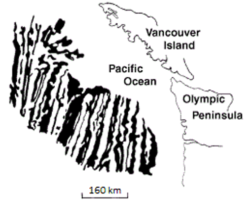
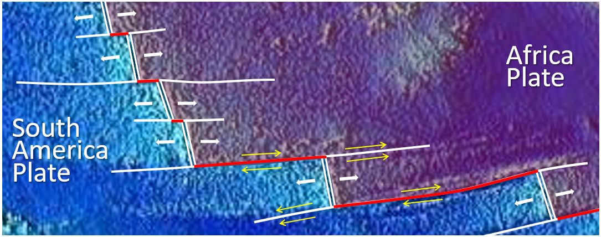
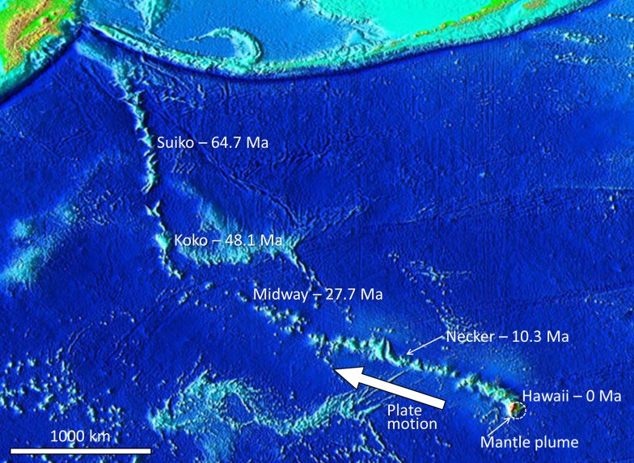

# Capítulo 12 — Estructuras Geológicas

La roca responde al esfuerzo de dos maneras: **se pliega** si es dúctil o **se fractura**
si es frágil. Ambos resultados crean los rasgos estructurales que deciden cómo se comporta
un macizo rocoso.

## 12.1 Esfuerzo y deformación

- **Compresión** — comprime la roca; produce pliegues y fallas inversas.
- **Extensión** — estira la roca; produce fallas normales y fosas tectónicas (graben).
- **Cizalle** — desplaza un bloque respecto del otro; produce fallas de rumbo
  (strike-slip).

## 12.2 Plegamiento

Bajo compresión, las rocas estratificadas se flexan en **anticlinales** (hacia arriba) y
**sinclinales** (hacia abajo). El plegamiento cambia el **buzamiento** de la
estratificación, y el buzamiento es lo que mide el ingeniero para juzgar la estabilidad de
taludes y cimentaciones.

## 12.3 Fracturación y fallamiento

Una **diaclasa** es una fractura sin movimiento; una **falla** es una fractura con
movimiento.

- **Falla normal** — extensión; el bloque de techo desciende.
- **Falla inversa** — compresión; el bloque de techo asciende.
- **Falla de cabalgamiento** — falla inversa de bajo ángulo; puede emplazar roca resistente
  sobre roca débil.
- **Falla de rumbo** — movimiento lateral a lo largo de la traza de la falla.

**Figura.** Una falla en roca intrusiva en la isla de Quadra, Columbia Británica. Un dique
rosado aparece desplazado unos 10 cm en sentido dextral.
*© Steven Earle, CC BY 4.0 — Physical Geology, 2nd ed., Fig. 12.3.4.*

**Figura.** El cabalgamiento de McConnell en el monte Yamnuska, Alberta: caliza del
Cámbrico cabalgando sobre lutita del Cretácico. Cuando un cabalgamiento coloca roca
resistente sobre roca débil, la unidad débil controla el diseño.
*© Steven Earle, CC BY 4.0 — Physical Geology, 2nd ed., Fig. 12.3.9.*

**Figura.** Estructuras de graben (fosa) y horst (pilar) formadas en un régimen extensional.
Todas las fallas son normales.
*© Steven Earle, CC BY 4.0 — Physical Geology, 2nd ed., Fig. 12.3.6.*

## 12.4 Medición de las estructuras geológicas

Las dos mediciones son el **rumbo** (la dirección de brújula de la intersección de un plano
con la horizontal) y el **buzamiento** (su ángulo de inclinación). Juntos definen la
orientación de la estratificación, la foliación o una familia de diaclasas: el dato
estructural más útil de todos para un diseño.

## Puntos clave para el ingeniero geotécnico

- **A menudo es la estructura, no el tipo de roca, la que controla el diseño.** Una roca
  moderadamente resistente con estratificación desfavorablemente buzante es peor que una
  roca más débil sin ella.
- **Las fallas son planos de debilidad y posibles vías de agua subterránea**, además de
  discontinuidades en el modelo del terreno.
- **Los cabalgamientos pueden poner roca resistente sobre roca débil**; la capa débil
  gobierna entonces el asentamiento y la estabilidad.
- **Rumbo y buzamiento deben medirse**, no suponerse, y deben consignarse en toda
  descripción del macizo rocoso.

## Terminología

| Español | Inglés | Vietnamita (libro) |
| --- | --- | --- |
| esfuerzo / deformación | stress / strain | ứng suất / biến dạng |
| pliegue / anticlinal / sinclinal | fold / anticline / syncline | uốn nếp / nếp lồi / nếp lõm |
| diaclasa | joint | khe nứt |
| falla (normal / inversa / cabalgamiento / de rumbo) | fault (normal / reverse / thrust / strike-slip) | đứt gãy (thuận / nghịch / chờm / trượt bằng) |
| graben / horst | graben / horst | địa hào / địa luỹ |
| rumbo / buzamiento | strike / dip | phương / góc dốc |

---

*Resumen del Capítulo 12, Physical Geology – 2nd Edition, de Steven Earle (CC BY 4.0).*
