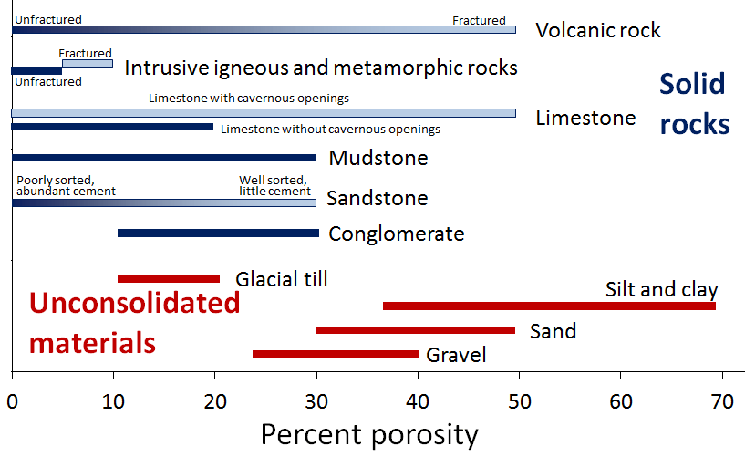
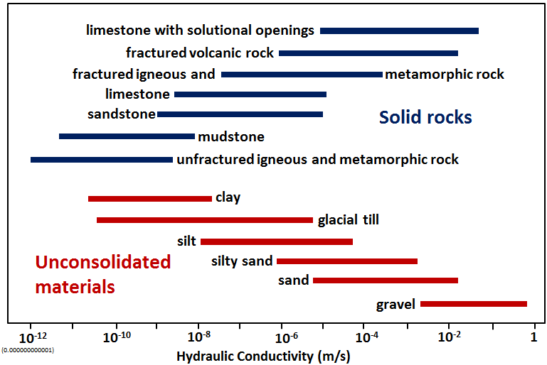
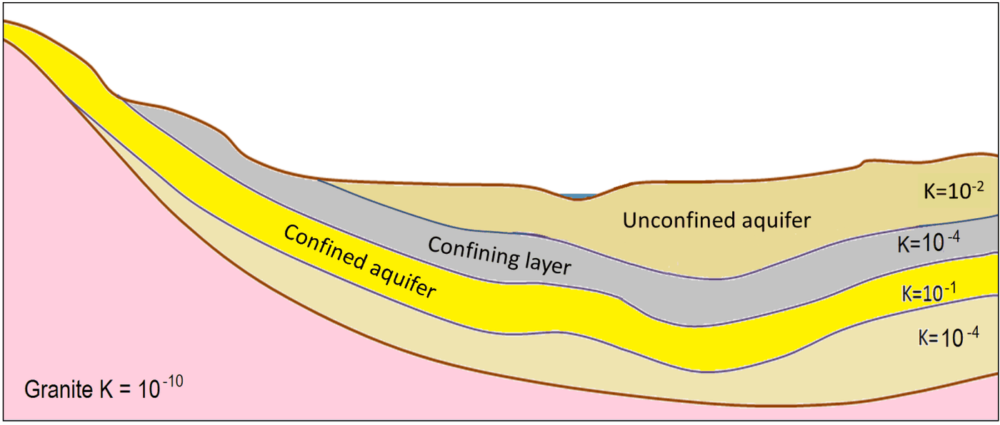

# Capítulo 14 — Aguas Subterráneas

El agua subterránea se almacena en los huecos del suelo y la roca. Dos propiedades lo
deciden todo: **cuánto espacio hay** (porosidad) y **cuán bien conectados están esos
espacios** (permeabilidad).

## 14.1 Porosidad

La **porosidad** es el porcentaje del volumen de un material que corresponde a huecos. Los
sedimentos no consolidados son por lo general más porosos que sus equivalentes
consolidados, y los materiales finos (limo, arcilla) son *más* porosos que los gruesos.

**Figura.** Rangos típicos de porosidad para materiales no consolidados (rojo) y rocas
(azul). El limo y la arcilla son los materiales más porosos y, sin embargo, los menos
permeables.
*© Steven Earle, CC BY 4.0 — Physical Geology, 2nd ed., Fig. 14.1.1.*

## 14.2 Permeabilidad y conductividad hidráulica

La **permeabilidad** describe cuán bien conectados están los poros y, por tanto, con qué
facilidad fluye el agua. Se cuantifica mediante la **conductividad hidráulica $K$**, en
metros por segundo.

**Figura.** Conductividad hidráulica K (m/s) para materiales no consolidados (rojo) y
rocas (azul): un rango de unos doce órdenes de magnitud. La arcilla es porosa pero
prácticamente impermeable.
*© Steven Earle, CC BY 4.0 — Physical Geology, 2nd ed., Fig. 14.1.2.*

El punto contraintuitivo pero esencial: **la arcilla es porosa pero no permeable.** Casi
toda su agua está retenida como *agua ligada* en la superficie de los granos minerales y no
puede fluir. Por eso una capa de arcilla es una barrera, no un dren.

## 14.3 Acuíferos y capas confinantes

- **Acuífero** — masa de terreno que transmite agua de forma aprovechable.
- **Acuitardo / capa confinante** — masa que no la transmite.
- **Acuífero libre** — abierto a la superficie; el nivel freático es su límite superior.
- **Acuífero confinado** — cubierto por una capa de menor permeabilidad; su agua está a
  presión, de modo que un piezómetro lee por encima del techo del acuífero.

**Figura.** Corte transversal de acuíferos y capas confinantes, con permeabilidades
relativas expresadas como K (m/s).
*© Steven Earle, CC BY 4.0 — Physical Geology, 2nd ed., Fig. 14.1.4.*

## 14.4 Extracción y calidad del agua subterránea

El bombeo modifica el nivel freático y crea un **descenso (drawdown)**, que provoca
asentamientos: una causa clásica de daños en estructuras próximas a pozos y excavaciones
profundas. La calidad del agua también importa: un agua subterránea agresiva corroe el
acero y ataca al hormigón.

## Puntos clave para el ingeniero geotécnico

- **Porosidad ≠ permeabilidad.** La arcilla es la prueba.
- **La conductividad hidráulica abarca 12 órdenes de magnitud**: es el número más
  importante de cualquier cálculo de filtración o drenaje.
- **Los acuíferos confinados están a presión**: el nivel piezométrico no es el nivel
  freático.
- **Bombear produce asentamientos**: el descenso del nivel es un problema geotécnico, no
  solo de abastecimiento.
- **La química del agua subterránea** controla la corrosión y el ataque al hormigón.

## Terminología

| Español | Inglés | Vietnamita (libro) |
| --- | --- | --- |
| porosidad | porosity | độ rỗng |
| permeabilidad / conductividad hidráulica | permeability / hydraulic conductivity | tính thấm / hệ số thấm |
| acuífero / acuitardo | aquifer / aquitard | tầng chứa nước / tầng cách nước |
| acuífero libre / confinado | unconfined / confined aquifer | tầng không áp / tầng có áp |
| nivel freático | water table | mực nước ngầm |
| descenso del nivel | drawdown | hạ thấp mực nước |
| agua ligada | bound water | nước liên kết |

---

*Resumen del Capítulo 14, Physical Geology – 2nd Edition, de Steven Earle (CC BY 4.0).*
