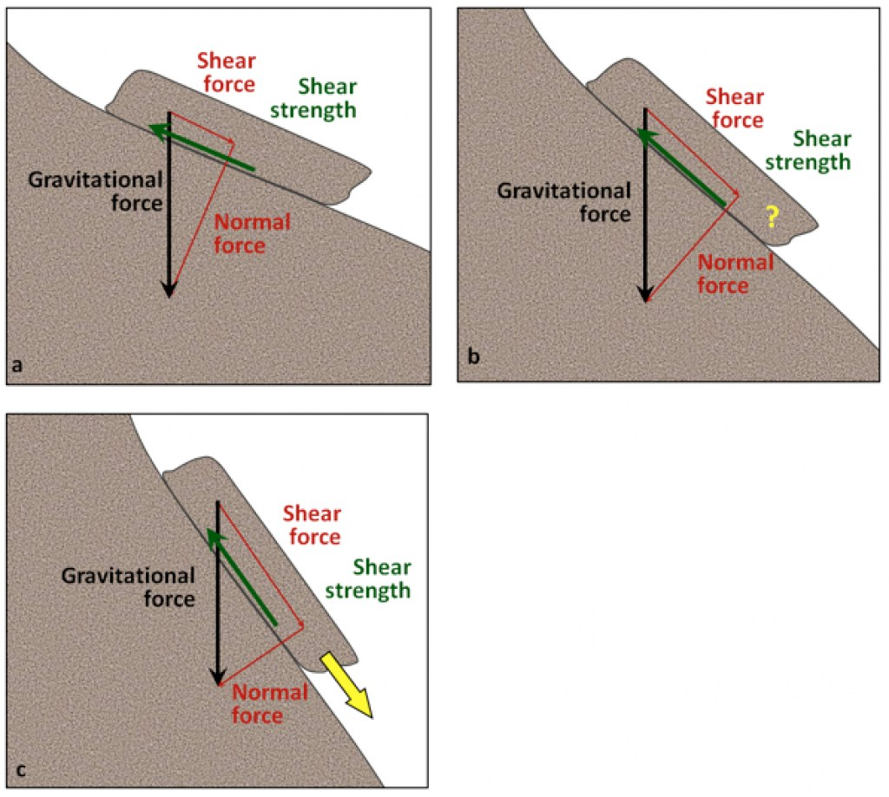
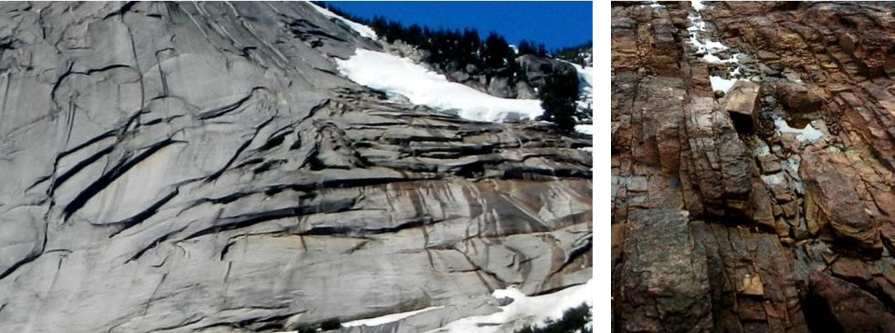
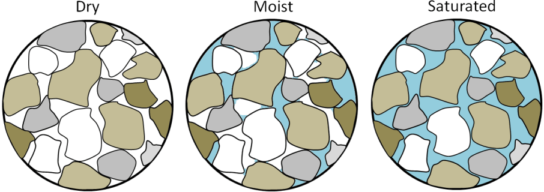
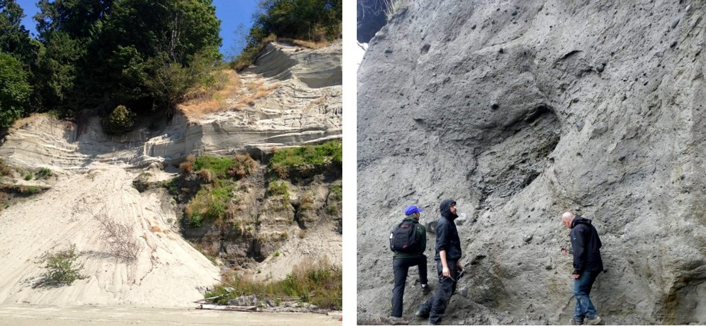
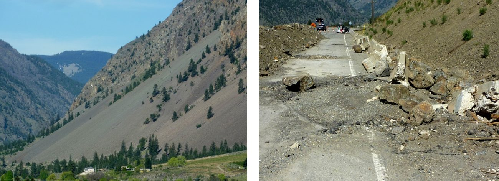
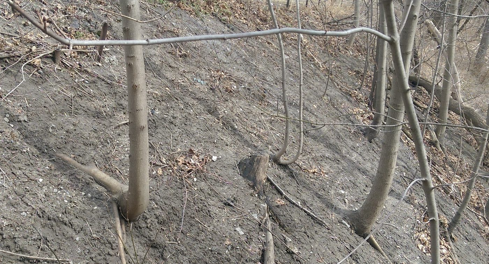
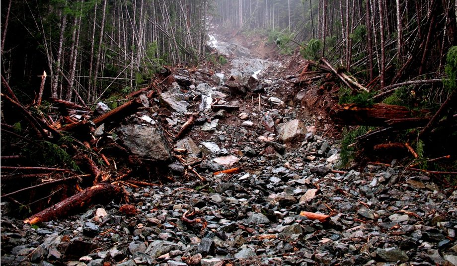
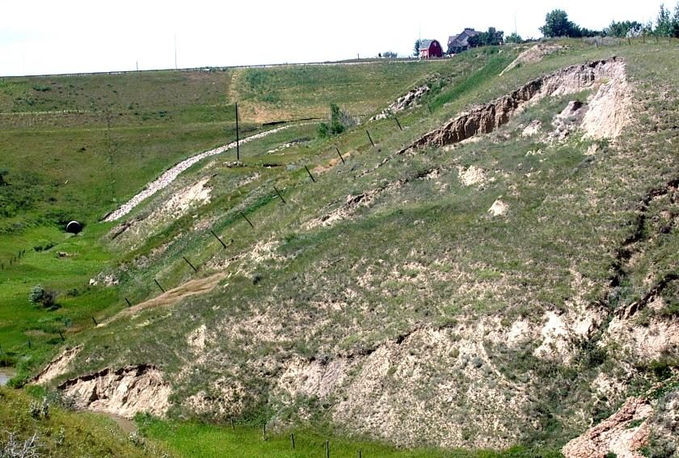
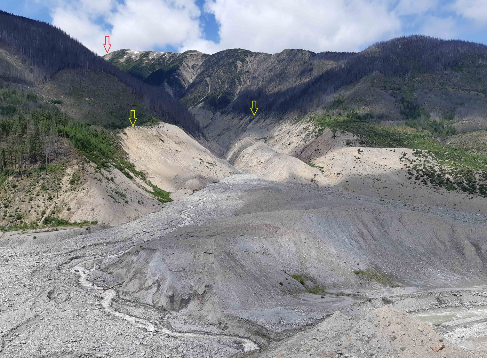
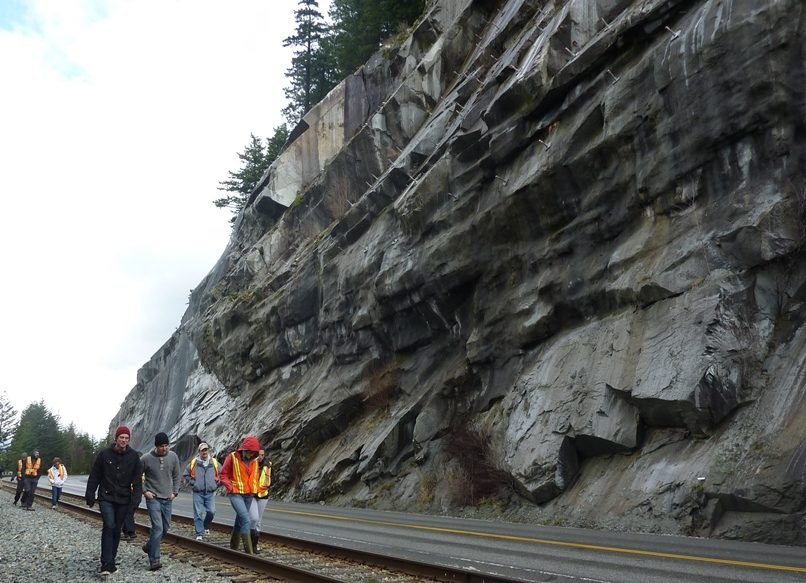

# Capítulo 15 — Remoción en Masa

La remoción en masa es el movimiento ladera abajo de roca y suelo por acción de la
gravedad. Es la **visión geológica de la estabilidad de taludes**, y resulta útil
precisamente porque considera el paisaje completo en lugar de una única sección analizada.

## 15.1 Qué controla la estabilidad de un talud

Dos factores: el **ángulo del talud** y la **resistencia del material** que lo constituye.
La gravedad se descompone en una **fuerza de cizalle** (ladera abajo) y una **fuerza
normal** (hacia el interior del talud); el talud se mantiene mientras la **resistencia al
corte** supera la fuerza de cizalle.

**Figura.** Componentes de cizalle y normales de la gravedad en taludes de pendiente
creciente. (a) fuerza de cizalle muy inferior a la resistencia al corte: estable;
(b) aproximadamente iguales: marginal; (c) fuerza de cizalle muy superior: rotura.
*© Steven Earle, CC BY 4.0 — Physical Geology, 2nd ed., Fig. 15.1.1.*

**Figura.** Estabilidad relativa de los taludes en función de la orientación de las
debilidades (planos de estratificación) respecto de la cara del talud. La estratificación
paralela es el caso más inestable.
*© Steven Earle, CC BY 4.0 — Physical Geology, 2nd ed., Fig. 15.1.2.*

### El agua, factor dominante

La cantidad de agua presente en el material es el control más importante de su
resistencia. Esto es especialmente cierto en materiales no consolidados:

- **Seco** — retenido solo por la fricción entre granos; débil si está bien seleccionado o
  es redondeado.
- **Húmedo** — el más resistente, porque la tensión superficial en los contactos entre
  granos los mantiene unidos.
- **Saturado** — el más débil, porque el agua a presión separa los granos.

**Figura.** Arena seca, húmeda y saturada. La arena húmeda es la más resistente; la
saturada, la más débil.
*© Steven Earle, CC BY 4.0 — Physical Geology, 2nd ed., Fig. 15.1.4.*

**Figura.** Izquierda: depósito fluviglacial en Point Grey, Vancouver: una capa inferior
resistente bajo una arena más débil recientemente fallada. Derecha: till glacial en la isla
de Quadra, Columbia Británica, lo bastante resistente para mantenerse casi vertical.
*© Steven Earle, CC BY 4.0 — Physical Geology, 2nd ed., Fig. 15.1.3.*

## 15.2 Tipos de remoción en masa

Se clasifican por **material** y **velocidad**:

- **Desprendimiento de rocas (rockfall)** — caída libre de roca desde una cara empinada;
  produce derrubios (talus) al pie.
- **Deslizamiento rotacional (slump)** — deslizamiento giratorio de un bloque coherente.
- **Deslizamiento traslacional (slide)** — movimiento a lo largo de una superficie plana.
- **Flujo (flow)** — flujo de detritos, flujo de lodo, flujo de tierra; el material se
  mueve como un fluido.
- **Reptación (creep)** — movimiento extremadamente lento e imperceptible, legible en la
  vegetación inclinada.

**Figura.** Izquierda: talud de derrubios cerca de Keremeos, Columbia Británica. Derecha:
un desprendimiento de rocas sobre una carretera al oeste de Keremeos, diciembre de 2014.
*© Steven Earle, CC BY 4.0 — Physical Geology, 2nd ed., Fig. 15.2.2.*

**Figura.** Árboles con forma de culata de pistola en un talud afectado por reptación: un
inclinómetro natural y uno de los indicadores más baratos que puede leer una inspección
visual de campo.
*© Steven Earle, CC BY 4.0 — Physical Geology, 2nd ed., Fig. 15.2.7.*

**Figura.** Parte inferior de un flujo de detritos en un cauce empinado cerca del lago
Buttle, Columbia Británica, noviembre de 2006.
*© Steven Earle, CC BY 4.0 — Physical Geology, 2nd ed., Fig. 15.2.11.*

**Figura.** Un deslizamiento rotacional en las márgenes de un pequeño barranco cerca de
Lethbridge, Alberta.
*© Steven Earle, CC BY 4.0 — Physical Geology, 2nd ed., Fig. 15.2.9.*

**Figura.** La avalancha de rocas del monte Meager de agosto de 2010: el extremo más severo
del espectro de fallas de talud.
*'2010 Mt. Meager rock avalanche' by Isaac Earle, CC BY 4.0 — Physical Geology, 2nd ed., Fig. 15.2.5.*

**Figura.** Emplazamiento del deslizamiento de rocas de 2008 en Porteau Cove, Columbia
Británica: un talud rocoso en un corredor de transporte.
*© Steven Earle, CC BY 4.0 — Physical Geology, 2nd ed., Fig. 15.2.4.*

## 15.3 Prevención, retraso y monitoreo de la remoción en masa

Las medidas habituales son el **drenaje** (reducir la presión de poros), el **reperfilado**
(reducir el ángulo del talud), la **contención y el refuerzo**, y el **monitoreo**. El
monitoreo es el tema del resto de este sitio —inclinómetros, piezómetros, extensómetros y
demás— y su propósito es exactamente detectar el movimiento descrito en este capítulo con
la antelación suficiente para actuar.

## Puntos clave para el ingeniero geotécnico

- **El agua es el control dominante** de la resistencia del talud: el drenaje suele ser la
  medida de estabilización más barata y eficaz.
- **La orientación de las debilidades respecto del talud** decide si un talud puede llegar
  a fallar.
- **La reptación es un precursor**, no un proceso benigno: la inclinación de la vegetación
  y las grietas estructurales son señales de alerta temprana.
- **Desencadenante = pérdida rápida de resistencia al corte**, las más de las veces por
  agua, sacudimiento sísmico o socavación al pie.
- **La instrumentación existe para detectar el movimiento con antelación**: por eso el
  monitoreo de taludes y la geología de la remoción en masa son un mismo tema visto desde
  dos direcciones.

## Terminología

| Español | Inglés | Vietnamita (libro) |
| --- | --- | --- |
| remoción en masa | mass wasting | dịch chuyển khối (trượt lở) |
| fuerza de cizalle / resistencia al corte | shear force / shear strength | lực gây trượt / sức kháng cắt |
| desprendimiento / deslizamiento rotacional / traslacional / flujo | rockfall / slump / slide / flow | lăn rơi / trượt xoay / trượt / dòng chảy |
| flujo de detritos | debris flow | dòng bùn đá |
| reptación | creep | trượt từ từ |
| desencadenante | trigger | nguyên nhân kích hoạt |
| derrubios / coluvión | talus / colluvium | taluy (tích tụ sườn) |

---

*Resumen del Capítulo 15, Physical Geology – 2nd Edition, de Steven Earle (CC BY 4.0).*
