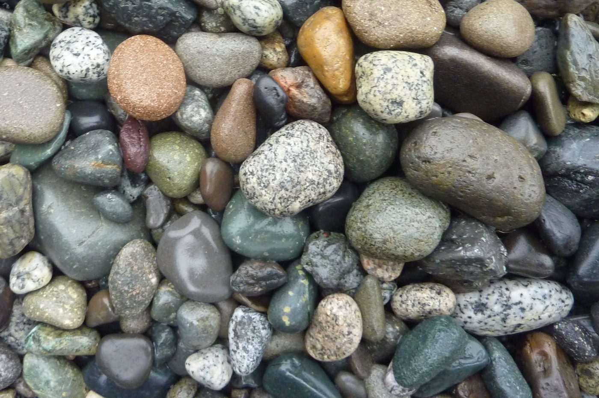

# Geología Física (2.ª Edición) — Steven Earle

Un **libro de texto abierto** de geología física, utilizado en este sitio como la
base geológica situada por debajo del corpus de referencia geotécnica. Donde los
demás manuales de referencia de este sitio parten de la *mecánica de suelos* o la
*instrumentación*, este comienza un nivel más atrás: de qué está hecho el planeta
Tierra, cómo se forma y se rompe la roca, y cómo se comportan realmente las aguas
subterráneas, los sismos y los taludes.

!!! info "Licencia — CC BY 4.0 (reutilizable abiertamente)"
    *Physical Geology – 2nd Edition* de **Steven Earle** (con Karla Panchuk), BCcampus,
    2019, está licenciado bajo **Creative Commons Attribution 4.0 International (CC BY 4.0)**.
    Puede retenerse, reutilizarse, copiarse y adaptarse libremente con atribución.
    Fuente: <https://opentextbc.ca/physicalgeology2ed/>

    Esta entrada es un **digest con comentario** —resume los capítulos del libro
    relevantes para la geotecnia y reproduce figuras seleccionadas. Solo se usan
    figuras **CC BY o de dominio público**; las figuras CC BY-SA y "todos los
    derechos reservados" del libro se excluyen deliberadamente. Véase el
    [crédito de figuras](../../../assets/figures/geology/CREDITS.txt).

## Por qué este libro está en este sitio

El manual *Cẩm nang dùng cho kỹ sư địa kỹ thuật* (Capítulo 1) plantea que **la
geología de ingeniería sin geología física es mera descripción**. Esta entrada
aporta la geología física: procesos formadores de roca, meteorización, estructura,
aguas subterráneas y remoción en masa. También es la **fuente de las fotografías**
que ahora ilustran el digest del manual —un vínculo legítimo precisamente porque el
libro tiene licencia abierta.

**Figura.** Cantos graníticos en una playa. El granito es la roca que el ingeniero
es más probable que encuentre como cimentación fuerte y diaclasada —y, una vez
meteorizada, como suelo residual.
*© Steven Earle, CC BY 4.0 — Physical Geology, 2.ª ed., Fig. 1.4.3.*

## Mapa de capítulos

| Capítulo | Título | Por qué importa aquí |
| --- | --- | --- |
| 1 | [Introducción a la Geología](chapter-01-introduction-to-geology.md) | El alcance de la geología y dónde se sitúa la geología de ingeniería |
| 2 | [Minerales](chapter-02-minerals.md) | De qué está hecha la roca; propiedades y reconocimiento de minerales |
| 3 | [Rocas Ígneas Intrusivas](chapter-03-igneous-rocks.md) | El ciclo de la roca, el magma y los cuerpos intrusivos |
| 5 | [Meteorización y Suelo](chapter-05-weathering-and-soil.md) | **El proceso que convierte la roca en suelo** —clave para los suelos residuales |
| 6 | [Sedimentos y Rocas Sedimentarias](chapter-06-sedimentary-rocks.md) | Depósitos clásticos, estratificación y ambientes de depositación |
| 7 | [Metamorfismo y Rocas Metamórficas](chapter-07-metamorphic-rocks.md) | La foliación —la causa de la anisotropía más fuerte en la roca |
| 9 | [Interior de la Tierra y Sismología](chapter-09-earths-interior.md) | Ondas sísmicas y la base de toda investigación sísmica |
| 11 | [Sismos](chapter-11-earthquakes.md) | Magnitud, intensidad y peligro sísmico |
| 12 | [Estructuras Geológicas](chapter-12-geological-structures.md) | Estrés, plegamiento, fracturamiento y fallamiento |
| 14 | [Aguas Subterráneas](chapter-14-groundwater.md) | Porosidad, permeabilidad, acuíferos y capas confinantes |
| 15 | [Remoción en Masa](chapter-15-mass-wasting.md) | Estabilidad de taludes desde el lado geológico |

Los capítulos restantes del libro (4 vulcanismo, 8 tiempo geológico, 10 tectónica de
placas, 13 arroyos e inundaciones, 16 glaciación, 17 litorales, 18 océanos, 19 clima,
20 recursos, 21 oeste de Canadá, 22 origen del sistema solar) están fuera del alcance
geotécnico de este sitio y no se resumen aquí.

## GTI Doctor

El asistente [GTI Doctor](../../gti-doctor.md) indexa el corpus de referencia del
sitio. Pregúntele sobre meteorización de roca, aguas subterráneas o mecanismos de
falla de taludes y responderá desde estas páginas y el manual.

---

## Video Destacado y Recursos Prácticos

  <iframe src="https://www.youtube-nocookie.com/embed/qt3KySXZdG8" title="Plate Tectonics at 50 - The William Smith Lecture" frameborder="0" allow="accelerometer; autoplay; clipboard-write; encrypted-media; gyroscope; picture-in-picture" allowfullscreen style="position: absolute; top: 0; left: 0; width: 100%; height: 100%; border-radius: 6px;"></iframe>

<em>Conferencia Magistral Destacada (The Geological Society of London): William Smith Lecture del Prof. Dan McKenzie (Universidad de Cambridge) — Plate Tectonics at 50: La Formulación de la Mecánica Cortical, la Dinámica de Fallas y el Movimiento Litosférico.</em>

!!! tip "Recursos Prácticos de Campo Complementarios de RST Instruments & Measurand (Terra Insights)"
    - **RST Instruments (@RSTgeotechnical):** [RST Geotechnical Overview](https://www.youtube.com/watch?v=g3GAmDL5rrM){ target="_blank" }  
      *Cartera integral de instrumentación para monitoreo de amenazas geológicas, fallas y remoción en masa.*
    - **Measurand (@MeasurandVideos):** [SAAView 3D Analysis Software](https://www.youtube.com/watch?v=OtLkPOCQCoo){ target="_blank" }  
      *Visualización y seguimiento vectorial 3D de superficies de deslizamiento activas y zonas de movimiento de masa.*
