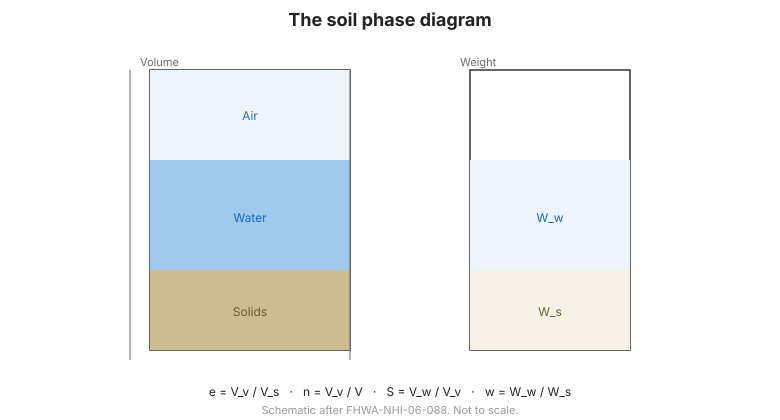

# Capítulo 2 — Composición del Suelo y Propiedades Índice

## 2.1 El diagrama de fases

El suelo se describe mediante el **diagrama de fases**, que separa el volumen en
sólidos, agua y aire. Las relaciones volumétricas clave son:

- **Relación de vacíos** $e = V_v / V_s$ — el volumen de vacíos por unidad de volumen
  de sólidos.
- **Porosidad** $n = V_v / V$ — la fracción del volumen total que son vacíos.
- **Grado de saturación** $S = V_w / V_v$ — la fracción de vacíos llena de agua.

**Figura.** El diagrama de fases del suelo: volúmenes y pesos de sólidos, agua y aire,
y las relaciones entre relación de vacíos, porosidad y saturación (según
FHWA-NHI-06-088).

## 2.2 Pesos unitarios y contenido de agua

- **Contenido de agua** $w = W_w / W_s$ — la masa de agua por unidad de masa de
  sólidos.
- **Peso unitario total (bruto)** $\gamma$ — el peso total por unidad de volumen.
- **Peso unitario seco** $\gamma_d = \gamma / (1 + w)$ — el peso de sólidos por unidad
  de volumen; el parámetro clave de control de compactación.
- **Peso unitario saturado** $\gamma_{sat}$ — cuando todos los vacíos están llenos de
  agua.
- **Peso unitario sumergido (flotante)** $\gamma' = \gamma_{sat} - \gamma_w$.

## 2.3 Distribución granulométrica

El **análisis por tamizado** (para suelos gruesos) y el **análisis por hidrómetro**
(para finos) dan la **curva granulométrica**. De ella se obtienen:

- **$D_{10}$, $D_{30}$, $D_{60}$** — los tamaños de partícula por los que pasa el
  10 %, 30 % y 60 %.
- **Coeficiente de uniformidad** $C_u = D_{60}/D_{10}$ — cuán bien graduado está el
  suelo.
- **Coeficiente de curvatura** $C_c$ — la forma de la curva.

Un suelo **bien graduado** (amplio rango de tamaños de partícula) se compacta más
denso y drena mejor que uno **uniformemente graduado**.

## 2.4 Límites de Atterberg y consistencia

Para suelos de grano fino, los **límites de Atterberg** definen los contenidos de agua
a los que el suelo cambia de consistencia:

- **Límite líquido (LL)** — de plástico a líquido.
- **Límite plástico (PL)** — de semisólido a plástico.
- **Índice de plasticidad** $PI = LL - PL$ — el rango de contenido de agua en el que
  el suelo es plástico.

Un $PI$ alto indica una **arcilla compresible y plástica**; un $PI$ bajo indica un
**limo o suelo de baja plasticidad**. Los límites se usan directamente en la
clasificación ([Capítulo 3](chapter-03-classification.md)).

## 2.5 Puntos clave

- El **diagrama de fases** relaciona vacíos, agua y sólidos; $e$, $n$ y $S$ describen
  el empaquetamiento.
- El **peso unitario seco** es el parámetro clave de compactación.
- La **granulometría** ($C_u$, $C_c$) indica cuán bien graduado y drenable es un suelo
  grueso.
- Los **límites de Atterberg** ($LL$, $PL$, $PI$) describen la plasticidad de los
  finos.
- Las propiedades índice son baratas, rápidas y están **fuertemente correlacionadas**
  con el comportamiento de ingeniería.
