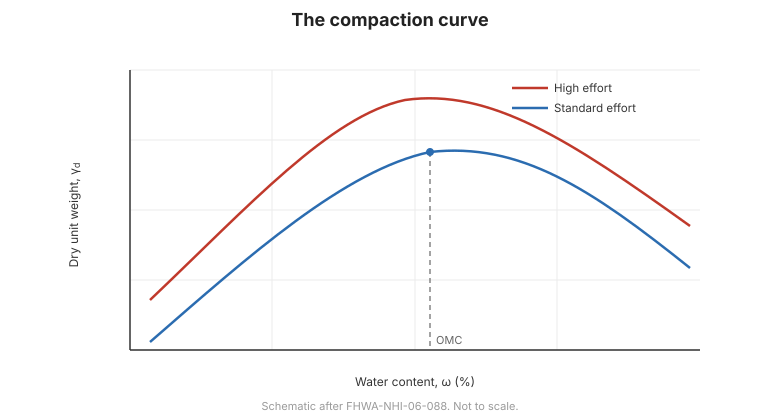

# Capítulo 4 — Compactación

## 4.1 Qué es la compactación

La **compactación** es la densificación del suelo mediante la eliminación de vacíos de
aire por esfuerzo mecánico —rodillado, apisonado o vibración. **Aumenta el peso
unitario seco** y con él la **resistencia y la rigidez**, a la vez que **reduce la
permeabilidad y la compresibilidad**. No elimina agua, por lo que compactación y
consolidación son procesos distintos.

## 4.2 La relación humedad–densidad

Para una energía de compactación dada, existe un **contenido de agua óptimo**
$w_{opt}$ con el que el suelo alcanza su **peso unitario seco máximo**
$\gamma_{d,max}$:

- **Lado seco del óptimo** — el suelo es rígido y difícil de compactar; las
  partículas resisten el reacomodamiento.
- **Lado húmedo del óptimo** — el agua lubrica las partículas pero llena los vacíos;
  la densidad vuelve a caer.

La **curva de compactación** (peso unitario seco frente a contenido de agua) es la
base del control de campo.

**Figura.** La curva de compactación: el peso unitario seco alcanza su máximo en el
contenido de agua óptimo; una mayor energía de compactación eleva la curva (según
FHWA-NHI-06-088).

## 4.3 Proctor estándar y modificado

Se usan dos energías normalizadas de laboratorio:

- **Proctor estándar** — menor energía; usado para la mayoría de rellenos y
  terraplenes.
- **Proctor modificado** — mayor energía (martillo más pesado, mayor altura de caída);
  usado para rellenos muy cargados, aeropuertos y pavimentos.

Mayor energía da un **peso unitario seco máximo mayor** y un **contenido de agua
óptimo menor**.

## 4.4 Control de campo

La compactación en campo se controla especificando un **porcentaje del peso unitario
seco máximo** (p. ej., 95 % del Proctor estándar) y un **rango de humedad** en torno
al óptimo. La verificación usa:

- **Ensayos de densidad in-situ** — cono de arena, globo o densímetro nuclear; y
- **Contenido de humedad** — horno, speedy o nuclear.

## 4.5 Compactación, estructura y comportamiento

La compactación no es solo densidad:

- **Compactado en el lado seco** — estructura floculada, mayor permeabilidad y
  rigidez, menor resistencia a grandes deformaciones.
- **Compactado en el lado húmedo** — estructura dispersa, menor permeabilidad, mayor
  resistencia, pero más potencial de contracción.
- El **método** (amasado frente a estático) también cambia la estructura.

Esto importa para arcillas usadas como **revestimientos** o **barreras**, donde la
permeabilidad —no la densidad— gobierna el diseño.

## 4.6 Puntos clave

- La compactación elimina **aire**, aumentando peso unitario seco, resistencia y
  rigidez, y reduciendo permeabilidad y compresibilidad.
- Existe un **contenido de agua óptimo** para la densidad seca máxima.
- **Proctor estándar** y **modificado** difieren en energía.
- El control de campo especifica **porcentaje de compactación y rango de humedad**.
- La **estructura** (lado seco frente a húmedo) afecta permeabilidad y resistencia.
