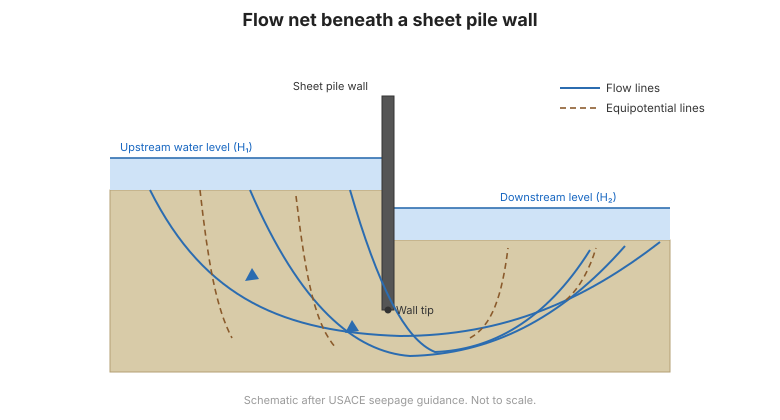

# Capítulo 6 — Filtración y Redes de Flujo

## 6.1 La filtración y sus consecuencias

La **filtración** es el flujo de agua a través del suelo bajo un gradiente
hidráulico. Importa porque:

- ejerce **fuerzas de filtración** sobre el esqueleto del suelo, reduciendo la
  estabilidad;
- causa **presiones de subpresión (uplift)** sobre las estructuras;
- puede desencadenar **tubificación (piping)** y **erosión interna**, mecanismo de
  muchas fallas de presas y diques; y
- gobierna la **consolidación** y la velocidad del asentamiento.

## 6.2 Redes de flujo

Una **red de flujo** es una solución gráfica de la ecuación de Laplace para
filtración estacionaria. Consta de dos familias ortogonales de curvas:

- **Líneas de flujo** — las trayectorias que sigue el agua; y
- **Líneas equipotenciales** — líneas de igual carga total.

La red se dibuja de modo que los elementos sean **«cuadrados»**. De ella el ingeniero
lee:

- el **caudal de filtración** $q = k H (N_f / N_d)$;
- la **presión de poros** (y por tanto la subpresión) en cualquier punto;
- el **gradiente de salida** en la superficie aguas abajo, que gobierna la
  tubificación.

**Figura.** Una red de flujo bajo una tablestaca: las líneas de flujo y las
equipotenciales dan el caudal, la subpresión y el gradiente de salida (según la guía
de filtración del USACE).

## 6.3 Subpresión y flotación

La presión de agua actúa **hacia arriba** sobre una estructura o masa de suelo,
reduciendo el esfuerzo efectivo. Bajo una presa o losa de piso, la **subpresión** se
lee de la red de flujo y debe ser resistida por el peso de la estructura. Cuando la
subpresión reduce el esfuerzo efectivo a cero, el suelo **flota** y pierde toda
resistencia.

## 6.4 Tubificación y erosión interna

La **tubificación** ocurre cuando el **gradiente de salida** en la superficie aguas
abajo supera un valor crítico, de modo que el agua levanta y arrastra partículas de
suelo, formando un conducto que progresa hacia atrás y puede causar el colapso. El
**factor de seguridad frente a tubificación** compara el gradiente crítico (a menudo
~1,0, o menor por seguridad) con el gradiente de salida real.

La mitigación incluye:

- **trayectorias de filtración más largas** (pantallas, mantos impermeables);
- **filtros y drenes** que interceptan y descargan la filtración de forma segura; y
- **pozos de alivio** para controlar la subpresión.

## 6.5 Filtros y drenaje

Los **filtros** protegen contra la erosión interna permitiendo pasar el agua pero
reteniendo las partículas de suelo. El diseño sigue **criterios de filtro** (el filtro
debe ser suficientemente grueso para ser permeable y suficientemente fino para
retener el suelo protegido). Las **capas drenantes** y los **geotextiles** cumplen la
misma función.

## 6.6 Puntos clave

- Las **fuerzas de filtración** reducen la estabilidad y causan **subpresión**.
- Una **red de flujo** da caudal, presión de poros y **gradiente de salida**.
- La **tubificación** ocurre cuando el gradiente de salida es demasiado alto —
  verifique un factor de seguridad.
- **Filtros y drenes** son la protección estándar contra la erosión interna.
- La filtración gobierna la **consolidación** y debe gestionarse en el diseño.
