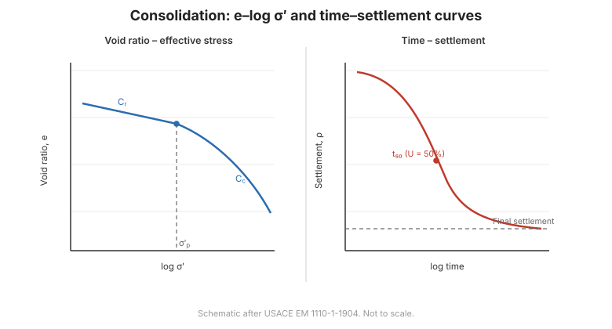

# Capítulo 9 — Consolidación

## 9.1 Qué es la consolidación

La **consolidación** es el cambio de volumen **dependiente del tiempo** de un suelo
saturado de grano fino a medida que **se disipa el exceso de presión de poros** y la
carga se transfiere del agua al esqueleto sólido. Es el mecanismo detrás del
asentamiento a largo plazo de las arcillas y se rige por la **teoría de
consolidación unidimensional de Terzaghi**.

## 9.2 El ensayo edométrico

El **ensayo de consolidación unidimensional (edómetro)** carga una muestra confinada
por etapas y registra la compresión con el tiempo. De él se obtienen:

- el **índice de compresión** $C_c$ (pendiente de compresión virgen);
- el **índice de recompresión** $C_r$ (pendiente de descarga–recarga);
- la **presión de preconsolidación** $\sigma'_p$ — el máximo esfuerzo efectivo pasado;
- el **coeficiente de consolidación** $c_v$ — el parámetro de velocidad.

## 9.3 Magnitud del asentamiento

Para una arcilla normalmente consolidada, el asentamiento por consolidación primaria
es:

$$S_c = \frac{C_c H}{1+e_0}\log\frac{\sigma'_{v0}+\Delta\sigma}{\sigma'_{v0}}$$

Para una arcilla sobreconsolidada se usa el **índice de recompresión** hasta
$\sigma'_p$ y $C_c$ más allá. La **razón de sobreconsolidación** $OCR =
\sigma'_p / \sigma'_{v0}$ indica si la arcilla es NC ($OCR=1$) u OC ($OCR>1$).

**Figura.** Consolidación: la curva e–log σ′ que da $C_c$, $C_r$ y la presión de
preconsolidación, y la curva tiempo–asentamiento de la que se deriva $c_v$ (según
USACE EM 1110-1-1904).

## 9.4 Velocidad de consolidación

La **velocidad** está gobernada por el **coeficiente de consolidación** $c_v$ y la
**longitud de la trayectoria de drenaje**. El **factor de tiempo** $T_v = c_v t /
H_{dr}^2$ relaciona el grado de consolidación $U$ con el tiempo. Como $H_{dr}$ aparece
al cuadrado, **duplicar la trayectoria de drenaje cuadruplica el tiempo** —la razón
por la que los **drenes verticales**
([Capítulo 14](chapter-14-testing-program.md)) aceleran la consolidación de forma
tan notable.

## 9.5 Compresión secundaria

Tras la consolidación primaria, la **compresión secundaria (fluencia)** continúa a
esfuerzo efectivo aproximadamente constante. Es significativa en **arcillas
orgánicas y blandas** y se describe mediante el **índice de compresión secundaria**
$C_\alpha$. En algunos suelos domina el asentamiento a largo plazo.

## 9.6 Puntos clave

- La **consolidación** es asentamiento dependiente del tiempo por **disipación de
  presión de poros**.
- El **edómetro** da $C_c$, $C_r$, $\sigma'_p$ y $c_v$.
- La magnitud del asentamiento sigue la **fórmula logarítmica $C_c$ / $C_r$**.
- La **velocidad** está gobernada por $c_v$ y la **trayectoria de drenaje**
  ($T_v = c_v t / H_{dr}^2$).
- La **compresión secundaria** puede dominar en suelos orgánicos.
