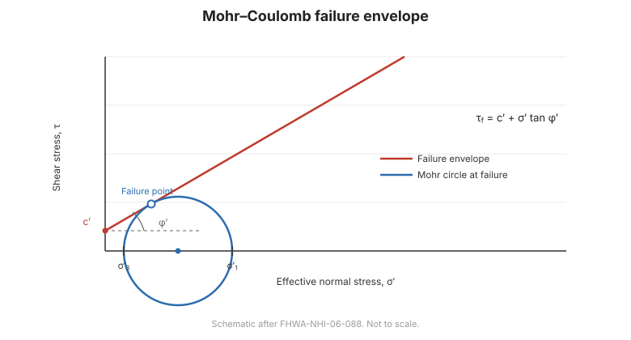

# Capítulo 10 — Resistencia al Corte

## 10.1 El criterio de Mohr–Coulomb

La **resistencia al corte** es la resistencia del suelo al deslizamiento —la
propiedad que gobierna capacidad de carga, estabilidad de taludes y presión de
tierras. El criterio de **Mohr–Coulomb** la expresa como:

$$\tau_f = c' + \sigma'_n \tan\phi'$$

donde $c'$ es la **cohesión efectiva**, $\sigma'_n$ es el **esfuerzo normal efectivo**
y $\phi'$ es el **ángulo de fricción efectivo**. Para condiciones de esfuerzo total
(no drenadas), la misma forma usa $c_u$ y $\phi_u = 0$:

$$\tau_f = c_u$$

**Figura.** La envolvente de falla de Mohr–Coulomb: resistencia al corte
$\tau_f = c' + \sigma'\tan\phi'$, con el círculo de falla tangente a la envolvente
(según FHWA-NHI-06-088).

## 10.2 Resistencia drenada frente a no drenada

La elección de los parámetros de resistencia depende del **drenaje**:

- **Drenada** — las presiones de poros se han equilibrado; use parámetros
  **efectivos** $c', \phi'$. Crítica para condiciones **a largo plazo** y para arenas.
- **No drenada** — sin drenaje durante la carga; use parámetros **totales**,
  normalmente **$c_u$** con $\phi = 0$. Crítica para condiciones **a corto plazo** en
  arcillas saturadas.

El **factor de seguridad menor** de ambos gobierna el diseño.

## 10.3 Ensayos de laboratorio

- **Corte directo** — simple, da $c'$ y $\phi'$; drenaje controlable.
- **Compresión triaxial** — el más versátil: **UU** (no consolidada no drenada) para
  $c_u$; **CU** (consolidada no drenada) con medición de presión de poros para
  parámetros efectivos; **CD** (consolidada drenada) para resistencia drenada.
- **Compresión no confinada** — un $c_u$ rápido para arcillas.
- **Corte anular** — para resistencia residual en superficies de deslizamiento
  preexistentes.

## 10.4 Factores que afectan la resistencia al corte

- **Densidad e historia de esfuerzos** — los suelos más densos y más
  sobreconsolidados son más resistentes.
- **Cementación y estructura** — el cementado natural añade cohesión aparente.
- **Anisotropía y fisuras** — la resistencia varía con la dirección; las fisuras
  debilitan la masa.
- **Velocidad de carga** — la resistencia no drenada depende de la velocidad de carga.
- **Resistencia residual** — en una superficie de deslizamiento preexistente, la
  resistencia cae al valor **residual**, que gobierna los deslizamientos
  reactivados.

## 10.5 Puntos clave

- **$\tau_f = c' + \sigma'\tan\phi'$** (efectiva) o **$\tau_f = c_u$** (no drenada).
- Elija **drenada frente a no drenada** según la condición de drenaje; el $F$ menor
  gobierna.
- Los ensayos **triaxiales** dan la gama completa: UU, CU, CD.
- Densidad, historia de esfuerzos, estructura y velocidad afectan la resistencia.
- En superficies de deslizamiento use la resistencia **residual**.
