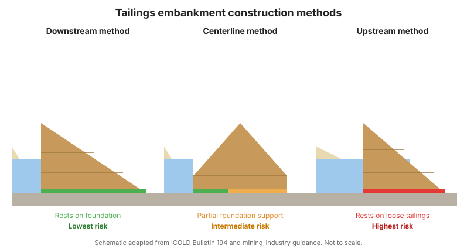
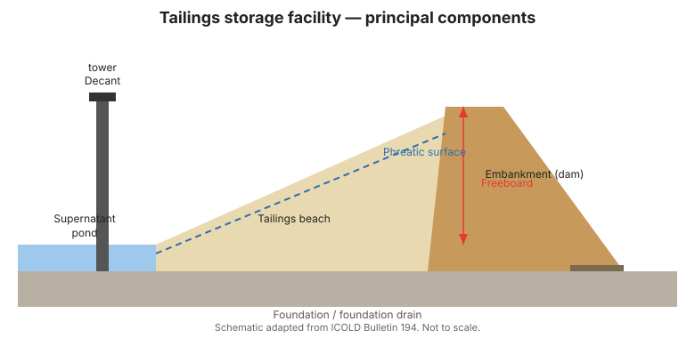

# Capítulo 2 — Instalaciones de Relaves y Cómo Fallan

## 2.1 Tipos de instalaciones de relaves

Los relaves se depositan como una pulpa y el agua sobrenadante se recupera mediante
un sistema de **vertedero de decantación (decant)**. El terraplén que retiene el
depósito se eleva por uno de varios métodos, que influyen fuertemente en la
seguridad:

- **Método aguas abajo (downstream)** — cada elevación se coloca aguas abajo de la
  anterior, produciendo una sección transversal amplia y estable con apoyo de
  cimentación bajo la mayor parte de la estructura. Generalmente el más robusto.
- **Método de línea central (centerline)** — las elevaciones se colocan sobre la
  línea central; riesgo intermedio.
- **Método aguas arriba (upstream)** — cada elevación se coloca en el lado aguas
  arriba (de depositación), apoyándose en la playa de relaves. **Mayor riesgo**: el
  terraplén reposa sobre el material más débil, a menudo suelto y saturado, y es
  propenso a la licuefacción estática y sísmica.

Configuraciones alternativas incluyen almacenamiento en **corrales / en fosa
(paddock / in-pit)** y relaves **espesados / pasta / filtrados**, que reducen el agua
libre y disminuyen el riesgo de licuefacción.

## 2.2 Los modos de falla dominantes

Comprender cómo fallan las instalaciones de relaves enfoca el programa de monitoreo.
Los modos principales son:

1. **Licuefacción estática del terraplén o del depósito.** Relaves sueltos,
   saturados y contractivos pierden resistencia bajo carga estática (p. ej., una
   elevación, un aumento rápido de la superficie freática o una debilidad de
   cimentación) y fluyen. Este es el mecanismo tras varias de las peores fallas
   históricas.
2. **Licuefacción sísmica.** La sacudida cíclica convierte relaves sueltos
   saturados en un estado licuado, desencadenando un deslizamiento fluente. Las
   regiones sísmicas exigen atención especial a las capas licuables.
3. **Sobrevertimiento (overtopping).** Coronamiento (freeboard) inadecuado,
   precipitación extraordinaria, mala gestión de la laguna o decantadores bloqueados
   permiten que el agua sobrepase el terraplén.
4. **Tubificación / erosión interna (piping).** La filtración erosiona un canal a
   través o bajo el terraplén, a menudo sin detectarse hasta una explosión (blowout).
5. **Inestabilidad de talud (estática).** Playas o terraplenes excesivamente
   empinados fallan por deslizamiento, especialmente donde la presión de poros es
   alta.
6. **Falla de cimentación.** Cimentaciones débiles o variables (p. ej., suelos
   compresibles, karst o capas licuables) provocan asentamiento, grietas o flujo.
7. **Falla estructural de obras accesorias.** Torres de decantación, tuberías y
   vertederos pueden fallar y comprometer todo el sistema.

## 2.3 La cadena hacia la falla

La mayoría de las fallas catastróficas no son eventos únicos sino cadenas: una
condición predisponente (relaves sueltos saturados, superficie freática alta) más un
desencadenante (precipitación, llenado rápido, sismo) más una detección inadecuada.
El monitoreo existe para romper esa cadena —revelando la condición predisponente a
tiempo.

!!! warning "La construcción aguas arriba merece vigilancia especial"
    Las instalaciones que usan el método aguas arriba llevan el mayor riesgo
    inherente y son objeto de esfuerzos globales para prohibirlas o controlarlas
    estrictamente. Sus programas de vigilancia deben ser los más intensivos, con
    especial atención a la presión de poros y la geometría de la playa.

## 2.4 Vincular modos de falla con instrumentos

| Modo de falla | Señales principales | Instrumentos |
|---------------|---------------------|--------------|
| Licuefacción estática / sísmica | Aumento de presión de poros, baja resistencia SPT/CPT, asentamiento | Piezómetros, inclinómetros, topografía, CPT |
| Sobrevertimiento | Pérdida de coronamiento, nivel de laguna alto | Topografía, indicadores de nivel, precipitación |
| Tubificación | Levantamiento, filtración fangosa, asentamiento | Piezómetros, vertederos de filtración, visual |
| Inestabilidad de talud | Movimiento, grietas | Topografía, inclinómetros, extensómetros |
| Falla de cimentación | Asentamiento diferencial, inclinación | Topografía, piezómetros, inclinómetros de pendiente |

**Figura.** Métodos de construcción de terraplenes de relaves. Elevaciones aguas
abajo, de línea central y aguas arriba: solo el método aguas abajo reposa sobre la
cimentación; el método aguas arriba se apoya en relaves sueltos y saturados y lleva
el mayor riesgo (Boletín ICOLD 194).

**Figura.** Componentes principales de una instalación de almacenamiento de relaves:
terraplén, playa, laguna sobrenadante, torre de decantación, superficie freática y
coronamiento (freeboard) (Boletín ICOLD 194).

## 2.5 Puntos clave

- El método de construcción gobierna el riesgo inherente; aguas arriba es el mayor.
- La licuefacción (estática y sísmica) es el mecanismo catastrófico dominante.
- Las fallas son cadenas de predisposición + desencadenante + detección tardía.
- Mapee cada modo de falla a instrumentos específicos antes de diseñar el programa.
