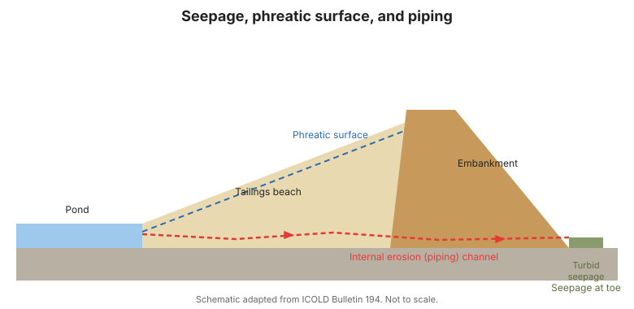

# Capítulo 7 — Monitoreo de Filtraciones y Superficie Freática

## 7.1 La filtración: amiga y enemiga

Alguna filtración es normal en una instalación de relaves; la filtración **no
controlada o cambiante** es un indicador principal de erosión interna (tubificación) y
sobresaturación. La tarea de vigilancia es cuantificar la filtración y detectar el
cambio.

## 7.2 Qué medir

- **Ubicación y claridad** — dónde emerge la filtración y si es clara o turbia (la
  turbidez puede señalar erosión interna).
- **Caudal** — volumen por unidad de tiempo, vía vertederos en V, canaletas o medidores
  de flujo.
- **Temperatura y química** — pueden distinguir fuentes y detectar fugas de decantadores
  o tuberías.
- **Superficie freática** — el nivel del nivel freático dentro del depósito y el
  terraplén, seguido por piezómetros ([Capítulo 6](chapter-06-pore-pressure.md)).

## 7.3 Geometría de la playa y la superficie freática

La **playa** es la superficie ligeramente inclinada donde se deposita la pulpa. Su
geometría controla dónde se sitúa la superficie freática. Una instalación bien dirigida
mantiene la superficie freática **baja y dentro de la playa**, lejos de la coronación,
gestionando la depositación y la decantación. El monitoreo incluye:

- **Pendiente y longitud de la playa** (topografía, fotogrametría con dron).
- **Elevación de la superficie freática** desde piezómetros y pozos de observación.
- **Coronamiento (freeboard)** — la distancia vertical desde la laguna hasta la
  coronación.

!!! danger "La gestión de la playa es vigilancia"
    Una playa corta o plana empuja la superficie freática hacia el terraplén y reduce
    el coronamiento —un camino directo a la licuefacción y al sobrevertimiento. La
    geometría de la playa no es solo operación; es un parámetro de seguridad.

## 7.4 Detectar erosión interna (tubificación)

La tubificación es insidiosa porque puede desarrollarse dentro del terraplén. Signos de
alerta:

- Filtración nueva o creciente, especialmente **turbia** o **arenosa**.
- Filtración que emerge en ubicaciones inesperadas (pie, talud aguas abajo).
- Asentamiento o pequeñas depresiones sobre un camino de filtración.
- Un **aumento súbito del caudal** sin un aumento correspondiente de la laguna.

## 7.5 Instrumentos y métodos

- **Vertederos y canaletas** para la cantidad total de filtración.
- **Piezómetros y pozos de observación** para la superficie freática.
- **Vigilancia visual** para ubicación, claridad y turbidez
  ([Capítulo 3](chapter-03-philosophy.md)).
- **Monitoreo de decantación** para confirmar nivel de laguna y coronamiento.

**Figura.** Filtración, superficie freática y tubificación (erosión interna). La
filtración turbia en el pie aguas abajo es un signo de alerta (Boletín ICOLD 194).

## 7.6 Puntos clave

- Cuantifique la filtración y vigile el cambio, especialmente la turbidez.
- Mantenga la superficie freática baja y dentro de la playa; proteja el coronamiento.
- La geometría de la playa es un parámetro de seguridad, no solo operación.
- La tubificación se anuncia por filtración nueva, turbia o creciente.
