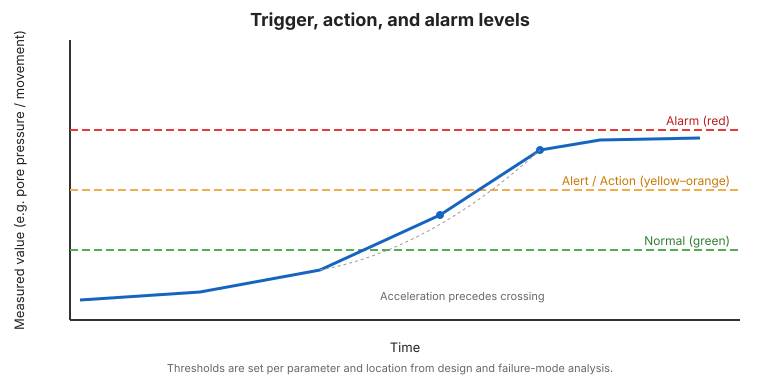

# Capítulo 13 — Evaluación del Desempeño y Toma de Decisiones

## 13.1 De la anomalía a la acción

El monitoreo existe para apoyar decisiones. Un programa bien dirigido define, *por
adelantado*, qué significa cada nivel de cada parámetro y qué debe suceder a
continuación. Esto elimina la hesitación durante un evento.

## 13.2 Niveles de disparo, acción y alarma

La mayoría de los planes definen niveles escalonados:

- **Normal / verde** — dentro del rango esperado; monitoreo rutinario.
- **Alerta / amarillo** — desviación que justifica mayor frecuencia y revisión.
- **Acción / naranja** — respuesta predefinida: notificar al ingeniero, restringir
  acceso, aumentar vigilancia, preparar respuesta.
- **Alarma / rojo** — respuesta de emergencia predefinida: evacuar aguas abajo,
  notificar al regulador, activar el plan de emergencia.

Los niveles se fijan por parámetro y por ubicación, informados por el diseño y el
análisis de modos de falla ([Capítulo 2](chapter-02-facilities-and-failures.md)).

## 13.3 Apoyo a la decisión, no reemplazo

Los instrumentos y tableros **apoyan** el criterio del ingeniero responsable; no lo
reemplazan. Una lectura en verde no excusa una grieta visible; un solo amarillo no
obliga a evacuar. El plan documenta quién decide y cómo.

## 13.4 Respuesta de emergencia

Cuando ocurren niveles rojos o distrés visible, la respuesta es operativa, no solo
técnica:

- **Evacuación** de poblaciones aguas abajo y personal en sitio según el plan de
  emergencia.
- **Notificación** al regulador y a las partes interesadas.
- **Contención** donde sea seguro (bajar la laguna, desviar el flujo).
- **Documentación** de acciones y observaciones para revisión posterior.

## 13.5 Revisión independiente

Las instalaciones de mayor consecuencia se benefician de una **revisión periódica
independiente** de los datos de monitoreo y del propio programa —una nueva mirada a
tendencias que el equipo operativo puede haber normalizado.

!!! danger "Actúe ante la aceleración"
    La historia muestra que las fallas catastróficas de relaves suelen estar precedidas
    por movimiento acelerado o aumento de presión de poros que fue observado pero no
    actuado. Los niveles de acción predefinidos existen precisamente para forzar una
    respuesta antes de cruzar un umbral.

**Figura.** Niveles de disparo, acción y alarma. La señal monitoreada cruza umbrales;
la aceleración a menudo precede al cruce (Boletín ICOLD 194 / práctica de vigilancia de
instalaciones).

## 13.6 Puntos clave

- Defina niveles de disparo/acción/alarma por adelantado, por parámetro y ubicación.
- El monitoreo apoya —nunca reemplaza— el criterio de ingeniería responsable.
- Predefina la respuesta de emergencia: evacuar, notificar, contener, documentar.
- La revisión independiente detecta tendencias normalizadas.
