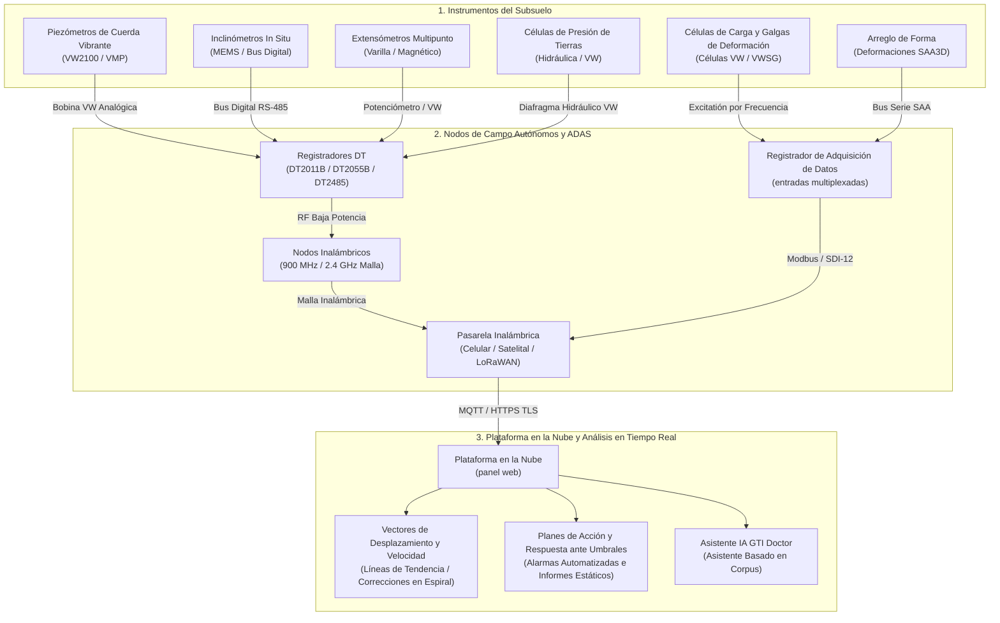

# 📊 Visualizador Interactivo de Monitoreo Geotécnico

Explore un modelo visual interactivo de sistemas de instrumentación geotécnica, física de sensores, topologías de adquisición automatizada de datos y perfiles de desplazamiento en tiempo real.

---

  

    

      <h2 style="margin: 0; color: #ff6b35; font-size: 22px;">🛠️ Banco de Pruebas de Instrumentación Geotécnica</h2>
      
Seleccione un escenario de ingeniería para simular instrumentación de campo, deformación estructural y arreglos de sensores

    

    

      <button id="btn-dam" onclick="switchScenario('dam')" style="background: #ff6b35; color: white; border: none; padding: 7px 13px; border-radius: 6px; cursor: pointer; font-weight: 600; font-size: 12px;">Presa de Tierra</button>
      <button id="btn-excavation" onclick="switchScenario('excavation')" style="background: #2a2a35; color: #ccc; border: none; padding: 7px 13px; border-radius: 6px; cursor: pointer; font-weight: 600; font-size: 12px;">Excavación Profunda</button>
      <button id="btn-slope" onclick="switchScenario('slope')" style="background: #2a2a35; color: #ccc; border: none; padding: 7px 13px; border-radius: 6px; cursor: pointer; font-weight: 600; font-size: 12px;">Inclinómetro en Talud</button>
      <button id="btn-tunnel" onclick="switchScenario('tunnel')" style="background: #2a2a35; color: #ccc; border: none; padding: 7px 13px; border-radius: 6px; cursor: pointer; font-weight: 600; font-size: 12px;">Convergencia de Túnel</button>
      <button id="btn-pile" onclick="switchScenario('pile')" style="background: #2a2a35; color: #ccc; border: none; padding: 7px 13px; border-radius: 6px; cursor: pointer; font-weight: 600; font-size: 12px;">Ensayo de Pilote Perforado</button>
      <button id="btn-retaining" onclick="switchScenario('retaining')" style="background: #2a2a35; color: #ccc; border: none; padding: 7px 13px; border-radius: 6px; cursor: pointer; font-weight: 600; font-size: 12px;">Muro con Tirantes</button>
    

  

  <!-- Lienzo interactivo y viewport SVG -->
  

    <!-- Corte transversal gráfico -->
    

      

        Corte Transversal y Arreglo de Sensores
        Presa de Terraplén de Tierra (Dunnicliff Cap. 21)
      

      <svg id="geo-svg" viewBox="0 0 600 340" style="width: 100%; height: 320px; background: #0d0d11; border-radius: 6px;">
        <!-- Renderizado dinámico vía JS -->
      </svg>
      

        
 Piezómetro (VWP)

        
 Inclinómetro (IPI/MEMS)

        
 Extensómetro / Objetivo

        
 Célula de Carga / Galga de Deformación

        
 Célula de Presión de Tierras

        
 Concentrador Inalámbrico

      

    

    <!-- Panel de telemetría en vivo y control -->
    

      

        <h4 style="margin: 0 0 12px 0; color: #f0f0f5; font-size: 15px; border-bottom: 1px solid #2a2a35; padding-bottom: 6px;">Diagnóstico ADAS en Vivo</h4>

        

          <label style="font-size: 12px; color: #aaa; display: flex; justify-content: space-between;">
            Carga Hidrostática Simulada:
            <strong id="val-head" style="color: #00e5ff;">18.5 m</strong>
          </label>
          <input type="range" id="slider-head" min="5" max="30" value="18.5" step="0.5" oninput="updateSimulation()" style="width: 100%; margin-top: 4px; accent-color: #00e5ff;">
        

        

          <label style="font-size: 12px; color: #aaa; display: flex; justify-content: space-between;">
            Desplazamiento / Tensión de Carga:
            <strong id="val-disp" style="color: #ff4081;">1.2 mm/día</strong>
          </label>
          <input type="range" id="slider-disp" min="0" max="10" value="1.2" step="0.1" oninput="updateSimulation()" style="width: 100%; margin-top: 4px; accent-color: #ff4081;">
        

        

          
Estado de Disparo TARP

          
NORMAL (Nivel 0)

        

        

          
📡 <strong>Telemetría:</strong> LoRaWAN 915 MHz / Malla

          
🔋 <strong>Batería del Concentrador:</strong> 3.65V (SAFT LSH20)

          
📶 <strong>RSSI:</strong> -44 dBm (Enlace Estable)

          
⏱️ <strong>Intervalo:</strong> 15 min (Continuo)

        

      

      

        P_vw1: 181.4 kPa 
        T_vw1: 14.2 °C 
        Incli_max: 3.4 mm @ -12m
      

    

  

---

## 🏗️ Arquitectura de Telemetría ADAS de Extremo a Extremo

El diagrama a continuación ilustra cómo los sensores de campo se integran en la arquitectura inalámbrica de inteligencia en la nube:

