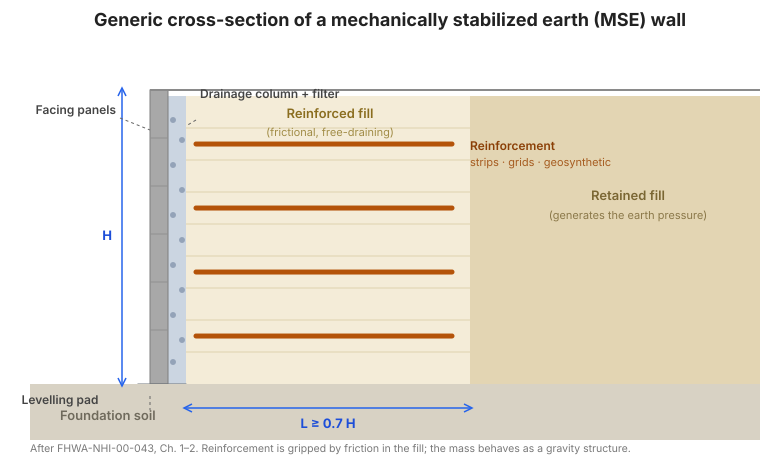

# Chapter 4 — Design of MSE Walls

## 4.1 Design methods

**Analysis of working stresses.** MSE wall design is a **working-stress** (allowable
stress) procedure: the reinforcement is checked against a reduced, long-term
allowable strength, and the structure against minimum factors of safety. (Modern
practice re-casts the same checks in load-and-resistance form; the mechanics are
identical.)

**Limit equilibrium analysis.** The reinforced mass is treated as a **rigid body**
for external stability, and as a stack of layers for internal stability, with
limit-equilibrium checks at each level.

**Deformation evaluations.** The design must also anticipate **deformation**: the
facing tilts outward and the wall bulges slightly as the reinforcement strains.
The manual gives an empirical curve (Figure 10) relating anticipated lateral
displacement during construction to wall height and reinforcement type, so that
tolerances — especially for utilities and adjacent structures — can be set
realistically.

**Inextensible reinforcement (steel).** Design uses a **coherent-gravity** model:
a Rankine-type active earth pressure acts on the reinforced mass, and the
**maximum tensile force line** marks where the reinforcement tension peaks. The
lateral earth pressure coefficient used for internal stability is higher than the
active value near the top of the wall (a common form is $K_r = 1.7K_a$ in the
upper zone, reducing toward at-rest below), reflecting the restraint the stiff
reinforcement imposes.

**Extensible reinforcement (geosynthetics).** Because the reinforcement strains
with the soil, the load distributes more uniformly with depth and a **tie-back
wedge** model is used, with a lateral earth pressure coefficient taken as the
active value $K_a$ (or a slightly elevated value depending on the design method).

**Figure.** Generic cross-section of an MSE wall: facing panels, a drainage
column and filter behind the face, horizontal reinforcement layers extending
through the frictional reinforced fill, the retained fill behind the reinforced
zone, and the foundation soil (after FHWA-NHI-00-043, Ch. 1–2).

## 4.2 Sizing for external stability

**a. Define wall geometry and soil properties.** Wall height, face batter,
reinforcement length, foundation profile, and the unit weights and friction
angles of the reinforced fill, retained fill, and foundation soil.

**b. Select performance criteria.** The acceptable facing deformation,
differential settlement, and joint opening.

**c. Preliminary sizing.** Set the reinforcement length. A common starting rule is
**$L \ge 0.7H$** with a minimum practical length (about 2.4 m / 8 ft); the length
is then adjusted for external stability.

**d. Earth pressures for external stability.** The reinforced mass is loaded by
the **active earth pressure** from the retained fill behind it, plus any surcharge
(traffic, structures) and, if drainage is inadequate, **hydrostatic** pressure.
The resultant acts on the back of the reinforced mass.

**e. Sliding stability.** Check that the base friction plus any passive
resistance in front of the wall resists the horizontal thrust:

$$FS_{(sliding)} = \frac{\text{resisting horizontal force}}{\text{driving horizontal force}} \ge 1.5$$

**f. Bearing capacity failure.** Check the foundation's bearing capacity under the
eccentric load of the reinforced mass, and check that the resultant stays within
the base (no tension beneath the wall):

$$FS_{(bearing)} \ge 2.0 \quad \text{and} \quad e \le \frac{L}{6}$$

**g. Overall (global) stability.** Perform a slope-stability analysis through the
reinforced mass and its foundation to confirm that deep-seated failure surfaces
have an adequate factor of safety (commonly $\ge 1.5$).

**h. Seismic loading.** Apply a **pseudo-static** inertial force (a horizontal
seismic coefficient times the mass) and re-check external stability; the
Mononobe–Okabe framework is used to modify the earth pressure for the seismic
case.

**i. Settlement estimate.** Estimate immediate and consolidation settlement of the
foundation, and compare it with the performance criteria — especially where a
structure or utility sits on the wall.

## 4.3 Sizing for internal stability

**a. Critical slip surfaces.** Identify the potential internal failure surfaces
(through the reinforced mass) and, for each reinforcement layer, the **effective
embedment length** $L_e$ behind the surface.

**b. Maximum tensile forces in the reinforcement layers.** For each layer, the
maximum mobilized tension is the lateral earth pressure times the tributary
area:

$$T_{max} = K_r\ \sigma_v\ S_v$$

where $K_r$ is the lateral earth pressure coefficient, $\sigma_v$ is the effective
vertical stress at the layer (including surcharge and traffic load), and $S_v$ is
the vertical spacing of the reinforcement. For discrete elements (strips, bars),
the tension is divided by the number of elements per unit width.

**c. Internal stability with respect to pullout failure.** The available pullout
resistance $P_r$ (Chapter 3) must exceed the mobilized tension with an adequate
factor of safety:

$$FS_{(PO)} = \frac{P_r}{T_{max}} \ge 1.5$$

This check sets the **reinforcement length** and **spacing**: increase $L_e$ or
reduce $S_v$ until every layer passes.

**d. Seismic loading.** Add the dynamic increment to the static tension and
re-check pullout and connection for the seismic case.

**e. Connection strength.** Where the reinforcement is connected to the facing,
verify the **connection** against the mobilized tension, using the
connection strength from tests (Appendix A):

$$T_{conn} \ge T_{max}\ \cdot\ FS_{conn}$$

**f. Reinforcement spacing.** Vertical spacing is limited by the facing system,
by compaction requirements, and by the need to keep each layer's $T_{max}$
within its capacity. Closer spacing generally reduces the facing load and the
reinforcement length.

## 4.4 Design of facing elements

**Rigid facings (concrete, steel, timber).** The facing is designed for the
lateral pressure of the retained fill over its tributary area, for the connection
loads from the reinforcement, and for its own handling and erection loads.

**Flexible facings (wrapped geosynthetic).** The facing is the wrapped
reinforcement itself; the design checks the **wrap strength**, the connection of
the wrap to the main reinforcement, and the stability of the face fill under the
wrap.

## 4.5 Design details

- **Traffic barriers** — the barrier and its impact load must be carried by the
  wall or by a separate structural element; the load path to the reinforcement
  must be explicit.
- **Drainage systems** — the design assumes free-draining fill. Provide
  drainage aggregate, filter geotextile, and outlet pipes, and keep the drainage
  system functional for the design life.
- **Termination to cast-in-place structures** — the joint between an MSE wall and
  a rigid structure (abutment, culvert) must accommodate differential movement.
- **Hydrostatic pressures** — if drainage can be blocked or the fill is not
  free-draining, add hydrostatic pressure to the design, or design the drainage
  so it cannot be blocked.
- **Obstructions in the reinforced soil zone** — pipes, inlets, and utilities
  interrupt reinforcement; design the reinforcement layout and any local
  stiffening around them.
- **Internal details** — panel-to-panel connections, bearing pads, joint covers,
  and the reinforcement-to-facing connection details.

## 4.6 Design example — steel strip reinforcement

The manual works a complete steel-strip MSE wall: geometry and soil properties,
external stability (sliding, bearing, global), internal stability ($T_{max}$,
pullout, connection), and the resulting strip size, spacing, and length — first
by hand calculation, then with the FHWA computer program, so the two can be
compared.

## 4.7 Design example — geosynthetic reinforcement

A parallel example with geosynthetic reinforcement, using the extensible-
reinforcement model, the creep/installation/durability reduction factors, and the
geosynthetic connection strength — again by hand and by computer.

## 4.8 Standard MSEW designs

The manual provides **standard designs** — pre-worked geometries and
reinforcement layouts for common wall heights and conditions — so that routine
walls need not be redesigned from scratch. These standard designs are the basis
of the "standard design" contracting approach in
[Chapter 8](chapter-08-contracting-specifications.md).

## 4.9 Key takeaways

- Design in two passes: **external stability** of the mass as a rigid body, then
  **internal stability** of each reinforcement layer.
- External checks: **sliding ($\ge 1.5$)**, **bearing ($\ge 2.0$)**, **eccentricity
  ($e \le L/6$)**, and **global stability ($\ge 1.5$)**.
- Internal checks: **tension ($T_{max} = K_r\sigma_v S_v$)**, **pullout
  ($FS_{(PO)} \ge 1.5$)**, and **connection**.
- **Length is set by pullout**, not by habit — start at $L \approx 0.7H$ and
  adjust until every layer passes.
- **Drainage and hydrostatic pressure** are design decisions, not site details.
