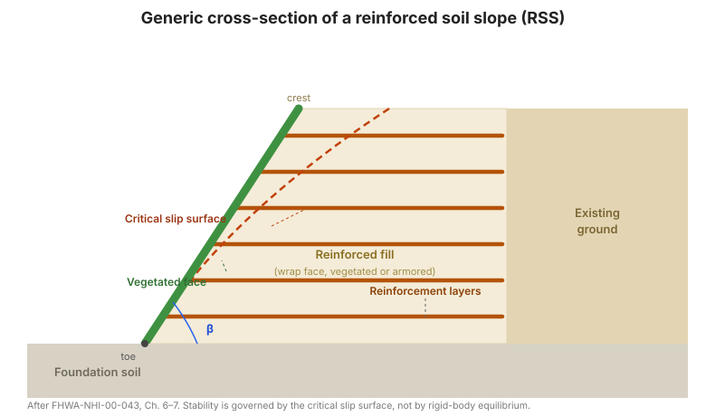

# Chapter 7 — Design of Reinforced Soil Slopes

## 7.1 Introduction

Reinforced slope design raises the factor of safety of a slope by adding
reinforcement across the potential slip surfaces. The reinforcement force is
introduced into a **modified limit-equilibrium analysis**: the resisting moment
of the reinforcement (its tension times its lever arm about the centre of
rotation) is added to the soil's resisting moment, and the reinforcement length
behind the slip surface must be sufficient to develop that tension by pullout.

Because the critical slip surface is not known in advance, the design is
iterative: choose a surface, compute the required reinforcement, check that the
reinforcement can develop its force by pullout, then re-search for the critical
surface with the reinforcement included.

**Figure.** Generic cross-section of a reinforced soil slope: reinforcement layers
extending from the vegetated face back into the stable ground behind the critical
slip surface, with the face standing at angle β (after FHWA-NHI-00-043, Ch. 6–7).

## 7.2 Reinforced slope design guidelines

The manual sets out a **nine-step procedure**:

**Step 1 — Establish the geometric, loading, and performance requirements.**
Slope geometry, external loads (traffic, structures), required factor of safety,
and performance criteria.

**Step 2 — Determine the engineering properties of the in-situ soils.**
Unit weight, shear strength (drained and undrained), and pore pressure regime of
the existing ground and the foundation.

**Step 3 — Determine the properties of the reinforced fill (and, if different, the
retained fill).** Unit weight, friction angle, and gradation/plasticity limits
for the reinforced fill.

**Step 4 — Evaluate design parameters for the reinforcement.** The long-term
allowable strength — after creep, installation-damage, and durability reduction
for geosynthetics, or after corrosion loss for steel — and the pullout friction
factor $F^{*}$ and scale factor $\alpha$ for the soil–reinforcement pair.

**Step 5 — Check unreinforced stability.** Analyse the slope without reinforcement
to establish the baseline factor of safety and to locate the critical surface.
This tells you how much reinforcement is needed.

**Step 6 — Design reinforcement to provide a stable slope.** Select the
reinforcement layout (spacing, length, strength) so that the reinforced slope
reaches the required factor of safety. The **required reinforcement force** is
found from the difference between the required and available resisting moments:

$$T_{req} = \frac{FS_{req}\ \cdot\ M_{driving} - M_{resisting}}{\sum (\text{lever arm}_i)}$$

The reinforcement is distributed over the slope height, typically closer together
near the toe where the driving stresses are highest, and each layer is checked
for **pullout** behind the critical surface.

**Step 7 — Check external stability.** Confirm that the reinforced slope does not
slide along a weak foundation layer, does not overload the foundation in bearing,
and does not fail on a deep-seated surface passing below the reinforced zone.

**Step 8 — Seismic stability.** Apply pseudo-static inertial forces and re-check
the reinforced slope, adding the seismic increment to the reinforcement forces.

**Step 9 — Evaluate requirements for subsurface and surface water runoff
control.** Design the drainage so that pore pressures in the reinforced zone stay
at the design values and surface water is intercepted and conveyed away.

## 7.3 Computer-assisted design

Because Step 6 requires searching for the critical surface with reinforcement
present, RSS design is normally performed with a slope-stability program that
supports reinforcement elements. The manual's worked examples include both
hand calculations and the corresponding computer solution, so the two can be
compared.

## 7.4 Design examples

- **Example 1 — Reinforced slope design, road widening.** A slope widened by
  steepening the face, designed with reinforcement layers.
- **Example 2 — Reinforced slope design, new road construction.** A new
  embankment slope built with reinforcement from the outset.
- **Example 3 — Computer-aided solution.** The same problem solved with the
  slope-stability program.
- **Example 4 — Facing stability calculation.** A check of the stability of the
  face (wrap and face fill) under the reinforcement's own force.

## 7.5 Project cost estimates

The manual closes with a **cost-estimate procedure** for reinforced slopes —
quantity take-off for reinforcement, fill, face treatment, and drainage — again
as dated reference data to be re-based to local prices.

## 7.6 Key takeaways

- RSS design is **iterative limit-equilibrium with reinforcement**: locate the
  critical surface, add the reinforcement force, re-check.
- **Step 5 (unreinforced stability) tells you how much reinforcement you need**;
  do not skip it.
- Distribute reinforcement **closer near the toe** where driving stresses peak,
  and check **pullout** behind the critical surface for every layer.
- Check **external stability** independently — a reinforced slope can still slide
  on a weak foundation.
- **Drainage design (Step 9)** is part of the stability design, not a detail.
