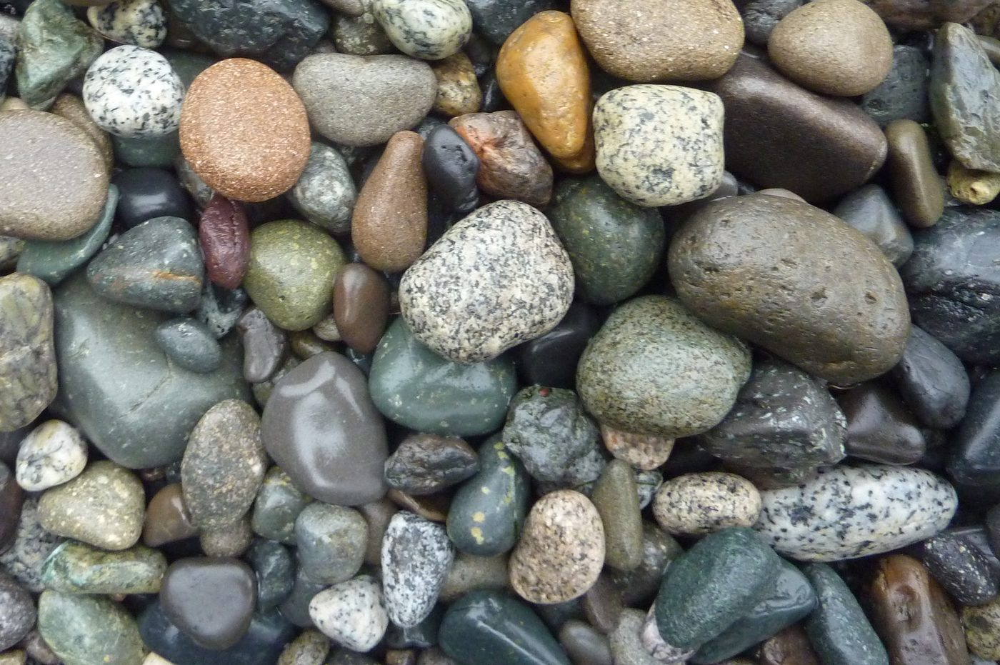

# Physical Geology (2nd Edition) — Steven Earle

An **open textbook** of physical geology, used on this site as the geology foundation
beneath the geotechnical reference corpus. Where the other reference manuals on this site
start from *soil mechanics* or *instrumentation*, this one starts one level further back:
what the Earth is made of, how rock is formed and broken, and how groundwater, earthquakes
and slopes actually behave.

!!! info "Licence — CC BY 4.0 (openly reusable)"
    *Physical Geology – 2nd Edition* by **Steven Earle** (with Karla Panchuk), BCcampus,
    2019, is licensed **Creative Commons Attribution 4.0 International (CC BY 4.0)**.
    It may be retained, reused, copied and adapted freely with attribution.
    Source: <https://opentextbc.ca/physicalgeology2ed/>

    This entry is a **digest with commentary** — it summarises the book's geotechnically
    relevant chapters and reproduces selected figures. Only figures that are **CC BY or
    public domain** are used; the textbook's CC BY-SA and "all rights reserved" figures
    are deliberately excluded. See the
    [figure credits](../../assets/figures/geology/CREDITS.txt).

## Why this book is on this site

The handbook *Cẩm nang dùng cho kỹ sư địa kỹ thuật* (Chapter 1) makes the point that
**engineering geology without physical geology is just description**. This entry supplies
the physical geology: rock-forming processes, weathering, structure, groundwater and mass
wasting. It is also the **source of the photographs** now used to illustrate the handbook
digest — a link that is legitimate precisely because the book is openly licensed.

**Figure.** Granitic pebbles on a beach. Granite is the rock the engineer is most likely to meet as a strong, jointed foundation — and, once weathered, as a residual soil.
*© Steven Earle, CC BY 4.0 — Physical Geology, 2nd ed., Fig. 1.4.3.*

## Chapter map

| Chapter | Title | Why it matters here |
| --- | --- | --- |
| 1 | [Introduction to Geology](chapter-01-introduction-to-geology.md) | The scope of geology and where engineering geology sits |
| 2 | [Minerals](chapter-02-minerals.md) | What rock is made of; mineral properties and identification |
| 3 | [Intrusive Igneous Rocks](chapter-03-igneous-rocks.md) | The rock cycle, magma, and intrusive bodies |
| 5 | [Weathering and Soil](chapter-05-weathering-and-soil.md) | **The process that turns rock into soil** — core to residual soils |
| 6 | [Sediments and Sedimentary Rocks](chapter-06-sedimentary-rocks.md) | Clastic deposits, bedding, and depositional environments |
| 7 | [Metamorphism and Metamorphic Rocks](chapter-07-metamorphic-rocks.md) | Foliation — the cause of the strongest anisotropy in rock |
| 9 | [Earth's Interior and Seismology](chapter-09-earths-interior.md) | Seismic waves and the basis of all seismic investigation |
| 11 | [Earthquakes](chapter-11-earthquakes.md) | Magnitude, intensity and seismic hazard |
| 12 | [Geological Structures](chapter-12-geological-structures.md) | Stress, folding, fracturing and faulting |
| 14 | [Groundwater](chapter-14-groundwater.md) | Porosity, permeability, aquifers and confining layers |
| 15 | [Mass Wasting](chapter-15-mass-wasting.md) | Slope stability from the geological side |

The remaining chapters of the book (4 volcanism, 8 geological time, 10 plate tectonics,
13 streams and floods, 16 glaciation, 17 shorelines, 18 oceans, 19 climate, 20 resources,
21 western Canada, 22 origin of the solar system) are outside this site's geotechnical
scope and are not digested here.

## GTI Doctor

The [GTI Doctor](../../gti-doctor.md) assistant indexes the site's reference corpus. Ask it
about rock weathering, groundwater or slope failure mechanisms and it will answer from
these pages and the handbook.

---

## Featured Video & Practical Resources

  <iframe src="https://www.youtube-nocookie.com/embed/qGkkXNxnxAo" title="Plate Tectonics | IIT Roorkee" frameborder="0" allow="accelerometer; autoplay; clipboard-write; encrypted-media; gyroscope; picture-in-picture" allowfullscreen style="position: absolute; top: 0; left: 0; width: 100%; height: 100%; border-radius: 6px;"></iframe>

<em>Featured Video (University Lecture — IIT Roorkee / NPTEL): Plate Tectonics and Crustal Dynamics in Physical Geology.</em>

!!! tip "Complementary Practical Field Resources from RST Instruments & Measurand (Terra Insights)"
    - **RST Instruments (@RSTgeotechnical):** [RST Geotechnical Overview](https://www.youtube.com/watch?v=g3GAmDL5rrM){ target="_blank" }  
      *Comprehensive instrumentation portfolio for geological hazard monitoring, faults, and mass wasting.*
    - **Measurand (@MeasurandVideos):** [SAAView 3D Analysis Software](https://www.youtube.com/watch?v=OtLkPOCQCoo){ target="_blank" }  
      *Visualization and 3D vector tracking of active landslide slip surfaces and mass movement zones.*

