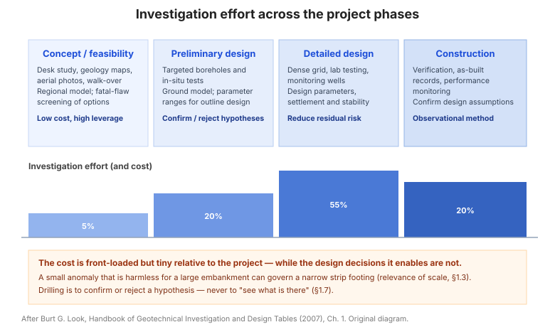

# Chương 1 — Khảo sát khu đất

Chương mở đầu đặt nền cho toàn bộ cuốn cẩm nang: khảo sát địa kỹ thuật không phải
một thủ tục hành chính mà là **quyết định thiết kế đầu tiên**. Chương này bàn về
việc lập kế hoạch khảo sát, phạm vi và mức độ khảo sát, chất lượng và xáo trộn mẫu,
và cả khía cạnh thương mại của công tác khảo sát.

**Hình.** Nỗ lực khảo sát theo từng giai đoạn dự án: chi phí tập trung ở giai đoạn đầu nhưng lại quyết định phần lớn rủi ro thiết kế. Khoan để kiểm chứng giả thuyết, không phải để xem có gì.

## 1.1 Sự tham gia của địa kỹ thuật

Có hai cách tiếp cận để thu thập dữ liệu địa kỹ thuật:

- **Coi điều kiện nền là một yếu tố thiết kế** — dựa trên vị trí và cấu hình công
  trình đã định, rồi thu thập điều kiện nền liên quan để thiết kế theo/đối phó.
  Đây là cách tiếp cận truyền thống.
- **Đưa đầu vào địa kỹ thuật xuyên suốt dự án** — lập kế hoạch khảo sát ngay từ
  giai đoạn ý tưởng, để địa kỹ thuật định hình vị trí, cấu hình và phương án công
  trình, chứ không chỉ phản ứng lại một thiết kế đã chốt.

## 1.2 Yêu cầu địa kỹ thuật theo từng giai đoạn dự án

Mức độ khảo sát phải khớp với giai đoạn dự án (nghiên cứu tiền khả thi → khả thi →
thiết kế kỹ thuật → thi công). Bảng của mục này đối chiếu từng giai đoạn với sản
phẩm địa kỹ thuật cần có, để tránh khảo sát quá ít ở giai đoạn sớm hoặc quá nhiều
ở giai đoạn đã đủ dữ liệu.

**Bảng 1.2 — Yêu cầu địa kỹ thuật theo giai đoạn dự án.**

| Giai đoạn dự án | Câu hỏi địa kỹ thuật chính | Sản phẩm cần có |
|---|---|---|
| Nghiên cứu tiền khả thi | Khu đất có khả thi? Rủi ro địa kỹ thuật nằm ở đâu? | Bản đồ địa chất, ảnh hàng không, khảo sát thị sát, mặt cắt dự kiến |
| Nghiên cứu khả thi | Phương án nào kinh tế nhất? Chi phí nền dự kiến? | Vài hố khoan thăm dò, thí nghiệm chỉ số, thông số sơ bộ |
| Thiết kế kỹ thuật | Thông số thiết kế là gì? | Mạng khảo sát chi tiết, thí nghiệm cường độ và nén cố kết, thông số thiết kế |
| Thi công | Giả thuyết thiết kế có đúng không? | Kiểm tra nền móng, quan trắc, xử lý phát sinh |

## 1.3 Tầm quan trọng của tỷ lệ

Mức độ chi tiết cần thiết phụ thuộc **tỷ lệ** của công trình so với đặc trưng địa
chất: một dị thường đất đá nhỏ có thể vô hại với một nền đắp lớn nhưng lại quyết
định với một móng băng hẹp. Mục này nhắc rằng cùng một mặt cắt địa chất có thể
"đủ tốt" cho công trình này và "chưa đủ" cho công trình khác.

## 1.4 Lập kế hoạch khảo sát khu đất

Nguyên tắc: khảo sát phải **hướng tới câu hỏi thiết kế**, không phải chạy theo số
lượng hố khoan. Bảng của mục này đưa các bước lập kế hoạch — xác định câu hỏi, chọn
phương pháp, bố trí mạng khảo sát, và trình tự thực hiện.

**Bảng 1.4 — Các bước lập kế hoạch khảo sát.**

| Bước | Nội dung |
|---|---|
| 1. Xác định câu hỏi thiết kế | Công trình cần thông số gì và sai số cho phép bao nhiêu |
| 2. Hình dung mặt cắt dự kiến | Từ bản đồ địa chất, ảnh hàng không, địa hình và kinh nghiệm địa phương |
| 3. Chọn phương pháp | Khoan, đào hố, xuyên, địa vật lý — theo loại đất và thông số cần đo |
| 4. Bố trí mạng khảo sát | Vị trí, khoảng cách, độ sâu và số điểm khảo sát |
| 5. Trình tự thực hiện | Khoan trước hay xuyên trước; xen kẽ thí nghiệm hiện trường và lấy mẫu |
| 6. Kiểm chứng và điều chỉnh | Cập nhật kế hoạch khi dữ liệu đầu tiên khác giả thuyết ban đầu |

## 1.5 Lập kế hoạch khảo sát nước ngầm

Nước ngầm thường là yếu tố bị đánh giá thấp nhất. Mục này hướng dẫn xác định **mực
nước ngầm**, **chế độ dao động theo mùa**, **các tầng ngậm nước có áp** và **hướng
dòng chảy** — tất cả đều cần cho phân tích ổn định, đào đất và lún.

## 1.6 Mức độ khảo sát

Mức độ khảo sát phải tương xứng với **rủi ro** và **tính bất định** của khu đất: nền
đã biết rõ cần ít, nền phức tạp hoặc công trình nhạy cảm cần nhiều.

## 1.7 Lập kế hoạch trước khi kiểm chứng thực địa

Trước khi khoan (kiểm chứng thực địa / *ground truthing*), cần **hình dung trước**
mặt cắt địa chất dự kiến từ bản đồ địa chất, ảnh hàng không, địa hình và kinh nghiệm
địa phương. Khoan là để **xác nhận hoặc bác bỏ** giả thuyết đó, không phải để "xem
có gì".

## 1.8 Phạm vi khảo sát

Bảng của mục này liên hệ **loại công trình** với **phạm vi khảo sát** cần thiết
(số hố khoan, độ sâu, khoảng cách). Độ sâu khảo sát phải vượt quá vùng chịu ảnh
hưởng của tải trọng, chứ không dừng ở "đủ để mô tả lớp trên cùng".

**Bảng 1.8 — Phạm vi khảo sát điển hình theo loại công trình.**

| Loại công trình | Số hố khoan | Độ sâu khảo sát | Khoảng cách |
|---|---|---|---|
| Nhà thấp tầng, tải nhẹ | 2–3 | 1,5–2 × bề rộng móng | 15–30 m |
| Nhà cao tầng | ≥ 3–5 | Vượt vùng ảnh hưởng (≥ 1,5 × bề rộng móng) | 15–25 m |
| Cầu, cống | 1 hố / trụ | ≥ 3 đường kính cọc dưới mũi cọc | 20–50 m |
| Đập, hồ chứa | Theo tuyến đập | Tới tầng không thấm | 20–50 m |
| Đường hầm | Dọc tim tuyến | ≥ 1–2 đường kính hầm dưới đáy hầm | 25–100 m |

Độ sâu khảo sát phải **vượt quá vùng chịu ảnh hưởng của tải trọng**, chứ không dừng ở lớp trên cùng.

## 1.9 Thể tích mẫu

Thể tích mẫu cần thiết phụ thuộc **loại đất** và **mục đích thí nghiệm** — hạt thô
cần mẫu lớn hơn hạt mịn để đại diện cho cấp phối thực tế.

## 1.10 Xếp hạng rủi ro tương đối của công trình

Bảng của mục này xếp hạng các loại công trình theo **rủi ro tương đối** (hậu quả
khi hư hỏng và độ bất định của nền), từ đó quyết định mức đầu tư khảo sát.

**Bảng 1.10 — Xếp hạng rủi ro tương đối của công trình.**

| Hạng | Loại công trình | Hậu quả khi hư hỏng | Mức khảo sát |
|---|---|---|---|
| Cao | Đập, nhà máy điện, cầu lớn | Thảm khốc, ảnh hưởng sinh mạng | Tối đa: khảo sát dày, thí nghiệm đầy đủ, quan trắc |
| Trung bình–cao | Nhà cao tầng, hầm, cảng | Nghiêm trọng về kinh tế | Khảo sát kỹ, thí nghiệm cường độ và nén |
| Trung bình | Nhà công nghiệp, đường cao tốc | Đáng kể, có thể sửa chữa | Khảo sát tiêu chuẩn, thí nghiệm chỉ số |
| Thấp | Nhà ở nhỏ, đường nông thôn | Nhẹ, dễ sửa chữa | Khảo sát tối thiểu, thí nghiệm hiện trường |

## 1.11 Lượng mẫu

Lượng mẫu (số lượng và khối lượng) phải đủ để chạy được **tất cả các thí nghiệm
cần thiết**, kể cả thí nghiệm lặp để phát hiện sai số và giá trị dị biệt.

## 1.12 Xáo trộn mẫu

Xáo trộn mẫu làm **tăng cường độ biểu kiến của sét mềm** và **giảm cường độ của cát
chặt**, đồng thời phá hủy cấu trúc đất. Bảng của mục này mô tả mức độ xáo trộn theo
từng phương pháp lấy mẫu.

**Bảng 1.12 — Xáo trộn mẫu theo phương pháp lấy mẫu.**

| Phương pháp lấy mẫu | Mức xáo trộn | Ảnh hưởng chính |
|---|---|---|
| Mẫu khối (block sample) | Không đáng kể | Giữ nguyên cấu trúc; dùng làm chuẩn đối chiếu |
| Ống mẫu thành mỏng (Shelby) | Ít | Dùng được cho thí nghiệm cường độ và nén cố kết |
| Ống mẫu piston | Ít–vừa | Tốt cho sét mềm đến dẻo cứng |
| Ống phẩy tiêu chuẩn (SPT) | Nhiều | Chỉ dùng cho thí nghiệm chỉ số và phân loại |
| Khoan rửa / guồng xoắn | Rất nhiều | Chỉ để nhận dạng lớp, không dùng cho cường độ |

Xáo trộn làm **tăng cường độ biểu kiến của sét mềm** và **giảm cường độ của cát chặt**.

## 1.13 Kích thước mẫu

Kích thước mẫu ảnh hưởng trực tiếp đến cường độ đo được: cường độ sét thường chỉ
bằng **50%–100%** giá trị thu được từ mẫu 38 mm — mẫu lớn hơn nắm bắt được ảnh
hưởng của cấu trúc đất.

## 1.14 Chất lượng khảo sát khu đất

Chất lượng khảo sát được đánh giá bằng **mức độ phù hợp của kết quả với câu hỏi
thiết kế**, không bằng số mét khoan. Mục này đưa các chỉ tiêu đánh giá chất lượng.

## 1.15 Chi phí khảo sát

Bảng của mục này phân tích cấu trúc chi phí khảo sát (khoan, thí nghiệm hiện
trường, thí nghiệm phòng, nhân công, báo cáo) theo loại công trình.

**Bảng 1.15 — Cấu trúc chi phí khảo sát.**

| Hạng mục | Tỷ lệ điển hình |
|---|---|
| Khoan, đào và lấy mẫu hiện trường | 40–60% |
| Thí nghiệm hiện trường (SPT, CPT, …) | 15–30% |
| Thí nghiệm phòng | 10–20% |
| Nhân công, quản lý và báo cáo | 15–25% |

## 1.16 Chi phí khảo sát khu đất

Chi phí khảo sát thường chỉ chiếm **một phần nhỏ** giá trị công trình, nhưng quyết
định phần lớn rủi ro thiết kế. Mục này đưa tỷ lệ chi phí khảo sát điển hình.

**Bảng 1.16 — Chi phí khảo sát so với giá trị công trình.**

| Loại công trình | Chi phí khảo sát điển hình (% giá trị công trình) |
|---|---|
| Nhà ở nhỏ | 0,1–0,5% |
| Nhà cao tầng | 0,1–0,3% |
| Cầu, hầm | 0,3–1,0% |
| Đập, công trình đặc biệt | 0,5–2,0% |

Chi phí khảo sát chỉ chiếm **một phần nhỏ** giá trị công trình nhưng quyết định phần lớn rủi ro thiết kế.

## 1.17 "Kinh doanh" khảo sát khu đất

Mục kết chương bàn về **khía cạnh thương mại**: xu hướng giảm khảo sát để hạ giá
thầu tạo ra rủi ro thiết kế, và cách một kỹ sư địa kỹ thuật cần bảo vệ tính đầy đủ
của dữ liệu khảo sát.

## Ghi nhớ của chương

- Khảo sát phải **hướng tới câu hỏi thiết kế**, và mức độ phải khớp **rủi ro** và
  **giai đoạn dự án**.
- **Khoan để kiểm chứng giả thuyết**, không phải để "xem có gì".
- **Xáo trộn và kích thước mẫu** thay đổi cường độ đo được — phải ghi rõ trong biên
  bản hố khoan.
- **Nước ngầm** là yếu tố bị bỏ sót nhiều nhất, và gây hư hỏng nhiều nhất.
