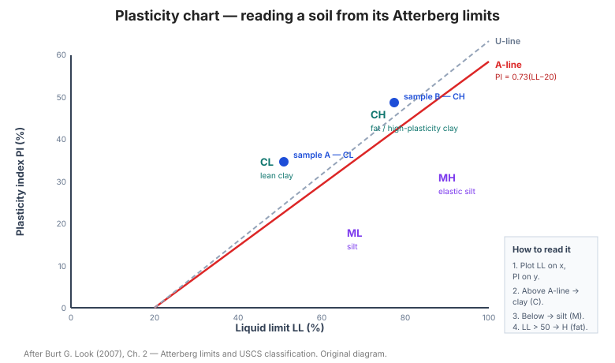

# Chương 2 — Phân loại đất

Chương này quy chuẩn cách **mô tả và phân loại đất** trong biên bản hố khoan — nền
tảng ngôn ngữ chung giữa người khoan hiện trường, phòng thí nghiệm và người thiết kế.
Chất lượng phân loại quyết định chất lượng của mọi hệ thức tương quan dùng ở các
chương sau.

**Hình.** Biểu đồ dẻo (Casagrande): đọc loại đất từ giới hạn chảy LL và chỉ số dẻo PI, phân biệt sét (trên đường A) với bụi (dưới đường A).

## 2.1 Biên bản hố khoan đất

Bảng của mục này quy định **các cột thông tin** phải có trong biên bản hố khoan:
số hiệu hố, cao độ, chiều sâu, mô tả đất, chỉ tiêu thí nghiệm hiện trường, mực nước
ngầm, ngày khoan và người thực hiện.

**Bảng 2.1 — Các cột thông tin trong biên bản hố khoan.**

| Cột thông tin | Nội dung |
|---|---|
| Nhận dạng | Số hiệu hố khoan, dự án, vị trí, cao độ miệng hố |
| Hình học | Chiều sâu khoan, cao độ đáy, đường kính |
| Mô tả đất | Tên đất, màu, độ ẩm, độ chặt, cấu trúc |
| Chỉ tiêu hiện trường | Số búa SPT, độ sâu lấy mẫu, ký hiệu mẫu |
| Nước ngầm | Độ sâu mực nước trong và sau khi khoan |
| Hành chính | Ngày khoan, thiết bị, người thực hiện |

## 2.2 Biên bản hố khoan tại hiện trường

Phân biệt biên bản **ghi tại hiện trường** (ngay khi khoan) với biên bản **hoàn
chỉnh tại văn phòng**. Mục này nhấn mạnh rằng mô tả phải được ghi tại hiện trường —
mẫu để lâu sẽ thay đổi độ ẩm và mất cấu trúc.

## 2.3 Thông tin khoan

Bảng của mục này liệt kê thông tin khoan cần ghi: loại thiết bị, đường kính, phương
pháp khoan, chiều sâu, mức từ chối, lượng nước rửa, và tỷ lệ thu hồi mẫu.

**Bảng 2.3 — Thông tin khoan cần ghi.**

| Thông tin | Ghi chú |
|---|---|
| Loại thiết bị | Giàn khoan, loại mũi (guồng xoắn, nón xoay, kim cương) |
| Đường kính | Đường kính lỗ khoan và đường kính mẫu |
| Phương pháp khoan | Xoay, xung kích, rửa; loại dung dịch khoan |
| Chiều sâu | Chiều sâu từng đoạn và tổng chiều sâu |
| Mức từ chối | Độ sâu và lý do dừng khoan |
| Nước rửa | Loại và lưu lượng |
| Tỷ lệ thu hồi mẫu | Tỷ lệ % trên từng đoạn |

## 2.4 Mực nước

Mực nước phải được đo **sau khi nghỉ** (mực nước ổn định), không phải ngay khi
khoan. Bảng của mục này đưa cách ghi nhận mực nước trong quá trình khoan và sau khi
kết thúc.

**Bảng 2.4 — Cách ghi nhận mực nước.**

| Thời điểm | Cách ghi |
|---|---|
| Trong khi khoan | Độ sâu nước gặp đầu tiên |
| Ngay sau khoan | Độ sâu nước (thường dâng cao do bơm/rửa) |
| Sau khi nghỉ ≥ 24 h | Mực nước ổn định — dùng cho thiết kế |
| Theo mùa | Đo lặp để xác định biên độ dao động |

## 2.5 Loại đất

Phân biệt các loại đất chính (hạt rời / dính, hữu cơ / vô cơ, tự nhiên / đắp) và
cách gọi tên thống nhất.

## 2.6 Thí nghiệm lắng

Thí nghiệm lắng (sedimentation) dùng để ước lượng **thành phần hạt mịn** khi không
thể sàng ướt — dựa trên tốc độ lắng của hạt trong nước theo định luật Stokes.

## 2.7 Phân loại đất thống nhất

Bảng của mục này trình bày hệ **phân loại thống nhất USCS** (Unified Soil
Classification System) — các nhóm ký hiệu (GW, GP, GM, GC, SW, SP, SM, SC, ML, CL,
OL, MH, CH, OH, PT) cùng tiêu chí phân biệt theo cấp phối, giới hạn Atterberg và
hàm lượng hữu cơ.

**Bảng 2.7 — Hệ phân loại đất thống nhất (USCS).**

| Ký hiệu | Tên | Tiêu chí phân biệt |
|---|---|---|
| GW | Sỏi cấp phối tốt | Cu ≥ 4, 1 ≤ Cc ≤ 3, < 5% hạt mịn |
| GP | Sỏi cấp phối kém | Không đạt GW, < 5% hạt mịn |
| GM | Sỏi lẫn bụi | > 12% hạt mịn, hạt mịn là bụi (dưới đường A) |
| GC | Sỏi lẫn sét | > 12% hạt mịn, hạt mịn là sét (trên đường A) |
| SW | Cát cấp phối tốt | Cu ≥ 6, 1 ≤ Cc ≤ 3, < 5% hạt mịn |
| SP | Cát cấp phối kém | Không đạt SW, < 5% hạt mịn |
| SM | Cát lẫn bụi | > 12% hạt mịn, hạt mịn là bụi |
| SC | Cát lẫn sét | > 12% hạt mịn, hạt mịn là sét |
| ML | Bụi vô cơ, độ dẻo thấp | LL < 50, dưới đường A |
| CL | Sét vô cơ, độ dẻo thấp | LL < 50, trên đường A |
| OL | Bụi hữu cơ, độ dẻo thấp | LL < 50, có hữu cơ |
| MH | Bụi vô cơ, độ dẻo cao | LL ≥ 50, dưới đường A |
| CH | Sét vô cơ, độ dẻo cao | LL ≥ 50, trên đường A |
| OH | Sét/bụi hữu cơ, độ dẻo cao | LL ≥ 50, có hữu cơ |
| PT | Than bùn, hữu cơ cao | Hàm lượng hữu cơ rõ rệt, rất nén được |

## 2.8 Mô tả hạt

Quy định **thuật ngữ mô tả hạt** theo kích thước (sỏi, cát thô/vừa/mịn, bụi, sét)
và theo hình dạng (góc cạnh, bán góc cạnh, tròn cạnh).

## 2.9 Độ hạt (cấp phối)

Bảng của mục này đưa cách mô tả **cấp phối** (đều / cấp phối tốt / cấp phối kém) và
các hệ số D60/D10, Cu, Cc.

**Bảng 2.9 — Mô tả cấp phối.**

| Thuật ngữ | Tiêu chí |
|---|---|
| Cấp phối tốt (well graded) | Cu lớn, Cc trong khoảng 1–3 |
| Cấp phối kém (poorly graded) | Hạt đồng đều hoặc thiếu cỡ trung |
| Cấp phối nhảy bậc (gap graded) | Thiếu hẳn một dải cỡ hạt |

Cu = D60 / D10; Cc = (D30)² / (D10 · D60).

## 2.10 Màu sắc

Màu sắc là chỉ dấu rẻ tiền nhưng hữu ích: đất sẫm màu thường có hữu cơ hoặc đã từng
bão hòa nước; đất có vệt nâu–vàng–xám chỉ ra các mức oxy hóa khử khác nhau (xem
[Chương 7](chapter-07-soil-properties-state.md), mục 7.4).

## 2.11 Độ dẻo của đất

Độ dẻo được mô tả theo chỉ số dẻo (PI) và được liên hệ với thành phần khoáng sét
(xem mục 7.5).

## 2.12 Giới hạn Atterberg

Bảng của mục này đưa **giới hạn chảy (LL)**, **giới hạn dẻo (PL)** và **chỉ số dẻo
(PI = LL − PL)** điển hình cho các loại đất, cùng cách diễn giải trên biểu đồ dẻo
Casagrande (đường A).

**Bảng 2.12 — Giới hạn Atterberg điển hình theo loại đất.**

| Loại đất | LL (%) | PL (%) | PI = LL − PL |
|---|---|---|---|
| Cát | — | — | Không dẻo |
| Bụi | 20–35 | 15–25 | < 10 |
| Sét dẻo thấp (CL) | 30–50 | 15–25 | 10–20 |
| Sét dẻo trung bình | 50–70 | 20–30 | 20–35 |
| Sét dẻo cao (CH) | 70–100 | 25–40 | > 35 |
| Sét trương nở (montmorillonit) | > 100 | 30–50 | > 60 |

## 2.13 Cấu trúc

Mô tả **cấu trúc đất**: phân lớp, khe nứt, cấu trúc tổ ong, cấu trúc nguyên dạng,
thấu kính, và các đặc trưng thứ sinh như vết trượt (slickenside).

## 2.14 Độ chặt (trạng thái) của đất dính

Bảng của mục này liên hệ **độ chặt** với **cường độ kháng nén một trục qu** và
**cường độ kháng cắt không thoát nước Cu**: rất mềm, mềm, dẻo cứng (firm), cứng,
rất cứng, rắn.

**Bảng 2.14 — Độ chặt (trạng thái) của đất dính.**

| Mô tả | qu (kPa) | Cu (kPa) | N (SPT) điển hình |
|---|---|---|---|
| Rất mềm | < 25 | < 12 | ≤ 2 |
| Mềm | 25–50 | 12–25 | 2–5 |
| Dẻo cứng (firm) | 50–100 | 25–50 | 5–10 |
| Cứng | 100–200 | 50–100 | 10–20 |
| Rất cứng | 200–400 | 100–200 | 20–40 |
| Rắn | > 400 | > 200 | > 40 |

Cu = qu / 2.

## 2.15 Độ chặt (trạng thái) của đất không dính

Với đất hạt rời, "độ chặt" được mô tả theo **độ chặt tương đối Dr** hoặc theo chỉ số
xuyên tiêu chuẩn N (xem [Chương 4](chapter-04-field-sampling-testing.md) và
[Chương 5](chapter-05-soil-strength.md)).

## 2.16 Độ ẩm

Bảng của mục này liên hệ **độ ẩm tự nhiên** với trạng thái đất và với độ ẩm tối ưu
đầm chặt, giúp đánh giá nhanh tính thi công.

**Bảng 2.16 — Độ ẩm tự nhiên và tính thi công.**

| Trạng thái | Độ ẩm tự nhiên (so với OMC) | Tính thi công |
|---|---|---|
| Khô | < 0,8 × OMC | Cần thêm nước mới đầm chặt được |
| Gần tối ưu | 0,9–1,1 × OMC | Đầm chặt tốt nhất |
| Ướt | 1,1–1,3 × OMC | Khó đầm, cần thoát nước |
| Bão hòa / nhão | > 1,3 × OMC | Không đầm được |

OMC = độ ẩm tối ưu (optimum moisture content).

## 2.17 Nguồn gốc

Nguồn gốc địa chất (tàn tích, trầm tích sông, biển, gió, băng hà, hữu cơ) quyết định
tính chất kỹ thuật và mức độ biến đổi theo phương ngang của đất.

## 2.18 Phân loại đất tàn tích theo dạng tồn tại chính

Đất tàn tích (residual soil) được phân loại theo **dạng tồn tại chính** của nó —
tại chỗ, vận chuyển cục bộ, hoặc lắng đọng — vì điều này chi phối cấp phối và độ
đồng nhất của khối đất.

## Ghi nhớ của chương

- Biên bản hố khoan là **ngôn ngữ chung**; phân loại sai làm sai toàn bộ chuỗi hệ
  thức tương quan phía sau.
- **Mực nước phải đo sau khi nghỉ**, không đo ngay khi khoan.
- **USCS** (mục 2.7) là hệ phân loại chuẩn dùng xuyên suốt cuốn sách.
- **Độ chặt và độ ẩm** là hai chỉ tiêu mô tả nhanh giá trị nhất tại hiện trường.
