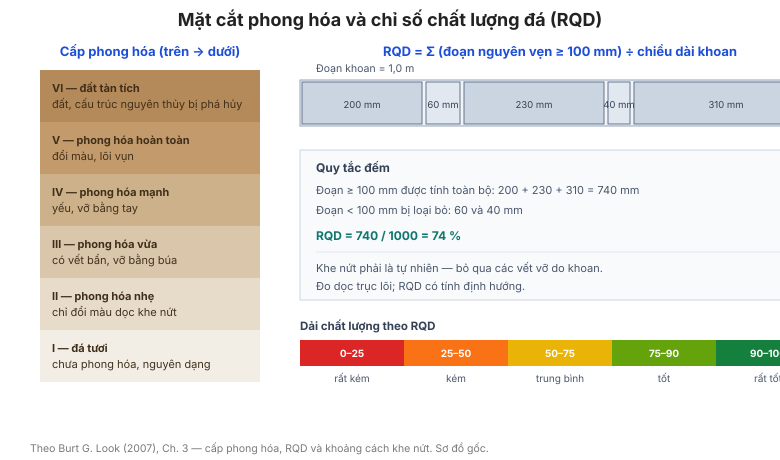

# Chương 3 — Phân loại đá

Chương này làm với đá điều mà [Chương 2](chapter-02-soil-classification.md) làm với
đất: quy chuẩn cách **mô tả, phân loại và đánh giá cường độ đá** ngay tại hiện
trường và trong biên bản lõi khoan.

**Hình.** Mặt cắt phong hóa (cấp I–VI) và cách tính chỉ số chất lượng đá RQD từ tổng chiều dài các đoạn lõi khoan nguyên vẹn ≥ 100 mm.

## 3.1 Mô tả đá

Bảng của mục này quy định trình tự mô tả đá: **độ mạnh (strength) → cấp phong hóa →
màu → kích thước hạt/kết tinh → cấu trúc → tên đá**, kèm các thuật ngữ chuẩn.

**Bảng 3.1 — Trình tự mô tả đá.**

| Thứ tự | Đặc trưng |
|---|---|
| 1 | Độ mạnh (cường độ) |
| 2 | Cấp phong hóa |
| 3 | Màu |
| 4 | Kích thước hạt / mức kết tinh |
| 5 | Cấu trúc (phân lớp, khe nứt) |
| 6 | Tên đá |

## 3.2 Biên bản lõi khoan đá tại hiện trường

Hướng dẫn ghi biên bản lõi khoan: chiều dài đoạn lõi, tỷ lệ thu hồi, RQD, mô tả khe
nứt, góc nghiêng khe nứt so với trục lõi.

## 3.3 Thông tin khoan

Thông tin khoan cần thiết cho đá: loại mũi khoan (kim cương / nón xoay), đường kính
lõi, phương pháp khoan, mức từ chối, và dung dịch khoan.

## 3.4 Phong hóa đá

Bảng của mục này trình bày **thang cấp phong hóa** (từ đá tươi đến đất tàn tích):
tươi (I), phong hóa nhẹ (II), phong hóa vừa (III), phong hóa mạnh (IV), phong hóa
hoàn toàn (V), và đất tàn tích (VI), kèm mô tả nhận dạng cho từng cấp.

**Bảng 3.4 — Thang cấp phong hóa đá.**

| Cấp | Mô tả | Nhận dạng tại hiện trường |
|---|---|---|
| I — Tươi (fresh) | Không có dấu hiệu phong hóa | Đá nguyên dạng, vỡ thành mảnh sắc cạnh |
| II — Phong hóa nhẹ | Phong hóa chỉ dọc theo khe nứt | Đổi màu dọc khe nứt, khối đá còn mạnh |
| III — Phong hóa vừa | Phong hóa xuyên vào khối đá | Đá yếu hơn, mảnh vỡ ngắn hơn |
| IV — Phong hóa mạnh | Phần lớn đã biến thành đất | Còn lõi đá nguyên dạng, có thể vỡ bằng tay |
| V — Phong hóa hoàn toàn | Toàn bộ thành đất | Cấu trúc đá còn thấy, dễ vỡ bằng tay |
| VI — Đất tàn tích | Mất hoàn toàn cấu trúc đá | Đất, không nhận ra đá gốc |

## 3.5 Màu sắc

Màu của đá tươi so với màu dọc theo khe nứt chỉ ra mức độ phong hóa và sự hiện diện
của nước — một chỉ dấu quan trọng khi đánh giá độ bền khối đá.

## 3.6 Cấu trúc đá

Mô tả cấu trúc khối đá: phân lớp, phiến, đá khối, đá dăm, đới dập vỡ, đứt gãy, và
các bất liên tục chính.

## 3.7 Chỉ số chất lượng đá (RQD)

Bảng của mục này giải thích cách tính **RQD** (Rock Quality Designation) — tổng chiều
dài các đoạn lõi nguyên vẹn ≥ 100 mm chia cho chiều dài khoan, biểu diễn bằng phần
trăm — và các ngưỡng phân loại: rất kém (< 25%), kém (25–50%), trung bình (50–75%),
tốt (75–90%), rất tốt (90–100%).

**Bảng 3.7 — Phân loại chất lượng khối đá theo RQD.**

| RQD (%) | Chất lượng khối đá |
|---|---|
| < 25 | Rất kém |
| 25–50 | Kém |
| 50–75 | Trung bình |
| 75–90 | Tốt |
| 90–100 | Rất tốt |

RQD = (tổng chiều dài các đoạn lõi nguyên vẹn ≥ 100 mm) / chiều dài khoan × 100%.

## 3.8 Cường độ đá

Bảng của mục này liên hệ **mô tả bằng mắt/tay** với **cường độ kháng nén một trục
(qu, MPa)**: cực yếu, rất yếu, yếu, trung bình, mạnh, rất mạnh, cực mạnh — theo
thang phân loại quốc tế (ISRM).

**Bảng 3.8 — Cường độ đá theo thang ISRM.**

| Mô tả | qu (MPa) |
|---|---|
| Cực yếu | < 1 |
| Rất yếu | 1–5 |
| Yếu | 5–25 |
| Trung bình | 25–50 |
| Mạnh | 50–100 |
| Rất mạnh | 100–250 |
| Cực mạnh | > 250 |

## 3.9 Độ cứng đá

Độ cứng đá liên quan đến **thang Mohs** và đến khả năng cày xới/đào (xem
[Chương 12](chapter-12-earthworks.md)).

## 3.10 Ảnh hưởng tỷ lệ của khe nứt

Cường độ khối đá giảm khi kích thước khe nứt và mật độ khe nứt tăng so với kích
thước công trình — nguyên lý tỷ lệ (scale effect).

## 3.11 Khoảng cách khe nứt

Bảng của mục này phân loại **khoảng cách khe nứt** (rất gần, gần, trung bình, xa,
rất xa) và liên hệ với chất lượng khối đá.

**Bảng 3.11 — Phân loại theo khoảng cách khe nứt.**

| Mô tả | Khoảng cách | Chất lượng khối đá |
|---|---|---|
| Rất gần | < 60 mm | Rất kém |
| Gần | 60–200 mm | Kém |
| Trung bình | 200–600 mm | Trung bình |
| Xa | 600–2000 mm | Tốt |
| Rất xa | > 2000 mm | Rất tốt |

## 3.12 Mô tả khe nứt

Quy định mô tả khe nứt theo các đặc trưng: **độ nhám, độ gồ ghề (waviness), vật liệu
lấp đầy, độ mở, độ phong hóa, và độ ẩm**.

## 3.13 Ký hiệu khe nứt

Bảng của mục này đưa bộ **ký hiệu chuẩn** dùng trên biên bản và bản vẽ để thể hiện
phương, hướng dốc và loại khe nứt.

**Bảng 3.13 — Các thuộc tính khe nứt cần ghi trong biên bản.**

| Thuộc tính | Cách ghi |
|---|---|
| Phương (dip direction) | Góc phương vị 000–360° |
| Góc dốc (dip) | 0–90° |
| Độ mở | Kín / mở, kèm chiều rộng ước lượng |
| Vật liệu lấp đầy | Canxit, thạch anh, sét, không có |
| Độ nhám / độ gồ ghề | Mô tả hoặc thang R1–R6 |
| Mức phong hóa mặt khe | Tươi đến phong hóa mạnh |
| Độ ẩm khe | Khô, ẩm, chảy |

## 3.14 Các loại đá trầm tích và pyroclastic

Bảng phân loại và mô tả các loại đá trầm tích (cát kết, bột kết, sét kết, đá vôi,
sạn kết) và đá núi lửa vụn (tuff, breccia), kèm tính chất kỹ thuật điển hình.

**Bảng 3.14 — Đá trầm tích và đá núi lửa vụn.**

| Đá | Thành phần | Tính chất kỹ thuật điển hình |
|---|---|---|
| Cát kết (sandstone) | Hạt cát gắn kết | Cường độ trung bình, phụ thuộc chất gắn kết |
| Bột kết (siltstone) | Hạt bụi gắn kết | Yếu hơn cát kết, dễ phong hóa |
| Sét kết (mudstone/shale) | Sét gắn kết | Yếu, dễ nứt, dễ trương |
| Đá vôi (limestone) | Canxit | Hòa tan trong nước axit, có thể có hang |
| Sạn kết (conglomerate) | Sỏi cuội gắn kết | Biến thiên mạnh theo chất gắn kết |
| Tuff | Tro núi lửa gắn kết | Nhẹ, cường độ yếu–trung bình |
| Breccia | Mảnh vụn góc cạnh | Biến thiên, phụ thuộc chất gắn kết |

## 3.15 Các loại đá biến chất và magma

Bảng phân loại đá biến chất (gneiss, schist, đá phiến, quarzit, đá hoa) và đá magma
(granit, bazan, gabro, ryolit), kèm tính chất kỹ thuật điển hình và cường độ.

**Bảng 3.15 — Đá biến chất và đá magma.**

| Đá | Nguồn gốc | Tính chất kỹ thuật điển hình |
|---|---|---|
| Gneiss | Biến chất cao | Mạnh, có cấu tạo phiến |
| Schist | Biến chất trung bình | Dễ tách phiến, cường độ định hướng |
| Đá phiến (slate) | Biến chất thấp | Tách phiến mạnh |
| Quarzit | Cát kết biến chất | Rất mạnh, bền |
| Đá hoa (marble) | Đá vôi biến chất | Mạnh, hòa tan trong axit |
| Granit | Magma xâm nhập | Rất mạnh, dạng khối |
| Bazan | Magma phun trào | Mạnh, có thể phân cột |
| Gabro | Magma xâm nhập mafic | Mạnh, nặng |
| Ryolit | Magma phun trào felsic | Mạnh, giòn |

## Ghi nhớ của chương

- **RQD** (mục 3.7) là chỉ số khối đá dùng xuyên suốt cuốn sách — từ móng đá
  ([Chương 22](chapter-22-rock-foundations.md)) đến mái dốc đá
  ([Chương 14](chapter-14-slopes.md)).
- **Cấp phong hóa** (mục 3.4) đi kèm **cường độ** (mục 3.8) là hai mô tả quan trọng
  nhất tại hiện trường.
- Cường độ khối đá phụ thuộc **tỷ lệ** (mục 3.10) — khe nứt quyết định ứng xử hơn
  cả cường độ đá nguyên khối.
