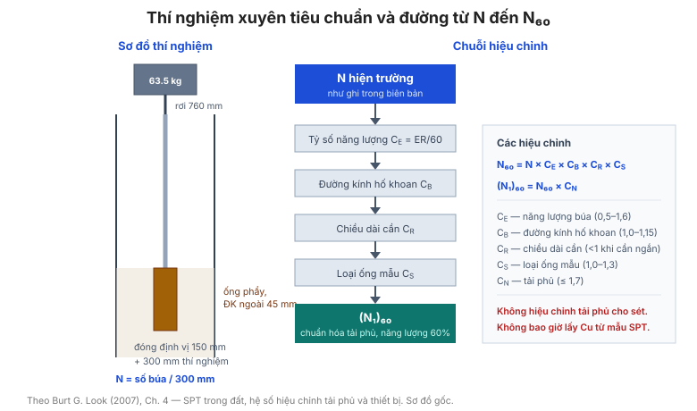

# Chương 4 — Lấy mẫu và thử nghiệm hiện trường

Chương này bàn về **các phương pháp lấy mẫu và thử nghiệm tại chỗ**, và quan trọng
hơn — về **các hệ số hiệu chỉnh** phải áp dụng trước khi dùng kết quả. Đây là chương
giải thích vì sao giá trị SPT "thô" báo trên biên bản hố khoan **không được** đưa
thẳng vào thiết kế.

**Hình.** Thí nghiệm SPT và chuỗi hiệu chỉnh từ N hiện trường về (N₁)₆₀ qua các hệ số năng lượng, đường kính lỗ khoan, chiều dài cần và loại ống mẫu.

## 4.1 Các loại lấy mẫu

Bảng của mục này phân loại mẫu theo **mức độ xáo trộn**: mẫu nguyên dạng (lấy bằng
ống mẫu thành mỏng hoặc mẫu khối), mẫu ít xáo trộn, và mẫu xáo trộn (từ ống phẩy
tiêu chuẩn).

**Bảng 4.1 — Phân loại mẫu theo mức xáo trộn.**

| Loại mẫu | Phương pháp | Mức xáo trộn | Dùng cho |
|---|---|---|---|
| Nguyên dạng | Mẫu khối, ống thành mỏng | Không / ít | Cường độ, nén cố kết |
| Ít xáo trộn | Ống mẫu piston | Ít–vừa | Cường độ, nén cố kết |
| Xáo trộn | Ống phẩy tiêu chuẩn (SPT) | Nhiều | Phân loại, chỉ số |
| Hoàn toàn xáo trộn | Khoan rửa, guồng xoắn | Rất nhiều | Nhận dạng lớp |

## 4.2 Các loại khoan

Bảng của mục này liệt kê các phương pháp khoan (khoan guồng xoắn, khoan rửa, khoan
xung kích, khoan kim cương) và phạm vi đất đá phù hợp với từng loại.

**Bảng 4.2 — Các phương pháp khoan và phạm vi phù hợp.**

| Phương pháp | Phù hợp với |
|---|---|
| Guồng xoắn (auger) | Đất mềm đến dẻo cứng, trên mực nước ngầm |
| Khoan rửa (wash boring) | Đất hạt rời, phân loại nhanh |
| Xung kích (percussive) | Sỏi, cuội, đá phong hóa |
| Khoan kim cương (diamond) | Đá, lấy lõi liên tục |
| Khoan nón xoay (TC bit) | Đất cứng, đá mềm |

## 4.3 Lấy mẫu hiện trường

Hướng dẫn lấy mẫu: vị trí, độ sâu, ký hiệu mẫu, bảo quản và vận chuyển về phòng thí
nghiệm, cùng thời gian tối đa từ lấy mẫu đến thí nghiệm.

## 4.4 Thử nghiệm hiện trường

Bảng của mục này liệt kê các thí nghiệm tại chỗ phổ biến (SPT, CPT, DMT, áp kế
máy nén ngang, cắt cánh vane) và đại lượng mà mỗi thí nghiệm đo được.

**Bảng 4.4 — Các thí nghiệm hiện trường và đại lượng đo được.**

| Thí nghiệm | Đại lượng đo được |
|---|---|
| SPT | Số búa N, mẫu xáo trộn |
| CPT | qc, fs, u |
| DMT | p0, p1, p2 |
| Áp kế (pressuremeter) | pL, EM |
| Cắt cánh (vane) | Cu của sét mềm |
| Địa vật lý (seismic) | Vs, Vp |

## 4.5 So sánh các thí nghiệm tại chỗ

Bảng so sánh các thí nghiệm theo **chi phí, độ tin cậy, loại đất phù hợp** và thông
số suy ra được — giúp chọn thí nghiệm theo câu hỏi thiết kế.

**Bảng 4.5 — So sánh các thí nghiệm tại chỗ.**

| Thí nghiệm | Chi phí | Độ tin cậy | Loại đất phù hợp | Thông số suy ra |
|---|---|---|---|---|
| SPT | Thấp | Trung bình | Đa số đất, kể cả sỏi | Dr, φ, Cu, E |
| CPT | Trung bình | Cao | Cát, bụi, sét mềm | Phân loại, φ, Cu, OCR, E |
| DMT | Trung bình | Cao | Sét, bụi, cát | K₀, OCR, E, Cu |
| Áp kế (pressuremeter) | Cao | Cao | Đất hạt rời, đá mềm | E, pL, K₀ |
| Cắt cánh (vane) | Thấp | Trung bình | Sét mềm | Cu |

## 4.6 Thí nghiệm xuyên tiêu chuẩn trong đất (SPT)

Quy trình SPT: ống phẩy tiêu chuẩn, búa 63,5 kg rơi 760 mm, đếm số búa cho 300 mm
xuyên cuối. Bảng của mục này liên hệ **N** với **độ chặt tương đối** và **góc ma
sát** (chi tiết ở [Chương 5](chapter-05-soil-strength.md)).

**Bảng 4.6 — Liên hệ N với độ chặt tương đối và góc ma sát.**

| Độ chặt tương đối | N hiện trường | Dr | φ (cát sạch) |
|---|---|---|---|
| Rất rời | ≤ 4 | < 15% | < 28° |
| Rời | 4–10 | 15–35% | 28–30° |
| Chặt vừa | 10–30 | 35–65% | 30–40° |
| Chặt | 30–50 | 65–85% | 40–45° |
| Rất chặt | > 50 | > 85% | 45–50° |

Chi tiết hệ thức cường độ xem [Chương 5](chapter-05-soil-strength.md).

## 4.7 Thí nghiệm xuyên tiêu chuẩn trong đá

SPT trong đá bị ảnh hưởng mạnh bởi khe nứt và mức từ chối; bảng của mục này đưa cách
diễn giải giá trị N cao trong đá phong hóa.

**Bảng 4.7 — Diễn giải giá trị N cao trong đá phong hóa.**

| Hiện tượng | Diễn giải |
|---|---|
| N tăng đột ngột | Gặp đá hoặc tầng cứng |
| N = 50 (từ chối) | Có thể đá, cuội, hoặc lớp rất chặt |
| N cao nhưng thu hồi mẫu thấp | Nghi ngờ đá nứt hoặc cuội — kiểm tra bằng khoan lõi |
| N cao trong "đất" | Xác minh lại mô tả đất và mức từ chối |

## 4.8 Hệ số hiệu chỉnh theo tải phủ cho kết quả SPT

**Hệ số hiệu chỉnh áp lực tải phủ Cn** đưa N về ứng suất thẳng đứng hữu hiệu chuẩn
100 kPa, cho ra **N₁ = Cn · N**. Bảng của mục này đưa công thức Cn và bảng tra theo
độ sâu/ứng suất.

**Bảng 4.8 — Hệ số hiệu chỉnh áp lực tải phủ Cn.**

| σ′v (kPa) | Cn (xấp xỉ) |
|---|---|
| 25 | 1,4 |
| 50 | 1,2 |
| 100 | 1,0 |
| 200 | 0,85 |
| 400 | 0,7 |

Cn ≈ √(100 / σ′v), giới hạn Cn ≤ 1,7 (Liao & Whitman); N₁ = Cn · N.

## 4.9 Hệ số hiệu chỉnh thiết bị và hố khoan cho kết quả SPT

Bảng của mục này liệt kê các hiệu chỉnh **năng lượng búa (CE)**, **đường kính hố
khoan (CB)**, **chiều dài cần (CR)** và **loại ống lấy mẫu (CS)**, cho ra giá trị
**N₆₀ = N · (CE·CB·CR·CS)** dùng cho mọi hệ thức tương quan.

**Bảng 4.9 — Các hệ số hiệu chỉnh thiết bị và hố khoan.**

| Hệ số | Ý nghĩa | Giá trị điển hình |
|---|---|---|
| CE | Năng lượng búa | 0,5–1,0 (búa an toàn 0,6–0,8) |
| CB | Đường kính hố khoan | 1,0 cho 65–115 mm, giảm khi lớn hơn |
| CR | Chiều dài cần | 1,0 cho 3–4 m; 0,75 khi < 3 m |
| CS | Loại ống lấy mẫu | 1,0 (có lót); 1,1–1,3 (không lót) |

N₆₀ = N · (CE · CB · CR · CS).

## 4.10 Thí nghiệm xuyên nón (CPT)

Bảng của mục này đưa cách đọc **sức kháng nón qc**, **ma sát thành fs**, **tỷ số ma
sát FR = fs/qc**, và **áp lực lỗ rỗng u** — dùng để phân loại đất và suy ra thông số
(xem [Chương 5](chapter-05-soil-strength.md)).

**Bảng 4.10 — Các đại lượng đọc từ thí nghiệm CPT.**

| Đại lượng | Ký hiệu | Ý nghĩa |
|---|---|---|
| Sức kháng nón | qc | Cường độ xuyên của đầu nón |
| Ma sát thành | fs | Ma sát bên của ống |
| Tỷ số ma sát | FR = fs / qc | Chỉ số phân loại đất |
| Áp lực lỗ rỗng | u | Đo bằng piezocone (CPTu) |

## 4.11 Thí nghiệm áp kế màng (DMT)

Bảng của mục này đưa các chỉ số **A, B, C** (p0, p1, p2) và các chỉ số dẫn xuất
**ID (vật liệu)**, **KD (ứng suất ngang)**, **ED (mô đun)**.

**Bảng 4.11 — Các chỉ số của thí nghiệm DMT.**

| Chỉ số | Định nghĩa | Ý nghĩa |
|---|---|---|
| A | p0 | Áp lực tiếp xúc màng |
| B | p1 | Áp lực mở rộng màng |
| C | p2 | Áp lực đóng màng |
| ID | (p1 − p0) / (p0 − u0) | Chỉ số loại vật liệu |
| KD | (p0 − u0) / σ′v | Chỉ số ứng suất ngang |
| ED | 34,7 × (p1 − p0) | Mô đun DMT |

## 4.12 Thí nghiệm áp kế (pressuremeter)

Thí nghiệm nén ngang đo **áp lực giới hạn pL** và **mô đun áp kế EM** — phù hợp
với đất hạt rời và đá mềm.

## 4.13 Cắt cánh (vane shear)

Thí nghiệm cắt cánh đo **cường độ kháng cắt không thoát nước Cu** tại chỗ trong sét
mềm — nhanh, rẻ, và không lấy mẫu.

## 4.14 Hệ số hiệu chỉnh cắt cánh

Bảng của mục này đưa **hệ số hiệu chỉnh μ** theo chỉ số dẻo (Bjerrum), vì cắt cánh
đo cường độ khác với cường độ "dài hạn" dùng trong thiết kế: **Cu(thiết kế) = μ ·
Cu(vane)**.

**Bảng 4.14 — Hệ số hiệu chỉnh cắt cánh theo chỉ số dẻo (Bjerrum).**

| PI (%) | μ |
|---|---|
| 20 | 1,0 |
| 30 | 0,9 |
| 40 | 0,85 |
| 50 | 0,8 |
| 60 | 0,75 |
| 80 | 0,7 |
| ≥ 100 | 0,65 |

Cu(thiết kế) = μ · Cu(vane).

## 4.15 Thí nghiệm xuyên nón động (DCP)

DCP có năng lượng bằng khoảng **1/3** SPT nhưng hình dạng nón ít ma sát hơn ống
phẩy. Bảng của mục này liên hệ **n (số búa/100 mm)** với cường độ (xem mục 5.10).

**Bảng 4.15 — Liên hệ số búa DCP với cường độ tương đối.**

| n (búa / 100 mm) | Cường độ tương đối |
|---|---|
| 0–3 | Rất yếu |
| 3–6 | Yếu |
| 6–10 | Trung bình |
| 10–20 | Cứng |
| > 20 | Rất cứng / từ chối |

## 4.16 Cường độ bề mặt từ đi bộ khảo sát

Bảng của mục này đưa cách **ước lượng cường độ bề mặt** bằng dấu giày, dấu bánh xe
và dấu thiết bị — một công cụ rẻ tiền để đánh giá nhanh tính thi công.

**Bảng 4.16 — Ước lượng cường độ bề mặt từ dấu giày.**

| Dấu hiệu | Cường độ bề mặt tương đối |
|---|---|
| Không để lại dấu | Rất cứng |
| Dấu mờ | Cứng |
| Dấu rõ, giày lún nhẹ | Trung bình |
| Lún sâu vài cm | Mềm |
| Lún > 5 cm | Rất mềm |

## 4.17 Cường độ bề mặt từ xe chạy qua

Bảng liên hệ **vết bánh xe** với cường độ bề mặt và loại đất, dùng cho khảo sát sơ
bộ đường và nền đường.

**Bảng 4.17 — Ước lượng cường độ từ vết bánh xe.**

| Vết bánh xe | Cường độ bề mặt |
|---|---|
| Không có vết | Cứng, chịu tải tốt |
| Vết nông, ổn định | Trung bình |
| Vết sâu, đất đùn lên | Yếu |
| Bánh lún, xe không qua được | Rất yếu |

## 4.18 Vận hành thiết bị đào đất

Bảng của mục này liên hệ **loại đất/đá** với **phương pháp đào** phù hợp (máy đào,
máy ủi, cày xới, nổ mìn) và năng suất điển hình (xem
[Chương 12](chapter-12-earthworks.md)).

**Bảng 4.18 — Liên hệ loại vật liệu với phương pháp đào.**

| Vật liệu | Phương pháp đào phù hợp |
|---|---|
| Đất rời, mềm | Máy đào, máy ủi thông thường |
| Đất dính, cứng | Máy đào lực lớn, cày xới (ripper) |
| Đá phong hóa mạnh | Cày xới, búa thủy lực |
| Đá mềm–trung bình | Búa thủy lực, nổ mìn nhẹ |
| Đá mạnh | Nổ mìn |

Năng suất đào xem [Chương 12](chapter-12-earthworks.md).

## Ghi nhớ của chương

- **Không dùng N thô.** Luôn hiệu chỉnh về **N₆₀** (mục 4.8–4.9) trước khi áp dụng
  bất kỳ hệ thức tương quan nào.
- **Hiệu chỉnh cắt cánh** (mục 4.14) là bắt buộc — bỏ qua sẽ thiết kế quá thiên về
  an toàn.
- Chọn thí nghiệm theo **câu hỏi thiết kế**, không theo thói quen.
