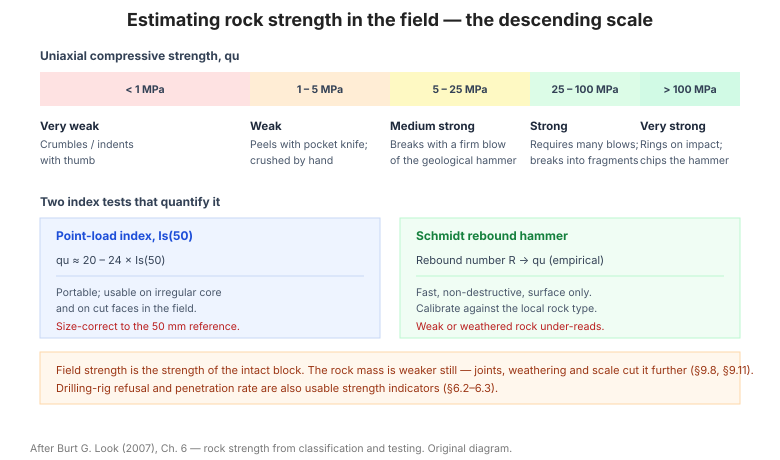

# Chương 6 — Thông số cường độ đá từ phân loại và thử nghiệm

Chương này là bản đối ứng với [Chương 5](chapter-05-soil-strength.md) nhưng cho đá:
cách suy **cường độ và thông số khối đá** từ mô tả hiện trường, từ mức từ chối của
giàn khoan, từ chỉ số tải trọng điểm và từ búa Schmidt.

**Hình.** Thang đánh giá cường độ đá tại hiện trường theo mô tả bằng tay và búa, kèm hai thí nghiệm chỉ số: point load và búa Schmidt.

## 6.1 Cường độ đá

Bảng của mục này liên hệ **mô tả bằng mắt** với **cường độ kháng nén một trục qu**
(MPa), theo thang ISRM: cực yếu (< 1), rất yếu (1–5), yếu (5–25), trung bình (25–50),
mạnh (50–100), rất mạnh (100–250), cực mạnh (> 250).

**Bảng 6.1 — Cường độ đá theo thang ISRM.**

| Mô tả | qu (MPa) |
|---|---|
| Cực yếu | < 1 |
| Rất yếu | 1–5 |
| Yếu | 5–25 |
| Trung bình | 25–50 |
| Mạnh | 50–100 |
| Rất mạnh | 100–250 |
| Cực mạnh | > 250 |

## 6.2 Mức từ chối điển hình của giàn khoan

Bảng của mục này liên hệ **loại giàn khoan** với **cường độ đá** mà nó có thể khoan
tới (mức từ chối) — một chỉ dấu gián tiếp nhưng rẻ tiền về cường độ đá.

**Bảng 6.2 — Mức từ chối điển hình của các loại giàn khoan.**

| Loại giàn | Cường độ đá có thể khoan tới (qu) |
|---|---|
| Guồng xoắn / nón xoay | < 5 MPa |
| Khoan rửa xung kích | 5–25 MPa |
| Khoan kim cương nhẹ | 25–100 MPa |
| Khoan kim cương nặng | > 100 MPa |

## 6.3 Thông số suy ra từ giàn khoan đã dùng

Từ loại giàn, đường kính, tốc độ khoan và mức từ chối, có thể suy ra **dải cường độ
đá** và **tính cày xới**.

## 6.4 Đánh giá cường độ đá tại hiện trường

Bảng của mục này đưa các phép thử hiện trường đơn giản — **búa địa chất, vạch bằng
dao, vỡ bằng tay, đập bằng búa** — và cường độ tương ứng.

**Bảng 6.4 — Đánh giá cường độ đá tại hiện trường.**

| Phép thử | Cường độ tương ứng |
|---|---|
| Vạch được bằng dao | Rất yếu |
| Vỡ được bằng tay | Yếu |
| Đập bằng búa địa chất thì vỡ | Trung bình |
| Phải đập mạnh mới vỡ | Mạnh |
| Không vỡ bằng búa | Rất mạnh |

## 6.5 Cường độ đá từ chỉ số tải trọng điểm

Tương quan chuẩn: **qu ≈ 20–24 × Is(50)** với Is(50) là chỉ số tải trọng điểm đã
hiệu chỉnh về đường kính 50 mm. Bảng của mục này đưa dải hệ số theo loại đá.

**Bảng 6.5 — Hệ số quy đổi từ chỉ số tải trọng điểm Is(50).**

| Loại đá | qu / Is(50) |
|---|---|
| Đá mạnh, giòn | 20–24 |
| Đá mềm, nhiều lỗ rỗng | 15–20 |
| Xấp xỉ chung | 24 |

Is(50) là chỉ số tải trọng điểm đã hiệu chỉnh về đường kính 50 mm.

## 6.6 Cường độ từ búa Schmidt

Bảng của mục này liên hệ **chỉ số nảy búa Schmidt R** với **cường độ kháng nén một
trục qu** cho các loại đá khác nhau, kèm cảnh báo rằng tương quan phụ thuộc mạnh vào
loại đá và phải hiệu chỉnh theo khối lượng riêng.

**Bảng 6.6 — Cường độ từ búa Schmidt.**

| R (chỉ số nảy) | qu (MPa), với γ ≈ 26 kN/m³ |
|---|---|
| 20 | ~29 |
| 30 | ~50 |
| 40 | ~84 |
| 50 | ~143 |
| 60 | ~241 |

Tương quan phụ thuộc mạnh vào loại đá và khối lượng riêng — phải hiệu chỉnh theo γ thực tế.

## 6.7 Thay đổi cường độ tương đối giữa các cấp phong hóa

Bảng của mục này cho **tỷ lệ cường độ** giữa các cấp phong hóa liền kề (ví dụ cấp III
so với cấp II), giúp ngoại suy cường độ khi chỉ có mô tả phong hóa.

**Bảng 6.7 — Tỷ lệ cường độ giữa các cấp phong hóa.**

| Cấp phong hóa | Cường độ tương đối (so với đá tươi) |
|---|---|
| I — Tươi | 1,0 |
| II — Phong hóa nhẹ | 0,8–1,0 |
| III — Phong hóa vừa | 0,4–0,8 |
| IV — Phong hóa mạnh | 0,1–0,4 |
| V — Phong hóa hoàn toàn | 0,02–0,1 |
| VI — Đất tàn tích | < 0,02 |

## 6.8 Thông số từ phong hóa đá

Bảng của mục này liên hệ **cấp phong hóa** với **thông số thiết kế** (cường độ, mô
đun, hệ số ma sát khe nứt) — công cụ hữu ích khi thiếu thí nghiệm.

**Bảng 6.8 — Thông số thiết kế theo cấp phong hóa.**

| Cấp | qu (MPa) | E (GPa) | φ khe nứt |
|---|---|---|---|
| I | > 100 | 50–80 | 35–45° |
| II | 50–100 | 20–50 | 30–40° |
| III | 25–50 | 5–20 | 28–38° |
| IV | 5–25 | 1–5 | 25–35° |
| V | 1–5 | 0,2–1 | 22–32° |

## 6.9 Phân loại đá

Bảng của mục này đưa cách phân loại đá theo **cường độ, cấu trúc và nguồn gốc** để
phục vụ thiết kế móng và mái dốc.

**Bảng 6.9 — Phân loại đá phục vụ thiết kế.**

| Nhóm | Cường độ | Cấu trúc | Ứng dụng |
|---|---|---|---|
| Đá mạnh | qu > 50 MPa | Khối, khe thưa | Móng trực tiếp, vật liệu |
| Đá trung bình | 25–50 MPa | Phân lớp vừa | Móng có kiểm tra |
| Đá yếu | 5–25 MPa | Nứt nhiều | Móng nông, cần xử lý |
| Đá rất yếu | < 5 MPa | Dập vỡ | Xử lý nền |

## 6.10 Cường độ đá từ ổn định mái dốc

Suy ngược **cường độ khối đá** từ việc phân tích ngược một mái dốc đã đứng vững hoặc
đã phá hoại — một phương pháp hiệu chuẩn thực tế mạnh mẽ.

## 6.11 Cường độ đá điển hình theo nhà địa chất hiện trường

Bảng của mục này đối chiếu cách **nhà địa chất hiện trường** thường mô tả cường độ
với giá trị định lượng tương ứng.

**Bảng 6.11 — Cường độ đá điển hình theo nhà địa chất hiện trường.**

| Mô tả | qu (MPa) |
|---|---|
| Rất yếu | < 5 |
| Yếu | 5–25 |
| Trung bình | 25–50 |
| Mạnh | 50–100 |
| Rất mạnh | > 100 |

Cách mô tả của nhà địa chất hiện trường thường **rộng hơn** thực tế ở phía đá mạnh.

## 6.12 Cường độ đá điển hình theo địa chất công trình

Bảng của mục này đối chiếu cách **nhà địa chất công trình** mô tả cường độ với giá
trị định lượng, và so sánh với mục 6.11 để thấy mức chênh lệch giữa hai cách mô tả.

**Bảng 6.12 — Cường độ đá điển hình theo địa chất công trình.**

| Mô tả | qu (MPa) |
|---|---|
| Rất yếu | < 1 |
| Yếu | 1–25 |
| Trung bình | 25–50 |
| Mạnh | 50–100 |
| Rất mạnh | > 100 |

So sánh với mục 6.11 để thấy mức chênh lệch giữa hai cách mô tả.

## 6.13 Cường độ tương đối — các yếu tố kết hợp

Bảng của mục này **kết hợp** nhiều yếu tố (loại đá, phong hóa, khe nứt, độ ẩm) thành
một cường độ tương đối, thay vì xét từng yếu tố riêng lẻ.

**Bảng 6.13 — Cường độ tương đối — các yếu tố kết hợp.**

| Yếu tố | Ảnh hưởng đến cường độ khối đá |
|---|---|
| Loại đá | Nền tảng (cường độ đá nguyên) |
| Phong hóa | Giảm mạnh theo cấp |
| Khe nứt (mật độ, độ nhám) | Giảm mạnh khi khe dày và trơn |
| Độ ẩm | Giảm với đá mềm, đá dễ trương |
| Kích thước công trình | Giảm khi tỷ lệ khe / kích thước tăng |

## 6.14 Thông số từ loại đá

Bảng của mục này đưa **thông số thiết kế điển hình theo loại đá** — cường độ, mô
đun, tỷ số Poisson, trọng lượng đơn vị, góc ma sát khe nứt.

**Bảng 6.14 — Thông số thiết kế điển hình theo loại đá.**

| Loại đá | qu (MPa) | E (GPa) | ν | γ (kN/m³) |
|---|---|---|---|---|
| Granit | 100–250 | 30–70 | 0,2–0,3 | 26–27 |
| Bazan | 100–300 | 30–80 | 0,2–0,3 | 27–30 |
| Đá vôi | 50–150 | 20–60 | 0,25–0,33 | 26–27 |
| Cát kết | 20–80 | 10–40 | 0,2–0,3 | 22–26 |
| Sét kết | 5–40 | 5–20 | 0,25–0,35 | 22–26 |
| Đá phiến | 20–100 | 10–40 | 0,2–0,3 | 26–28 |

## 6.15 Độ bền (durability) của đá

Bảng của mục này đánh giá **độ bền của đá** dưới tác động phong hóa và ẩm ướt–khô
hanh (các phép thử slake durability, hấp phụ nước), quan trọng cho đá dùng làm vật
liệu hoặc làm mái dốc lộ thiên.

**Bảng 6.15 — Độ bền (durability) của đá.**

| Phép thử | Đá bền | Đá không bền |
|---|---|---|
| Slake durability (Id₂) | > 90% | < 60% |
| Hấp phụ nước | Thấp | Cao |
| Chu kỳ ướt–khô | Không vỡ | Vỡ vụn |

Đá mạnh nhưng không bền vẫn phá hoại theo thời gian.

## 6.16 Sử dụng vật liệu

Bảng của mục này liên hệ **loại đá và mức phong hóa** với **mục đích sử dụng** phù
hợp — đá hộc, cấp phối, bê tông, đắp, hoặc loại bỏ.

**Bảng 6.16 — Liên hệ vật liệu đá với mục đích sử dụng.**

| Vật liệu | Mục đích sử dụng phù hợp |
|---|---|
| Đá tươi, mạnh | Đá hộc, cấp phối, cốt liệu bê tông |
| Đá phong hóa nhẹ | Cấp phối, vật liệu đắp |
| Đá phong hóa vừa | Đắp, gia cố |
| Đá phong hóa mạnh / đất tàn tích | Đắp (cần kiểm tra) hoặc loại bỏ |

## Ghi nhớ của chương

- **qu ≈ 20–24 × Is(50)** (mục 6.5) và **búa Schmidt** (mục 6.6) là hai cách suy
  cường độ nhanh tại hiện trường.
- **Cấp phong hóa** quyết định cường độ khối đá nhiều hơn loại đá nguyên khối.
- **Độ bền** (mục 6.15) khác **cường độ** — đá mạnh nhưng không bền vẫn phá hoại
  theo thời gian.
