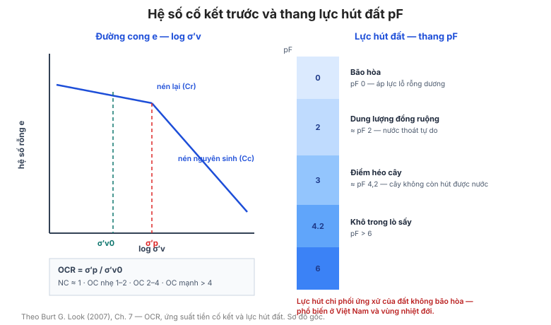

# Chương 7 — Tính chất đất và trạng thái của đất

Chương này bàn về **trạng thái và tính chất nền tảng của đất**: ứng xử, trọng lượng,
độ dẻo, ứng suất hữu hiệu, cố kết trước (OCR), và toàn bộ phần **lực hút đất (soil
suction)** — chủ đề ít được đề cập ở các sổ tay khác.

**Hình.** Hệ số cố kết trước OCR trên đường cong e – log σ′v (nhánh nén lại và nhánh nén nguyên sinh) và thang lực hút đất pF.

## 7.1 Ứng xử của đất

Bảng của mục này đối chiếu **ứng xử điển hình** của đất hạt rời và đất dính dưới
tải trọng, thoát nước và biến dạng — khung khái niệm cho các chương sau.

**Bảng 7.1 — Ứng xử điển hình của đất hạt rời và đất dính.**

| Khía cạnh | Đất hạt rời | Đất dính |
|---|---|---|
| Thoát nước | Thoát nhanh | Thoát chậm |
| Cường độ | Góc ma sát φ | Lực dính c và φ |
| Nén | Ít nén | Nén nhiều, có cố kết |
| Ảnh hưởng của nước | Nhỏ (trừ cát mịn) | Lớn |
| Cường độ theo thời gian | Ổn định | Thay đổi (nhạy, cố kết) |

## 7.2 Trạng thái của đất

Bảng của mục này liên hệ **trạng thái** (rời/chặt, mềm/cứng) với các **thông số
đo được** (N, Cu, độ ẩm, Dr) và với ý nghĩa thiết kế.

**Bảng 7.2 — Trạng thái đất và thông số đo được.**

| Trạng thái | Thông số đo được | Ý nghĩa thiết kế |
|---|---|---|
| Rời | Dr thấp, N thấp | Nguy cơ lún, hóa lỏng |
| Chặt | Dr cao, N cao | Sức chịu tải tốt, lún ít |
| Mềm | Cu thấp, độ ẩm cao | Sức chịu tải thấp |
| Cứng | Cu cao, độ ẩm thấp | Sức chịu tải tốt |

## 7.3 Trọng lượng đất

Bảng của mục này đưa **trọng lượng đơn vị** (kN/m³) điển hình cho các loại đất —
trên mực nước ngầm, dưới mực nước ngầm (đẩy nổi), đất đắp đầm chặt.

**Bảng 7.3 — Trọng lượng đơn vị điển hình của các loại đất.**

| Loại đất | γ trên mực nước ngầm (kN/m³) | γ′ dưới mực nước ngầm (kN/m³) |
|---|---|---|
| Sỏi | 19–21 | 10–12 |
| Cát | 17–20 | 9–11 |
| Bụi | 17–19 | 8–10 |
| Sét mềm | 15–18 | 6–9 |
| Sét cứng | 18–21 | 9–12 |
| Đất đắp đầm chặt | 19–22 | 10–13 |

## 7.4 Ý nghĩa của màu sắc

Bảng của mục này diễn giải **màu sắc đất**: vệt nâu–vàng (oxy hóa, thoát nước tốt),
vệt xám–xanh (khử, bão hòa thường xuyên), đốm (dao động mực nước), và đất sẫm (hữu
cơ) — công cụ đọc lịch sử nước ngầm miễn phí.

**Bảng 7.4 — Ý nghĩa của màu sắc đất.**

| Màu / vệt | Diễn giải |
|---|---|
| Nâu–vàng | Oxy hóa, thoát nước tốt, ở trên mực nước ngầm |
| Xám–xanh | Môi trường khử, bão hòa thường xuyên |
| Đốm loang | Dao động mực nước ngầm theo mùa |
| Sẫm đen | Giàu hữu cơ |

## 7.5 Đặc trưng dẻo của các khoáng sét phổ biến

Bảng của mục này đưa **giới hạn chảy và chỉ số dẻo điển hình** cho kaolinit, illit,
montmorillonit (smectit), và hỗn hợp — giải thích vì sao cùng "đất sét" lại có độ
trương nở rất khác nhau.

**Bảng 7.5 — Đặc trưng dẻo của các khoáng sét phổ biến.**

| Khoáng | LL (%) | PI (%) | Tính trương nở |
|---|---|---|---|
| Kaolinit | 30–60 | 10–25 | Thấp |
| Illit | 60–100 | 20–40 | Trung bình |
| Montmorillonit (smectit) | 100–900 | 50–700 | Rất cao |
| Hỗn hợp | Biến thiên | Biến thiên | Vừa–cao |

## 7.6 Chỉ số dẻo có trọng số

Chỉ số dẻo có trọng số (weighted PI) kết hợp **hàm lượng và độ dẻo của từng loại
khoáng sét**, cho dự báo tốt hơn về tính trương nở và cường độ.

## 7.7 Ảnh hưởng của cấp phối

Bảng của mục này liên hệ **cấp phối (Cu, Cc)** với **tính thi công, độ thấm và cường
độ** của đất đắp.

**Bảng 7.7 — Ảnh hưởng của cấp phối đến tính chất đất đắp.**

| Đặc trưng | Ảnh hưởng |
|---|---|
| Cu cao (cấp phối tốt) | Đầm chặt tốt, cường độ cao, thấm thấp |
| Cu thấp (hạt đều) | Thấm cao, khó đầm chặt |
| Cc trong khoảng 1–3 | Tính thi công tốt |
| Thiếu cỡ trung (gap graded) | Khó đầm, tính chất biến thiên |

## 7.8 Ma sát hữu hiệu của đất hạt rời

Bảng của mục này đưa **góc ma sát hữu hiệu φ′** điển hình theo cấp phối, hình dạng
hạt và độ chặt (bổ sung cho mục 5.7–5.9).

**Bảng 7.8 — Góc ma sát hữu hiệu điển hình.**

| Loại đất | φ′ |
|---|---|
| Sỏi | 34–45° |
| Cát thô | 32–40° |
| Cát trung | 30–36° |
| Cát mịn | 28–34° |
| Bụi | 26–32° |

## 7.9 Cường độ hữu hiệu của đất dính

Bảng của mục này đưa **c′ và φ′** điển hình cho sét cố kết thường và cố kết trước,
và liên hệ với chỉ số dẻo.

**Bảng 7.9 — c′ và φ′ điển hình của đất dính.**

| Loại đất | c′ (kPa) | φ′ |
|---|---|---|
| Sét cố kết thường (NC) | 0–10 | 18–28° |
| Sét cố kết trước (OC) | 5–30 | 20–30° |
| Sét rất cứng | 20–100 | 15–25° |

## 7.10 Hệ số cố kết trước (OCR)

**OCR = σ′p / σ′v**. Bảng của mục này diễn giải các dải OCR (cố kết thường OCR ≈ 1,
cố kết trước nhẹ 1–2, trung bình 2–4, mạnh > 4) và nguyên nhân (bào mòn, băng hà,
khô hạn, tải trọng đã dỡ).

**Bảng 7.10 — Diễn giải các dải OCR.**

| Trạng thái | OCR | Nguyên nhân điển hình |
|---|---|---|
| Cố kết thường | ≈ 1 | Chưa từng chịu tải lớn hơn hiện tại |
| Cố kết trước nhẹ | 1–2 | Bào mòn nhẹ, dao động mực nước |
| Cố kết trước trung bình | 2–4 | Bào mòn, khô hạn |
| Cố kết trước mạnh | > 4 | Băng hà, bào mòn lớn, tải trọng đã dỡ |

OCR = σ′p / σ′v.

## 7.11 Ứng suất tiền cố kết từ CPT

Tương quan **σ′p từ qc và u** (phương pháp Kulhawy–Mayne), cho phép lập hồ sơ OCR
theo độ sâu từ một lần xuyên.

## 7.12 Ứng suất tiền cố kết từ DMT

Bảng của mục này suy **σ′p** từ các chỉ số DMT (p0, p1) cho sét và cho cát.

**Bảng 7.12 — Suy σ′p từ các chỉ số DMT.**

| KD | OCR xấp xỉ (sét) |
|---|---|
| 2 | 1 |
| 4 | 3 |
| 6 | 5,5 |
| 8 | 9 |
| 10 | 12 |

σ′p = OCR × σ′v; quan hệ mang tính xấp xỉ, cần hiệu chỉnh theo địa phương.

## 7.13 Ứng suất tiền cố kết từ vận tốc sóng cắt

Từ **vận tốc sóng cắt Vs** (thí nghiệm seismic CPT, cross-hole, hoặc MASW) suy ra
**σ′p** và **OCR** mà không cần lấy mẫu — hữu ích cho đất khó lấy mẫu.

## 7.14 OCR từ DMT

Bảng của mục này liên hệ **KD** với **OCR** cho sét và bụi.

**Bảng 7.14 — Liên hệ KD với OCR cho sét và bụi.**

| KD | Sét | Bụi |
|---|---|---|
| 2 | 1 | 1 |
| 4 | 3 | 2 |
| 6 | 6 | 4 |
| 8 | 9 | 6 |

Giá trị mang tính xấp xỉ; nên kiểm chứng bằng ít nhất hai phương pháp độc lập.

## 7.15 Áp lực đất ngang từ DMT

Từ **KD** suy ra **K₀** (xem thêm [Chương 19](chapter-19-earth-pressures.md)).

## 7.16 OCR từ tỷ số cường độ không thoát nước và góc ma sát

Bảng của mục này liên hệ **Cu/σ′v** với **OCR** và **φ′** (khung SHANSEP), cho phép
kiểm tra chéo giữa các phương pháp.

**Bảng 7.16 — Liên hệ Cu/σ′v với OCR (khung SHANSEP).**

| OCR | Cu / σ′v điển hình |
|---|---|
| 1 | 0,20–0,25 |
| 2 | 0,35–0,45 |
| 4 | 0,60–0,75 |
| 8 | 1,05–1,30 |

Cu/σ′v = S · OCR^m với S ≈ 0,22 và m ≈ 0,8 cho nhiều loại sét.

## 7.17 OCR từ tỷ số cường độ không thoát nước

Bảng rút gọn: **OCR** suy trực tiếp từ **Cu/σ′v** khi đã biết chỉ số dẻo.

**Bảng 7.17 — Suy OCR trực tiếp từ tỷ số Cu/σ′v.**

| Cu / σ′v | OCR (PI trung bình) |
|---|---|
| 0,2 | 1 |
| 0,3 | 2 |
| 0,4 | 3 |
| 0,5 | 5 |
| 0,7 | 10 |

## 7.18 Các mốc thang hút đất pF

Bảng của mục này đưa **thang pF** (logarit của lực hút tính bằng cm nước) và các mốc
vật lý: bão hòa (pF 0), dung lượng đồng ruộng (~pF 2), điểm héo cây (~pF 4,2), lò
sấy (pF > 6).

**Bảng 7.18 — Các mốc của thang hút đất pF.**

| Trạng thái | pF | Lực hút xấp xỉ (kPa) |
|---|---|---|
| Bão hòa | 0 | 0 |
| Dung lượng đồng ruộng | ~2 | ~10 |
| Điểm héo cây | ~4,2 | ~1.500 |
| Lò sấy (khô hoàn toàn) | > 6 | > 100.000 |

pF = log₁₀ của lực hút tính bằng cm nước.

## 7.19 Giá trị hút đất cho các vật liệu khác nhau

Bảng của mục này đưa **giá trị lực hút điển hình** cho cát, bụi, sét, sét trương nở
ở các trạng thái khác nhau.

**Bảng 7.19 — Giá trị hút đất điển hình theo vật liệu.**

| Vật liệu | Lực hút ở trạng thái điển hình (kPa) |
|---|---|
| Cát | 0–10 |
| Bụi | 10–100 |
| Sét dẻo thấp | 100–500 |
| Sét trương nở | 500–3000 |

## 7.20 Mạch mao dẫn

Bảng của mục này liên hệ **kích thước hạt/lỗ rỗng** với **chiều cao mao dẫn** — yếu
tố quan trọng cho đất trên mực nước ngầm và cho vật liệu thoát nước.

**Bảng 7.20 — Liên hệ kích thước lỗ rỗng với chiều cao mao dẫn.**

| Vật liệu | Kích thước lỗ (mm) | Chiều cao mao dẫn (m) |
|---|---|---|
| Sỏi | > 2 | < 0,03 |
| Cát thô | 0,5–2 | 0,03–0,1 |
| Cát mịn | 0,05–0,5 | 0,1–1 |
| Bụi | 0,005–0,05 | 1–10 |
| Sét | < 0,005 | > 10 |

## 7.21 Hút đất cân bằng tại Úc

Bảng dữ liệu khu vực: **lực hút cân bằng** theo vùng khí hậu và loại đất tại Úc —
một ví dụ về việc lực hút phụ thuộc mạnh vào khí hậu địa phương.

**Bảng 7.21 — Lực hút cân bằng theo vùng khí hậu tại Úc.**

| Vùng khí hậu | Lực hút cân bằng (kPa) |
|---|---|
| Ẩm ướt (ven biển) | 0–50 |
| Bán ẩm | 50–150 |
| Bán khô | 150–300 |
| Khô hạn | 300–600 |

Ví dụ cho thấy lực hút phụ thuộc mạnh vào khí hậu địa phương.

## 7.22 Ảnh hưởng của khí hậu đến biến thiên lực hút

Bảng của mục này liên hệ **biên độ thay đổi lực hút theo mùa** với khí hậu, làm cơ
sở xác định vùng hoạt động.

**Bảng 7.22 — Biên độ biến thiên lực hút theo mùa.**

| Khí hậu | Biên độ theo mùa (kPa) |
|---|---|
| Ẩm | < 50 |
| Bán ẩm | 50–150 |
| Khô hạn | > 150 |

## 7.23 Ảnh hưởng của khí hậu đến vùng hoạt động

**Vùng hoạt động (active zone)** là lớp đất chịu thay đổi độ ẩm theo mùa. Bảng của
mục này đưa **chiều sâu vùng hoạt động điển hình** theo khí hậu và loại đất — cơ sở
cho thiết kế móng nhà nhẹ và mặt đường.

**Bảng 7.23 — Chiều sâu vùng hoạt động điển hình.**

| Khí hậu | Sét trương nở | Sét thường | Cát / bụi |
|---|---|---|---|
| Ôn hòa ẩm | 1,0–1,5 m | 0,8–1,2 m | 0,5–1,0 m |
| Bán khô | 1,5–2,5 m | 1,0–1,8 m | 0,8–1,5 m |
| Khô hạn | 2,5–4,0 m | 1,5–2,5 m | 1,0–2,0 m |

## 7.24 Ảnh hưởng của đầm chặt đến lực hút

Đầm chặt ở độ ẩm khác độ ẩm tối ưu làm thay đổi lực hút và cấu trúc đất, ảnh hưởng
đến độ bền lâu dài của đất đắp — đặc biệt với đất trương nở.

## Ghi nhớ của chương

- **OCR** (mục 7.10–7.17) là thông số trung tâm — nó chi phối K₀, mô đun, cường độ và
  lún. Luôn xác định OCR bằng **ít nhất hai phương pháp độc lập**.
- **Lực hút đất** (mục 7.18–7.24) chi phối ứng xử của đất không bão hòa — phổ biến ở
  Việt Nam và các vùng khí hậu nhiệt đới.
- **Màu sắc** (mục 7.4) là chỉ dấu miễn phí về lịch sử nước ngầm.
