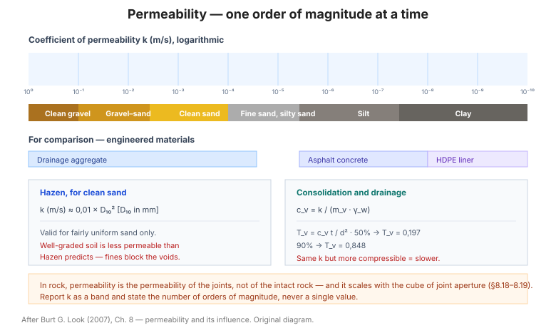

# Chương 8 — Độ thấm và ảnh hưởng của nó

Độ thấm **k** là thông số chi phối dòng chảy, tốc độ cố kết, hạ mực nước ngầm và độ
ổn định thấm của công trình. Chương này gom các **giá trị điển hình** và các **hệ
thức tương quan** giữa độ thấm, cấp phối, phân loại đất và hệ số cố kết cv.

**Hình.** Thang độ thấm theo bậc độ lớn từ sỏi sạch đến sét, so sánh với vật liệu kỹ thuật, kèm quan hệ Hazen và liên hệ với hệ số cố kết.

## 8.1 Giá trị độ thấm điển hình

**Bảng 8.1 — Độ thấm điển hình của các loại đất (m/s).**

| Loại đất | k (m/s) | Đặc điểm thoát nước |
|---|---|---|
| Sỏi sạch | 10⁻¹ – 1 | Thoát nước rất tốt |
| Sỏi lẫn cát | 10⁻³ – 10⁻¹ | Thoát nước tốt |
| Cát sạch, cát sỏi | 10⁻⁵ – 10⁻³ | Thoát nước tốt |
| Cát mịn, cát bụi | 10⁻⁶ – 10⁻⁴ | Thoát nước vừa |
| Bụi, bụi sét | 10⁻⁸ – 10⁻⁶ | Thoát nước kém |
| Sét pha (sét bụi) | 10⁻⁹ – 10⁻⁷ | Gần như không thoát nước |
| Sét đồng nhất | 10⁻¹¹ – 10⁻⁹ | Không thoát nước (trừ khi nứt) |

Một bậc độ lớn của k tương ứng với **hệ số 10** về tốc độ dòng chảy — vì vậy khi
báo cáo độ thấm nên nêu rõ **số bậc độ lớn**, không chỉ giá trị đơn lẻ.

## 8.2 So sánh độ thấm với các vật liệu kỹ thuật

Bảng của mục này đặt **đất tự nhiên** cạnh các **vật liệu nhân tạo** (bê tông, nhựa
đường, màng chống thấm HDPE, bentonit) để thấy rằng đất sét tốt có độ thấm chỉ kém
màng nhân tạo khoảng **3–5 bậc độ lớn** — cơ sở cho các lớp lót tự nhiên.

## 8.3 Độ thấm theo kích thước hạt

Công thức **Hazen** cho cát: **k (cm/s) ≈ 100 × D₁₀²** với D₁₀ tính bằng **cm**.
Dạng tương đương với D₁₀ tính bằng **mm**: **k (m/s) ≈ 0,01 × D₁₀²**.

**Bảng 8.3 — Độ thấm theo D₁₀ (Hazen, cát và cát sỏi).**

| D₁₀ (mm) | k (m/s) | Loại đất điển hình |
|---|---|---|
| 0,05 | 2,5×10⁻⁵ | Cát bụi mịn |
| 0,1 | 1×10⁻⁴ | Cát mịn |
| 0,2 | 4×10⁻⁴ | Cát mịn–trung |
| 0,5 | 2,5×10⁻³ | Cát trung–thô |
| 1,0 | 1×10⁻² | Cát thô, cát sỏi |
| 2,0 | 4×10⁻² | Sỏi cát |

Hazen chỉ đúng với **cát có cấp phối tương đối đều**; cấp phối tốt (Cu lớn) cho độ
thấm **thấp hơn** dự báo vì hạt mịn lấp lỗ rỗng.

## 8.4 Độ thấm theo phân loại đất

Bảng của mục này gắn **nhóm USCS** (GW, GP, SW, SP, SM, SC, ML, CL, CH) với dải độ
thấm điển hình, để đọc nhanh k từ mô tả đất mà không cần thí nghiệm.

## 8.5 Độ thấm từ thí nghiệm tiêu tán

Thời gian tiêu tán 50% áp lực lỗ rỗng (t₅₀) trong **thí nghiệm xuyên nón có đo áp
lực lỗ rỗng (CPTu)** và **áp kế màng (DMT)** tỷ lệ nghịch với độ thấm — cho phép suy
k tại chỗ từ **tốc độ tiêu tán**, hữu ích ở đất bụi–sét khó lấy mẫu.

## 8.6 Ảnh hưởng của áp lực đến độ thấm

Độ thấm **giảm** khi ứng suất hữu hiệu tăng, do lỗ rỗng bị ép lại. Với đất hạt rời
mức giảm nhẹ; với sét mềm, k có thể giảm **một bậc độ lớn** khi ứng suất tăng từ
trạng thái gần mặt đất xuống vài mét sâu.

## 8.7 Độ thấm của sét đầm chặt

Sét đầm chặt ở **độ ẩm ướt hơn tối ưu** có độ thấm **nhỏ hơn nhiều** (có khi 100–1000
lần) so với sét đầm ở **khô hơn tối ưu** — vì cấu trúc đất khác nhau. Đây là điểm
mấu chốt cho lớp lót đầm chặt: kiểm soát **độ ẩm đầm** quan trọng hơn kiểm soát k.

## 8.8 Độ thấm của cốt liệu chưa xử lý và xử lý nhựa đường

Bảng của mục này đưa độ thấm của **cấp phối đá dăm** ở các mức đầm chặt, và cho thấy
**xử lý nhựa đường (asphalt-treated)** giảm độ thấm xuống 2–3 bậc độ lớn — cơ sở cho
lớp móng không thấm.

## 8.9 Phương pháp hạ mực nước theo loại đất

**Bảng 8.9 — Hạ mực nước ngầm theo loại đất.**

| Phương pháp | Sỏi | Cát thô | Cát mịn | Bụi | Sét |
|---|---|---|---|---|---|
| Rãnh hở / mương | ✔ | ✔ | — | — | — |
| Giếng sâu + bơm | ✔ | ✔ | ✔ | — | — |
| Wellpoint (kim hút) | ✔ | ✔ | ✔ | ✔ | — |
| Kim hút chân không | — | ✔ | ✔ | ✔ | — |
| Điện thẩm (electro-osmosis) | — | — | — | ✔ | ✔ |

Việc chọn phương pháp phụ thuộc cả **độ thấm** lẫn **độ hạ mực nước cần thiết**.

## 8.10 Bán kính ảnh hưởng khi hạ mực nước

Công thức **Sichardt**: **R = 3000 · s · √k** với s là độ hạ mực nước (m), k tính bằng
**m/s**, R tính bằng **m**. Bán kính ảnh hưởng quyết định số giếng/kim hút cần thiết.

## 8.11 Giá trị thủy văn điển hình

Bảng của mục này đưa các giá trị **lưu lượng, gradient, độ rỗng hữu hiệu và vận tốc
thấm** điển hình để kiểm tra chéo kết quả tính toán dòng chảy.

## 8.12 Quan hệ giữa hệ số thấm và hệ số cố kết

Hai hệ số liên hệ qua thể tích nén: **cv = k / (mv · γw)**
với mv là hệ số nén thể tích và γw là trọng lượng đơn vị nước.
Nghĩa là **cùng một độ thấm**, đất **nén được hơn** (mv lớn) sẽ cố kết
**chậm hơn**.

## 8.13 Giá trị hệ số cố kết điển hình

**Bảng 8.13 — Hệ số cố kết cv điển hình (m²/năm).**

| Loại đất | cv (m²/năm) |
|---|---|
| Sét mềm, cố kết thường | 0,5 – 5 |
| Sét bụi | 2 – 10 |
| Sét cứng, cố kết trước | 10 – 100 |
| Bụi | 10 – 50 |

## 8.14 Biến thiên cv theo giới hạn chảy

Bảng của mục này liên hệ **cv với LL**: giới hạn chảy càng cao thì đất
càng nén được và cv thường càng **nhỏ** — cho phép ước lượng nhanh cv
từ LL.

## 8.15 Hệ số cố kết từ thí nghiệm tiêu tán

Từ **t₅₀ của CPTu/DMT**, suy **ch** (cố kết theo phương ngang) mà không
cần thí nghiệm nén cố kết trong phòng — hữu ích cho thiết kế **bấc thấm (PVD)**.

## 8.16 Nhân tố thời gian cho cố kết

**Tv = cv · t / d²** với d là đường thoát nước (d = H cho thoát
một mặt, d = H/2 cho thoát hai mặt). Các mốc chuẩn:

| Độ cố kết U | Nhân tố thời gian Tv |
|---|---|
| 10% | 0,008 |
| 50% | 0,197 |
| 90% | 0,848 |
| 95% | 1,129 |

## 8.17 Thời gian cần thiết cho thoát nước của trầm tích

Từ Tv, cv và chiều dày lớp, tính **thời gian cố kết** — cơ sở
quyết định có cần **gia tải trước (surcharge)** hay **bấc thấm** hay không.

## 8.18 Ước lượng độ thấm của đá

Độ thấm của **khối đá nguyên** gần như bằng không; độ thấm thực tế đến từ **khe
nứt**. Bảng của mục này đưa độ thấm điển hình theo **mức độ nứt nẻ và RQD**.

## 8.19 Ảnh hưởng của khe nứt đến độ thấm của đá

Độ thấm do khe nứt tỷ lệ với **lũy thừa ba của độ mở khe (aperture)** — khe mở gấp
đôi → độ thấm tăng khoảng **8 lần**. Bảng của mục này liên hệ **độ mở khe và mật độ
khe** với độ thấm tương đương.

## 8.20 Thí nghiệm Lugeon trong đá

**1 Lugeon = 1 lít/phút trên mét dài dưới áp lực 1 MPa**, tương đương khoảng
**1,3×10⁻⁷ m/s**. Bảng của mục này phân loại **mức độ chống thấm của khối đá** theo
giá trị Lugeon và gợi ý biện pháp **khoan phụt (grouting)**.

## Ghi nhớ của chương

- Độ thấm là **đại lượng theo bậc độ lớn** — hãy báo cáo theo **dải**, không theo một
  con số đơn lẻ.
- **Hazen** (mục 8.3) chỉ dùng cho cát cấp phối tương đối đều; đừng áp dụng cho đất
  cấp phối tốt.
- Trong sét đầm chặt, **kiểm soát độ ẩm đầm** quyết định độ thấm (mục 8.7).
- Trong đá, độ thấm là **độ thấm của khe nứt**, không phải của đá nguyên (mục 8.18–8.20).
