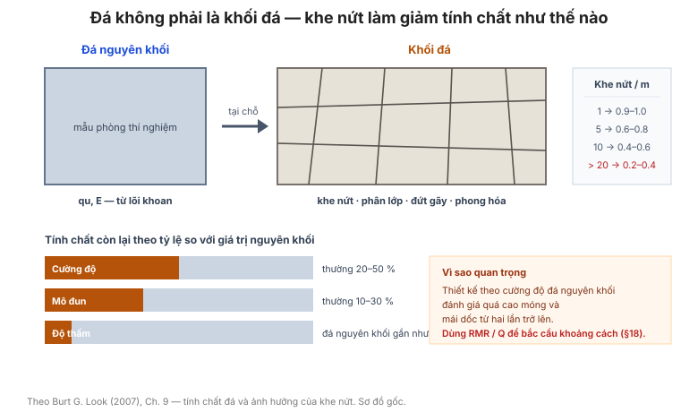

# Chương 9 — Tính chất của đá

Chương này bổ sung cho Chương 6 (cường độ đá từ phân loại và thử nghiệm) bằng **các
tính chất vật lý và cường độ cắt** của đá: trọng lượng, khoáng vật, độ cứng, cường
độ cắt theo vật liệu và theo **nguồn gốc địa chất**, và đặc biệt là **cường độ cắt
của khe nứt**.

**Hình.** Ảnh hưởng của khe nứt: cường độ và mô đun của khối đá chỉ còn một phần nhỏ so với đá nguyên, còn độ thấm lại do khe nứt quyết định.

## 9.1 Tính chất kỹ thuật chung của các loại đá phổ biến

**Bảng 9.1 — Tính chất điển hình (dải rộng do biến thiên tự nhiên).**

| Loại đá | Trọng lượng đơn vị (kN/m³) | qu khô (MPa) | Mô đun đàn hồi E (GPa) |
|---|---|---|---|
| Đá granit (granite) | 26 – 27 | 100 – 250 | 20 – 60 |
| Đá bazan (basalt) | 27 – 30 | 100 – 300 | 40 – 80 |
| Đá vôi (limestone) | 24 – 27 | 30 – 150 | 20 – 60 |
| Đá cát kết (sandstone) | 22 – 26 | 20 – 120 | 10 – 40 |
| Đá bùn (mudstone) | 20 – 24 | 5 – 40 | 2 – 15 |
| Đá phiến sét (shale) | 22 – 26 | 10 – 60 | 5 – 30 |
| Đá phiến (slate) | 26 – 28 | 50 – 150 | 20 – 50 |
| Đá hoa (marble) | 26 – 28 | 50 – 150 | 30 – 60 |
| Đá diệp thạch (gneiss) | 26 – 29 | 50 – 200 | 20 – 60 |

## 9.2 Trọng lượng của đá

Bảng của mục này đưa **trọng lượng đơn vị khô và bão hòa** cho từng nhóm đá, cần cho
tính **ứng suất phủ, tải trọng bản thân của khối đá và áp lực lên tường chắn**.

## 9.3 Khoáng vật của đá

Bảng của mục này liệt kê **khoáng vật tạo đá chính** theo nhóm đá (magma, trầm tích,
biến chất), giúp dự đoán **độ cứng, khả năng phong hóa và độ bền**.

## 9.4 Hàm lượng silica trong đá magma

**Bảng 9.4 — Phân loại đá magma theo hàm lượng SiO₂.**

| Nhóm | SiO₂ (%) | Đá điển hình |
|---|---|---|
| Siêu bazơ | < 45 | Peridotit, đunit |
| Bazơ | 45 – 52 | Gabro, bazan |
| Trung tính | 52 – 66 | Diorit, andesit |
| Axit | > 66 | Granit, ryolit |

Hàm lượng silica **càng cao** thì đá thường **càng cứng và càng giòn**; đá axit cũng
là nguồn **thạch anh tự do** gây **bệnh bụi phổi silic** khi khoan khô.

## 9.5 Thang độ cứng

Thang độ cứng khoáng vật **Mohs (1–10)** và các thang **độ cứng tương đối** dùng
trong mô tả đá tại hiện trường.

## 9.6 Độ cứng của đá

Bảng của mục này liên hệ **độ cứng (Mohs, hoặc thang địa kỹ thuật)** với **cường độ
nén một trục qu** và với **mức từ chối của giàn khoan** — công cụ ước lượng nhanh qu
tại hiện trường.

## 9.7 Phân loại bùn đá – sét phiến theo tỷ lệ khoáng

**Bảng 9.7 — Phân loại theo tỷ lệ sét/khoáng.**

| Tên gọi | Tỷ lệ khoáng sét | Đặc điểm |
|---|---|---|
| Bùn kết (mudstone) | < 1/3 | Giòn, khó bóc lớp |
| Bùn sét (claystone) | 1/3 – 2/3 | Dễ phân lớp |
| Sét phiến (shale) | > 2/3 | Phân lớp mạnh, dễ vỡ theo lớp |

Việc phân biệt này quan trọng vì **đá bùn** chịu được **phong hóa và ngậm nước**
tốt hơn **sét phiến**.

## 9.8 Biến thiên tương đối tính chất đá do khe nứt

**Bảng 9.8 — Tỷ số tính chất (khối đá / đá nguyên) theo mật độ khe nứt.**

| Số khe nứt trên mét | Tỷ số cường độ | Tỷ số mô đun |
|---|---|---|
| 1 | 0,9 – 1,0 | 0,8 – 1,0 |
| 5 | 0,6 – 0,8 | 0,5 – 0,7 |
| 10 | 0,4 – 0,6 | 0,3 – 0,5 |
| > 20 | 0,2 – 0,4 | 0,1 – 0,3 |

Đây là cơ sở của **hệ số giảm khối đá** — cường độ khối đá có thể chỉ bằng
**20–40%** cường độ đá nguyên.

## 9.9 Cường độ đá suy từ góc phá hoại

Từ **góc phá hoại** đo trên mẫu đá vỡ (góc của mặt phá hoại so với trục mẫu), suy ra
**tỷ số cường độ** giữa các phương — dùng để đánh giá **dị hướng (anisotropy)** của
đá phân lớp.

## 9.10 Defect đá và chỉ số chất lượng đá RQD

Bảng của mục này liên hệ **RQD** với **mật độ khe nứt thể tích (Jv)** và với **chất
lượng khối đá** — cầu nối sang Chương 18 (hệ thống phân loại khối đá).

## 9.11 Cường độ đá từ phòng thí nghiệm đến hiện trường

**Bảng 9.11 — Hệ số suy giảm cường độ từ mẫu phòng ra khối đá hiện trường.**

| Điều kiện | Hệ số áp dụng |
|---|---|
| Mẫu phòng, đá nguyên | 1,0 |
| Khối đá ít nứt | 0,5 – 0,7 |
| Khối đá nứt trung bình | 0,2 – 0,5 |
| Khối đá nứt mạnh | 0,05 – 0,2 |

## 9.12 Cường độ cắt và góc ma sát của đá theo vật liệu

Bảng của mục này đưa **c′ và φ** cho **đá nguyên** của từng loại vật liệu — dùng cho
phân tích **ổn định mái dốc đá** và **sức chịu tải móng đá**.

## 9.13 Cường độ cắt của đá từ giá trị RQD

Tương quan **cường độ cắt của khối đá** với **RQD**, cho phép chuyển từ cường độ
mẫu phòng sang cường độ khối đá chỉ bằng một chỉ số dễ đo.

## 9.14 Cường độ cắt và góc ma sát theo nguồn gốc địa chất

Bảng của mục này phân nhóm đá theo **nguồn gốc địa chất** (magma, biến chất, trầm
tích) và đưa **dải c′ và φ** điển hình — hữu ích khi chưa có thí nghiệm.

## 9.15 Góc ma sát của khe nứt đá

**Bảng 9.15 — Góc ma sát đỉnh của khe nứt (đá khô, không lấp nhét).**

| Điều kiện khe nứt | φ (°) |
|---|---|
| Khe mở, mặt nhẵn | 20 – 30 |
| Khe gợn sóng nhẹ | 30 – 35 |
| Khe gợn sóng, mặt nhám | 35 – 45 |
| Khe lấp nhét sét mềm | 15 – 25 |

**Khe nứt có lấp nhét sét** là trường hợp nguy hiểm nhất: φ giảm mạnh và có thể
xuống dưới **20°**.

## 9.16 Góc ma sát của gờ nhám (asperity)

Bảng của mục này đưa **góc ma sát tăng thêm do gờ nhám** (asperity) theo **biên độ
gồ ghề và chiều dài sóng** — cơ sở của tiêu chuẩn **Barton (JRC)**.

## 9.17 Cường độ cắt của khe nứt có lấp nhét

Bảng của mục này đưa **cường độ cắt của vật liệu lấp nhét** (sét, bùi, cát) và chiều
dày lấp nhét ảnh hưởng đến cường độ khe nứt — điểm quyết định trong **ổn định mái
dốc đá**.

## Ghi nhớ của chương

- **Cường độ khối đá ≠ cường độ đá nguyên** — hệ số suy giảm thường chỉ còn
  **20–50%** (mục 9.8, 9.11).
- **Khe nứt có lấp nhét sét** (mục 9.15, 9.17) là điều khiển chính của ổn định mái dốc
  đá — không thể bỏ qua.
- **Hàm lượng silica** (mục 9.4) vừa là chỉ dấu độ cứng vừa là cảnh báo **an toàn lao
  động** (bệnh bụi phổi silic).
- Trọng lượng đơn vị đá (mục 9.2) cần cho tính **ứng suất phủ và áp lực lên tường**.
