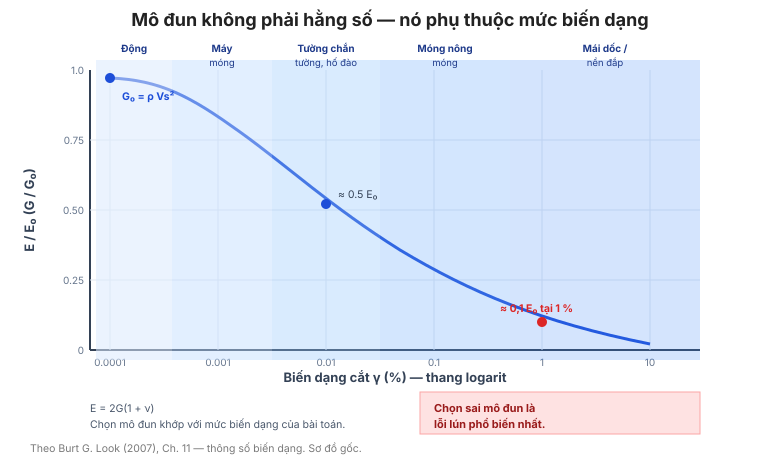

# Chương 11 — Thông số biến dạng

Cường độ quyết định **liệu** công trình có phá hoại; **mô đun biến dạng** quyết định
công trình **biến dạng bao nhiêu**. Chương này gom các định nghĩa mô đun, các giá trị
điển hình, và các hệ thức tương quan SPT/CPT → mô đun cho đất và đá.

**Hình.** Mô đun suy giảm theo mức biến dạng: từ G₀ ở biến dạng rất nhỏ xuống còn khoảng 0,1 E₀ ở biến dạng 1 %, kèm dải biến dạng theo ứng dụng.

## 11.1 Định nghĩa mô đun

**Bảng 11.1 — Các loại mô đun.**

| Ký hiệu | Tên | Định nghĩa / ứng dụng |
|---|---|---|
| E, E′ | Mô đun Young hữu hiệu | Quan hệ ứng suất–biến dạng dọc |
| Eu | Mô đun không thoát nước | Sét dưới tải nhanh (ngắn hạn) |
| G, G₀ | Mô đun trượt (cắt) | Biến dạng nhỏ, động đất |
| M | Mô đun nén một trục (constrained) | Thí nghiệm nén cố kết |
| Eₛ | Mô đun nén (settlement) | Tính lún |
| ν | Hệ số Poisson | Biến dạng ngang/dọc |

Các mô đun liên hệ qua **E = 2G(1 + ν)**. Nhầm lẫn giữa các mô đun này là **nguồn sai
số phổ biến nhất** trong tính lún.

## 11.2 Mô đun trượt biến dạng nhỏ

**G₀ = ρ · Vs²** với ρ là khối lượng riêng và Vs là vận tốc sóng cắt. G₀ là mô đun
**lớn nhất** (đất chưa bị xáo trộn biến dạng), dùng cho **phân tích động đất** và
**móng máy**.

## 11.3 So sánh mô đun biến dạng nhỏ và lớn

**Bảng 11.3 — Tỷ số E/E₀ theo mức biến dạng.**

| Biến dạng (%) | E/E₀ |
|---|---|
| 0,001 | 1,0 |
| 0,01 | 0,8 – 1,0 |
| 0,1 | 0,4 – 0,8 |
| 1,0 | 0,1 – 0,4 |

Mô đun giảm **hàng bậc độ lớn** khi biến dạng tăng từ 0,001% lên 1% — vì vậy **phải
chọn mô đun theo mức biến dạng của bài toán**.

## 11.4 Mức biến dạng theo ứng dụng

**Bảng 11.4 — Mức biến dạng điển hình.**

| Ứng dụng | Biến dạng (%) |
|---|---|
| Móng máy, tải động | 0,001 – 0,01 |
| Tường chắn, hố móng | 0,01 – 0,1 |
| Móng nông thông thường | 0,1 – 1,0 |
| Mái dốc, đắp | 1,0 – 5,0 |

## 11.5 Ứng dụng của mô đun

Bảng của mục này ánh xạ **từng loại mô đun** sang **bài toán thiết kế** tương ứng —
tránh dùng nhầm mô đun nén cố kết cho bài toán tường chắn.

## 11.6 Giá trị điển hình của thông số đàn hồi

**Bảng 11.6 — Thông số đàn hồi điển hình.**

| Vật liệu | E (MPa) | ν |
|---|---|---|
| Sét rất mềm | 0,5 – 2 | 0,45 – 0,5 |
| Sét mềm | 2 – 15 | 0,4 – 0,5 |
| Sét cứng | 15 – 100 | 0,3 – 0,4 |
| Cát rời | 10 – 30 | 0,3 – 0,35 |
| Cát chặt | 30 – 100 | 0,25 – 0,35 |
| Sỏi | 80 – 200 | 0,25 – 0,35 |

## 11.7 Thông số đàn hồi của các loại đất

Bảng của mục này mở rộng Bảng 11.6 cho **đất tàn tích, đất hữu cơ và đất trương
nở** — các loại đất đặc thù.

## 11.8 Giá trị điển hình của hệ số nén thể tích

**Bảng 11.8 — Hệ số nén thể tích mv (m²/MN).**

| Loại đất | mv (m²/MN) |
|---|---|
| Sét rất mềm | 1,0 – 2,0 |
| Sét mềm | 0,5 – 1,0 |
| Sét cứng | 0,05 – 0,2 |
| Bụi | 0,2 – 0,5 |
| Cát | 0,02 – 0,1 |

## 11.9 Hệ số nén thể tích suy từ SPT

Tương quan **mv ≈ 1/(α·N)** (α phụ thuộc loại đất), cho phép ước lượng
lún từ N mà không cần thí nghiệm nén cố kết.

## 11.10 Thông số biến dạng từ kết quả CPT

Bảng của mục này liên hệ **qc với mô đun E′** qua hệ số **α** (E′ = α·qc), với α từ
**2–4** cho sét mềm đến **8–12** cho cát chặt.

## 11.11 Mô đun đất thoát nước từ thí nghiệm xuyên nón

Bảng của mục này đưa **α** theo **loại đất và độ chặt** để tính **mô đun thoát nước**
từ qc.

## 11.12 Mô đun đất trong sét từ giá trị SPT

Tương quan **Eu = α·Cu** với **Eu/Cu = 100–500** — bảng của mục này đưa dải Eu/Cu
theo **OCR và PI**.

## 11.13 Mô đun thoát nước của sét theo cường độ và độ dẻo

Bảng của mục này liên hệ **E′ với Cu và PI** — phương pháp dùng cả cường độ lẫn độ
dẻo để ước lượng mô đun.

## 11.14 Mô đun không thoát nước của sét theo OCR

**Bảng 11.14 — Tỷ số Eu/Cu theo OCR.**

| OCR | Eu/Cu |
|---|---|
| 1 (cố kết thường) | 100 – 200 |
| 2 – 4 | 200 – 400 |
| > 4 (cố kết trước mạnh) | 400 – 1500 |

## 11.15 Mô đun đất từ giá trị SPT và chỉ số dẻo

Bảng của mục này dùng **N và PI** để ước lượng **E′** cho sét — hệ thức tương quan
phổ biến khi chỉ có dữ liệu SPT.

## 11.16 Mô đun ngắn hạn và dài hạn

Bảng của mục này so **mô đun ngắn hạn (không thoát nước)** với **mô đun dài hạn
(thoát nước)** — tỷ số có thể lên tới **2–5 lần** cho sét mềm.

## 11.17 Tỷ số Poisson trong đất

**Bảng 11.17 — Tỷ số Poisson điển hình.**

| Loại đất / điều kiện | ν |
|---|---|
| Sét bão hòa, không thoát nước | 0,5 |
| Sét bão hòa, thoát nước | 0,3 – 0,4 |
| Cát rời | 0,3 – 0,35 |
| Cát chặt | 0,25 – 0,35 |
| Đá | 0,1 – 0,3 |

ν = 0,5 (không thoát nước) nghĩa là **thể tích không đổi** — đặc trưng của sét bão
hòa chịu tải nhanh.

## 11.18 Thông số biến dạng đá điển hình

Bảng của mục này đưa **E và ν** điển hình cho từng loại đá nguyên.

## 11.19 Thông số biến dạng của đá

Bảng của mục này liên hệ **E của đá với cường độ qu và với loại đá** — cho phép ước
lượng E khi chỉ biết qu.

## 11.20 Mô đun khối đá suy từ mô đun đá nguyên

Tương quan **Emass = f(Eintact, RQD)** — mô đun khối đá giảm
mạnh so với đá nguyên (xem Chương 9, mục 9.8).

## 11.21 Tỷ số mô đun theo khe nứt mở và đóng

Bảng của mục này so **mô đun khối đá khi khe nứt mở** với **khi khe nứt đóng** —
khe nứt mở làm mô đun giảm mạnh vì đá chịu nén kém theo phương ngang khe.

## 11.22 Mô đun đá từ hệ thống phân loại khối đá

Từ **RMR hoặc Q** (Chương 18) suy **Emass** — phương pháp chuẩn khi chỉ có
dữ liệu khảo sát đá.

## 11.23 Tỷ số Poisson trong đá

Bảng của mục này đưa **ν** cho từng loại đá; ν đá thường **thấp (0,1–0,3)** so với
đất.

## 11.24 Ý nghĩa của mô đun

Bảng của mục này tóm tắt **khi nào dùng mô đun nào**: mô đun càng lớn (G₀) thì biến
dạng càng nhỏ, và ngược lại — sai lầm chọn mô đun dẫn tới sai số lún có thể **gấp
nhiều lần**.

## Ghi nhớ của chương

- **Chọn đúng mô đun cho đúng mức biến dạng** (mục 11.3–11.5) — đây là nguồn sai số
  phổ biến nhất trong tính lún.
- **G₀ = ρ·Vs²** là mô đun **lớn nhất**; không dùng nó cho bài toán tĩnh lớn.
- **Eu/Cu = 100–500** và tăng theo **OCR** (mục 11.14).
- Trong đá, **mô đun khối đá ≪ mô đun đá nguyên** (mục 11.20–11.22).
