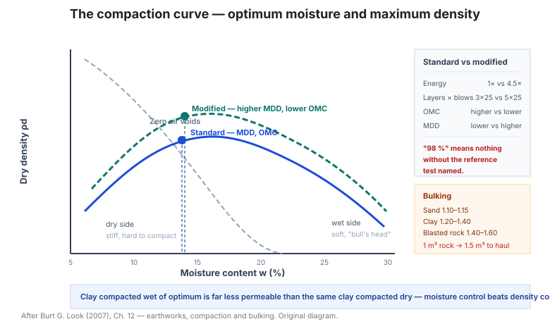

# Chương 12 — Công tác đất (Earthworks)

Chương này chuyển **mô tả đất và đá** thành quyết định **thi công**: đất đào được
bằng gì, hệ số nở rời, chiều dày lớp đầm, thiết bị đầm nào phù hợp, và mức đầm chặt
cần đạt cho từng ứng dụng.

**Hình.** Đường cong đầm chặt: độ ẩm tối ưu và dung trọng khô lớn nhất, so sánh đầm chuẩn với đầm cải tiến và đường không có lỗ rỗng.

## 12.1 Các vấn đề của công tác đất

Bảng của mục này liệt kê các câu hỏi thi công then chốt: **đào được hay phải nổ**,
**đầm bằng thiết bị nào**, **chiều dày lớp**, **độ chặt yêu cầu** — và loại dữ liệu
khảo sát cần để trả lời.

## 12.2 Khả năng đào (excavatability)

Khả năng đào phụ thuộc **cường độ, mức nứt nẻ và độ cứng** của vật liệu — không chỉ
loại đất/đá. Bảng của mục này phân loại vật liệu theo **phương pháp đào thích hợp**.

## 12.3 Yêu cầu đào

Bảng của mục này đưa **yêu cầu về độ sâu, độ dốc mái đào tạm, và biện pháp chống
đỡ** cho các loại đất khác nhau.

## 12.4 Đặc trưng đào

Bảng của mục này liên hệ **loại vật liệu** với **đặc trưng đào** (dễ, khó, phải nổ)
và với **hệ số nở rời** đi kèm.

## 12.5 Đánh giá khả năng đào

Bảng của mục này tổng hợp **tiêu chí đánh giá** khả năng đào (cường độ nén, khoảng
cách khe nứt, RQD) thành **quyết định thi công**.

## 12.6 Chỉ số đào (diggability index)

**Bảng 12.6 — Chỉ số đào theo loại vật liệu.**

| Vật liệu | Chỉ số đào | Phương pháp |
|---|---|---|
| Đất rời | 1 – 3 | Máy đào thường |
| Đất dính cứng | 4 – 6 | Máy đào gàu / ripper |
| Đá mềm, nứt mạnh | 7 – 9 | Ripper nặng |
| Đá cứng | 10 – 12 | Nổ mìn |

## 12.7 Phân loại khả năng đào

Bảng của mục này phân loại vật liệu thành các **cấp đào** tương ứng với **loại thiết
bị** và **năng suất** điển hình.

## 12.8 Đào trong đá

Bảng của mục này bàn về **phương pháp đào trong đá**: cắt, ripper, nổ mìn — theo
**cường độ và mức nứt nẻ**.

## 12.9 Biểu đồ đánh giá khả năng ripper

Biểu đồ **rippability** (thường theo **vận tốc sóng dọc Vp** hoặc **cường độ đá**)
cho biết đá có **ripper được** hay phải **nổ mìn** — công cụ thi công quan trọng.

## 12.10 Hệ số nở rời (bulking factor)

**Bảng 12.10 — Hệ số nở rời điển hình.**

| Vật liệu | Hệ số nở rời |
|---|---|
| Sỏi, cuội | 1,05 – 1,15 |
| Cát | 1,10 – 1,15 |
| Sét | 1,20 – 1,40 |
| Sét cứng, đá mềm | 1,30 – 1,50 |
| Đá nổ mìn | 1,40 – 1,60 |

Hệ số nở rời quyết định **khối lượng vận chuyển** — đào 1 m³ đá có thể cần chở
1,5 m³.

## 12.11 Chiều dày lớp đầm tối đa thực tế

Bảng của mục này đưa **chiều dày lớp đầm tối đa** theo **loại thiết bị đầm** — vượt
quá sẽ không đạt độ chặt ở đáy lớp.

## 12.12 Lực cản lăn của thiết bị bánh lốp

Bảng của mục này đưa **lực cản lăn** theo **loại đất nền và độ ẩm** — ảnh hưởng đến
**năng suất và khả năng leo dốc** của thiết bị.

## 12.13 Yêu cầu đầm chặt cho các ứng dụng

**Bảng 12.13 — Mức đầm chặt yêu cầu.**

| Ứng dụng | Độ chặt (% MDD) |
|---|---|
| Đắp không quan trọng | 90 – 92 |
| Nền đường, sân | 95 |
| Đường ô tô | 95 – 98 |
| Đập đất | 98 – 100 |
| Đất có cốt | 95 – 98 |

## 12.14 Mức đầm chặt yêu cầu

Bảng của mục này phân biệt **đầm theo thí nghiệm chuẩn (Standard)** và **đầm theo
thí nghiệm cải tiến (Modified)** — cùng một giá trị "95%" có ý nghĩa khác nhau tùy
theo thí nghiệm tham chiếu.

## 12.15 So sánh độ chặt tương đối và độ chặt tương đối (relative density)

**Bảng 12.15 — Ánh xạ độ chặt đầm (%) sang độ chặt tương đối Dr (%).**

| Độ chặt (% MDD, Standard) | Dr (%) |
|---|---|
| 90 | 45 – 55 |
| 95 | 60 – 70 |
| 98 | 75 – 85 |
| 100 | 85 – 95 |

## 12.16 Đặc trưng hiện trường của vật liệu dùng trong công tác đất

Bảng của mục này mô tả **đặc trưng hiện trường** (màu, cảm giác, cách vỡ) để nhận
biết vật liệu **tại mỏ hoặc tại nền đào**.

## 12.17 Đặc trưng đầm chặt điển hình của vật liệu

Bảng của mục này đưa **độ ẩm tối ưu và MDD điển hình** theo loại vật liệu.

## 12.18 Sự phù hợp của thiết bị đầm

**Bảng 12.18 — Thiết bị đầm phù hợp theo loại đất.**

| Thiết bị | Đất phù hợp |
|---|---|
| Lu rung | Cát, sỏi, đá dăm |
| Lu bánh lốp | Cát, sỏi, cấp phối |
| Lu chân cừu (sheepsfoot) | Sét, bụi dính |
| Đầm rung (vibratory plate) | Cát, sỏi (lớp mỏng) |
| Đầm cóc | Sét, bụi (chỗ hẹp) |

**Chọn sai thiết bị đầm** là nguyên nhân phổ biến của việc không đạt độ chặt.

## 12.19 Chiều dày lớp đầm điển hình

Bảng của mục này đưa **chiều dày lớp đầm** theo **thiết bị và loại đất** — thường
**150–300 mm** cho lu rung, dày hơn cho lu nặng.

## 12.20 Kích thước thiết bị tối đa theo mức rung cho phép

Bảng của mục này liên hệ **khoảng cách tới công trình lân cận** với **kích thước
thiết bị rung tối đa cho phép** — tránh gây hư hại công trình.

## 12.21 Đầm chặt yêu cầu theo chiều cao đắp

Bảng của mục này liên hệ **chiều cao đắp** với **mức đầm chặt yêu cầu** — đắp càng
cao thì yêu cầu càng khắt khe (giảm lún).

## 12.22 Kết quả thí nghiệm đầm chặt điển hình

Bảng của mục này đưa **kết quả thí nghiệm đầm chặt (Proctor)** điển hình cho các loại
đất — dùng làm giá trị tham chiếu.

## 12.23 Thử nghiệm đầm chặt hiện trường

Bảng của mục này đưa các **phương pháp kiểm tra độ chặt hiện trường** (rót cát, hạt
nhân, phóng xạ, siêu âm) và **độ chính xác** tương ứng.

## 12.24 Đầm chuẩn so với đầm cải tiến

**Bảng 12.24 — So sánh hai loại thí nghiệm đầm.**

| Đặc điểm | Standard (Proctor) | Modified |
|---|---|---|
| Năng lượng đầm | 1× | ~4,5× |
| Cối | 1000 mL | 1000 mL |
| Số lớp × búa | 3 × 25 | 5 × 25 |
| Độ ẩm tối ưu | Cao hơn | Thấp hơn |
| MDD | Thấp hơn | Cao hơn |

**Modified cho MDD cao hơn và độ ẩm tối ưu thấp hơn** — nên "98% Modified" khắt khe
hơn nhiều so với "98% Standard".

## 12.25 Ảnh hưởng của đá lẫn quá nhiều

Bảng của mục này bàn về **ảnh hưởng của đá/sỏi lẫn** đến thí nghiệm độ chặt và mật
độ — khi hàm lượng hạt thô lớn, kết quả thí nghiệm rót cát trở nên **không đại diện**.

## Ghi nhớ của chương

- **Hệ số nở rời** (mục 12.10) quyết định khối lượng vận chuyển — đào 1 m³ đá có thể
  cần chở **1,5 m³**.
- **Chọn thiết bị đầm theo loại đất** (mục 12.18) — lu rung cho hạt rời, lu chân cừu
  cho đất dính.
- Phân biệt **Standard vs. Modified** (mục 12.24) — "95%" không có ý nghĩa nếu không
  nói rõ thí nghiệm tham chiếu.
- **Chiều dày lớp đầm** (mục 12.19) phải khớp năng lượng thiết bị, nếu không đáy lớp
  sẽ rời.
