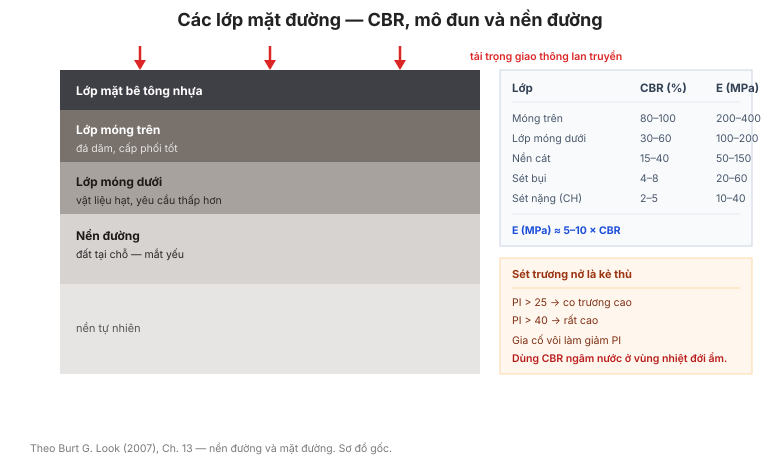

# Chương 13 — Nền đường và mặt đường (Subgrades and pavements)

Chương này gom các bảng cho **nền đường (subgrade) và kết cấu mặt đường**: phân loại
nền, ảnh hưởng của sét trương nở, CBR, ổn định đất bằng phụ gia, và các hệ thức
tương quan **mô đun ↔ CBR**.

**Hình.** Cấu tạo các lớp mặt đường với giá trị CBR và mô đun điển hình, cùng quan hệ E ≈ 5–10 × CBR và cảnh báo về sét trương nở.

## 13.1 Các loại nền đường

Bảng của mục này phân loại **nền đường** theo **loại đất và hành vi thể tích** — từ
nền tốt (cát, sỏi) đến nền xấu (sét trương nở, đất hữu cơ).

## 13.2 Phân loại cường độ nền đường

**Bảng 13.2 — Phân loại nền theo CBR.**

| Cấp nền | CBR (%) | Đánh giá |
|---|---|---|
| Rất tốt | > 30 | Nền lý tưởng |
| Tốt | 15 – 30 | Nền tốt |
| Trung bình | 8 – 15 | Nền chấp nhận |
| Yếu | 4 – 8 | Cần xử lý |
| Rất yếu | < 4 | Cần thay/cải tạo |

## 13.3 Thiệt hại do sét hoạt động thể tích

Bảng của mục này mô tả **thiệt hại do sét trương nở** gây ra cho mặt đường: nứt dọc,
gồ ghề, lún không đều — và liên hệ với **chỉ số dẻo và tiềm năng trương**.

## 13.4 Phân loại biến đổi thể tích của nền đường

**Bảng 13.4 — Phân loại tiềm năng trương.**

| Tiềm năng trương | PI | Độ trương tự do (%) |
|---|---|---|
| Thấp | < 15 | < 1 |
| Trung bình | 15 – 25 | 1 – 3 |
| Cao | 25 – 40 | 3 – 6 |
| Rất cao | > 40 | > 6 |

## 13.5 Giảm thiểu biến đổi thể tích của nền đường

Bảng của mục này đưa **biện pháp giảm trương** (đắp đất tốt, gia cố vôi, ổn định độ
ẩm, thoát nước) và **hiệu quả tương đối** của từng biện pháp.

## 13.6 Độ ẩm của nền đường

Bảng của mục này liên hệ **độ ẩm nền đường theo mùa** với **mực nước ngầm và khí
hậu** — cơ sở cho việc dùng CBR ngâm (soaked) hay không ngâm.

## 13.7 Hệ số hiệu chỉnh cường độ nền về CBR ngâm

Bảng của mục này đưa **hệ số hiệu chỉnh** để chuyển **CBR hiện trường (chưa ngâm)**
sang **CBR ngâm** tương đương — quan trọng ở vùng ẩm.

## 13.8 CBR gần đúng của nền đường sét

Bảng của mục này ước lượng **CBR từ chỉ số dẻo và độ ẩm** cho nền sét — khi chưa có
thí nghiệm CBR.

## 13.9 Giá trị CBR điển hình của nền đường

**Bảng 13.9 — CBR điển hình của nền đường.**

| Loại đất | CBR (%) |
|---|---|
| Sét nặng (CH) | 2 – 5 |
| Sét bụi (CL) | 4 – 8 |
| Bụi (ML) | 5 – 10 |
| Cát bụi (SM) | 8 – 15 |
| Cát (SP/SW) | 15 – 40 |
| Sỏi (GP/GW) | 30 – 80 |

## 13.10 Tính chất của cấp phối ổn định cơ học

Bảng của mục này đưa **yêu cầu cấp phối** (Cu, Cc, giới hạn dẻo) cho **cấp phối đá
dăm** đạt độ ổn định cơ học tốt.

## 13.11 Ổn định đất bằng phụ gia

**Bảng 13.11 — Phụ gia ổn định đất.**

| Phụ gia | Đất phù hợp | Mục đích |
|---|---|---|
| Xi măng | Cát, sỏi, sét ít dẻo | Tăng cường độ |
| Vôi | Sét dẻo (CH) | Giảm dẻo, tăng CBR |
| Nhựa đường | Cát, cấp phối | Chống ẩm |
| Tro bay | Sét, cát | Tăng cường độ (pozzolan) |

## 13.12 Ổn định đất bằng xi măng

Bảng của mục này đưa **liều lượng xi măng điển hình** (3–10% khối lượng) theo **loại
đất và cường độ mục tiêu**.

## 13.13 Ảnh hưởng của ổn định đất bằng xi măng

Bảng của mục này đưa **mức tăng cường độ** theo **hàm lượng xi măng và tuổi** — cường
độ tăng theo thời gian (pozzolanic).

## 13.14 Ổn định đất bằng vôi

Bảng của mục này đưa **liều lượng vôi** và **mức giảm PI** đạt được — vôi đặc biệt
hiệu quả với **sét dẻo cao**.

## 13.15 Ổn định đất bằng nhựa đường

Bảng của mục này đưa **liều lượng nhựa đường** cho các loại cấp phối — chủ yếu để
**chống ẩm** hơn là tăng cường độ.

## 13.16 Cường độ mặt đường cho cấp phối cuội sỏi

Bảng của mục này liên hệ **cấp phối cuội sỏi** với **cường độ mặt đường đạt được**
theo chiều dày lớp.

## 13.17 Giá trị CBR cho mặt đường

Bảng của mục này đưa **CBR điển hình** cho các lớp mặt đường: móng trên (base), móng
dưới (sub-base), nền đường.

## 13.18 Độ trương CBR trong mặt đường

Bảng của mục này đưa **giới hạn độ trương CBR cho phép** theo **cấp đường và vị trí
lớp** — kiểm soát sét trương nở.

## 13.19 Tính chất chỉ số dẻo của vật liệu mặt đường

Bảng của mục này đưa **giới hạn PI cho phép** theo **loại lớp mặt đường**.

## 13.20 Giá trị CBR điển hình của vật liệu mặt đường

**Bảng 13.20 — CBR điển hình của vật liệu.**

| Vật liệu | CBR (%) |
|---|---|
| Đá dăm cấp phối tốt | 80 – 100 |
| Đá dăm cấp phối kém | 40 – 80 |
| Cát gia cố xi măng | 100 – 200 |
| Cuội sỏi tự nhiên | 30 – 60 |

## 13.21 Giá trị mô đun mặt đường điển hình

Bảng của mục này đưa **mô đun đàn hồi E** điển hình cho từng lớp mặt đường.

## 13.22 Giá trị mô đun mặt đường hiện hữu

Bảng của mục này đưa **mô đun của mặt đường hiện hữu** (đã qua khai thác) — thấp hơn
mặt đường mới do hư hỏng tích lũy.

## 13.23 Mô đun tương đương của móng dưới cho vật liệu móng thông thường

Bảng của mục này đưa **mô đun tương đương** của hệ nhiều lớp (móng dưới + nền) khi
dùng **vật liệu móng tiêu chuẩn**.

## 13.24 Mô đun tương đương của móng dưới cho vật liệu móng chất lượng cao

Bảng của mục này tương tự nhưng cho **vật liệu móng chất lượng cao** — mô đun tương
đương cao hơn.

## 13.25 Quan hệ điển hình giữa mô đun và CBR nền đường

**E (MPa) ≈ 10 × CBR** (cho CBR < 5) và **E (MPa) ≈ 5 × CBR** (cho CBR lớn hơn) —
hệ thức tương quan phổ biến để chuyển CBR sang mô đun.

## 13.26 Quan hệ điển hình giữa mô đun và CBR lớp móng trên

Bảng của mục này đưa hệ thức **E ↔ CBR** riêng cho **lớp móng trên (base course)**.

## 13.27 Mô đun đàn hồi của nhựa đường

Bảng của mục này đưa **mô đun nhựa đường** theo **nhiệt độ và loại nhựa** — nhựa
đường rất nhạy với nhiệt độ.

## 13.28 Tỷ số Poisson

Bảng của mục này đưa **ν** cho từng lớp mặt đường: nhựa đường cao (0,35–0,5), cấp
phối 0,35, nền đường 0,3–0,45.

## Ghi nhớ của chương

- **CBR là thông số trung tâm** của thiết kế mặt đường; chuyển sang **mô đun** qua
  **E ≈ 5–10 × CBR** (mục 13.25).
- **Sét trương nở** (mục 13.3–13.5) là kẻ thù của mặt đường — kiểm soát bằng **vôi**
  và **thoát nước**.
- **CBR ngâm vs. chưa ngâm** (mục 13.7) khác nhau đáng kể ở vùng ẩm — dùng đúng
  trường hợp.
- **Mô đun nhựa đường phụ thuộc nhiệt độ** (mục 13.27) — ở khí hậu nóng như Việt Nam,
  mô đun giảm mạnh.
