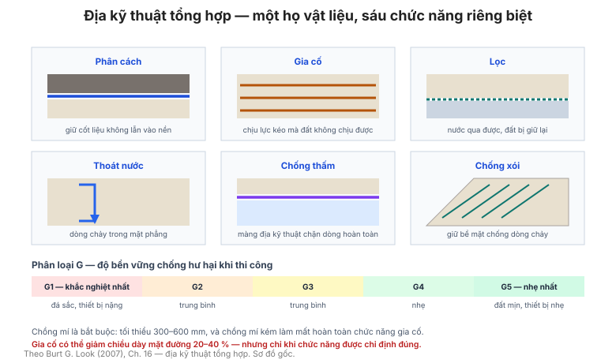

# Chương 16 — Địa kỹ thuật tổng hợp (Geosynthetics)

Chương này gom các bảng về **vật liệu địa kỹ thuật tổng hợp**: các loại, tính chất,
chức năng, sức kháng xuyên tĩnh, phân loại độ bền vững (G-rating), và các ứng dụng
trong mặt đường, lọc và gia cố.

**Hình.** Sáu chức năng của địa kỹ thuật tổng hợp (phân cách, gia cố, lọc, thoát nước, chống thấm, chống xói) và phân loại độ bền vững G-rating.

## 16.1 Các loại địa kỹ thuật tổng hợp

**Bảng 16.1 — Các loại chính.**

| Loại | Đặc điểm | Chức năng chính |
|---|---|---|
| Vải địa kỹ thuật (geotextile) | Vải dệt/không dệt | Phân cách, lọc, gia cố |
| Lưới địa kỹ thuật (geogrid) | Lưới có lỗ lớn | Gia cố |
| Màng địa kỹ thuật (geomembrane) | Màng liền | Chống thấm |
| Lưới thoát nước (geonet) | Lưới 3D | Thoát nước |
| Địa tổng hợp (geocomposite) | Kết hợp nhiều loại | Đa chức năng |
| Tấm tổ ong (geocell) | Tấm 3D | Gia cố, chống xói |

## 16.2 Tính chất của địa kỹ thuật tổng hợp

Bảng của mục này đưa các **tính chất kỹ thuật** (cường độ kéo, độ giãn dài, khổ rộng
lỗ, độ thấm, kháng xuyên) theo loại.

## 16.3 Chức năng của địa kỹ thuật tổng hợp

**Bảng 16.3 — Chức năng theo loại.**

| Chức năng | Loại thường dùng |
|---|---|
| Phân cách (separation) | Vải không dệt |
| Gia cố (reinforcement) | Lưới địa kỹ thuật |
| Lọc (filtration) | Vải không dệt |
| Thoát nước (drainage) | Lưới thoát, geocomposite |
| Chống thấm (containment) | Màng geomembrane |
| Chống xói (erosion control) | Tấm geocell, thảm |

## 16.4 Sức kháng xuyên tĩnh của vải địa kỹ thuật

Bảng của mục này liên hệ **sức kháng xuyên (CBR puncture, cone drop)** với **loại
vật liệu và ứng dụng** — cơ sở chọn vải chống xuyên thủng khi thi công.

## 16.5 Phân loại độ bền vững theo G-rating

**Bảng 16.5 — G-rating (độ bền vững thi công).**

| G-rating | Điều kiện thi công |
|---|---|
| G1 | Khắc nghiệt nhất (đá sắc, thiết bị nặng) |
| G2 | Khắc nghiệt trung bình |
| G3 | Trung bình |
| G4 | Nhẹ |
| G5 | Nhẹ nhất (đất mịn, thiết bị nhẹ) |

G-rating càng **thấp (G1)** thì vải càng phải **bền** để không rách khi thi công.

## 16.6 Độ bền vững của vải cho lọc, thoát nước và bịt kín

Bảng của mục này đưa **yêu cầu độ bền** cho vải dùng làm **lọc, thoát nước, chống
thấm** — nơi vải ít chịu tải cơ học nhưng phải bền hóa học.

## 16.7 Độ bền vững của vải theo điều kiện nền và thiết bị thi công

Bảng của mục này liên hệ **điều kiện nền (đá sắc vs. đất mịn)** và **loại thiết bị**
với **G-rating yêu cầu**.

## 16.8 Độ bền vững của vải theo vật liệu phủ và thiết bị thi công

Bảng của mục này tương tự mục 16.7 nhưng cho **vật liệu phủ lên trên vải** (đá, đất,
cấp phối).

## 16.9 Giảm chiều dày mặt đường nhờ vải địa kỹ thuật

Bảng của mục này đưa **mức giảm chiều dày mặt đường** khi dùng vải gia cố — có thể
giảm **20–40%** chiều dày móng.

## 16.10 Hệ số sức chịu tải nhờ vải địa kỹ thuật

Bảng của mục này đưa **hệ số tăng sức chịu tải** khi có vải gia cố trên nền yếu.

## 16.11 Vải địa kỹ thuật cho phân cách và gia cố

Bảng của mục này đưa **tiêu chí chọn vải** cho hai chức năng **phân cách** và **gia
cố** — hai mục đích khác nhau cần tính chất khác nhau.

## 16.12 Vải địa kỹ thuật làm lọc đất

Bảng của mục này đưa **tiêu chí thiết kế lọc địa kỹ thuật** (theo kích thước lỗ O₉₅
so với D₈₅ của đất) — cầu nối sang mục 15.24–15.25.

## 16.13 Cường độ vải cho hàng rào chắn bùn (silt fence)

Bảng của mục này đưa **cường độ và chiều cao** vải chắn bùn theo **lưu lượng dòng
chảy mặt**.

## 16.14 Cường độ vải địa kỹ thuật điển hình

**Bảng 16.14 — Cường độ kéo điển hình (kN/m).**

| Loại vải | Cường độ kéo (kN/m) |
|---|---|
| Vải không dệt nhẹ | 5 – 15 |
| Vải không dệt nặng | 15 – 40 |
| Vải dệt | 40 – 100 |
| Lưới địa kỹ thuật | 20 – 200 |

## 16.15 Chồng lấp vải địa kỹ thuật

Bảng của mục này đưa **chiều rộng chồng lấp** tối thiểu theo **loại vải và điều kiện
nền** — thường **300–600 mm**, có thể nối bằng khâu hoặc dán.

## Ghi nhớ của chương

- **Chọn đúng loại cho đúng chức năng** (mục 16.3): vải không dệt để **lọc/phân
  cách**, lưới để **gia cố**, màng để **chống thấm**.
- **G-rating** (mục 16.5) là tiêu chí **độ bền thi công** — chọn sai sẽ rách vải khi
  thi công.
- **Chồng lấp** (mục 16.15) quyết định hiệu quả — chồng lấp không đủ làm mất chức năng
  gia cố.
- Vải gia cố có thể **giảm 20–40% chiều dày mặt đường** (mục 16.9).
