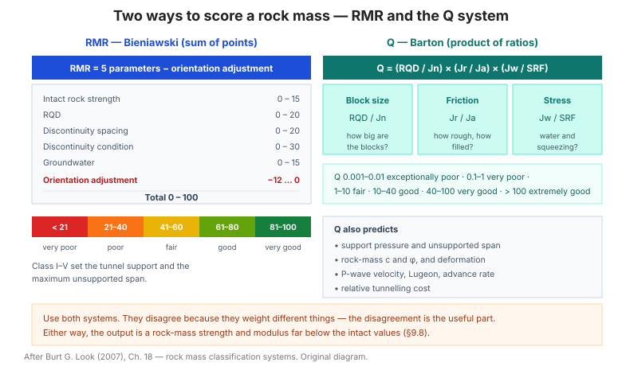

# Chương 18 — Các hệ thống phân loại khối đá

Chương này gom hai **hệ thống phân loại khối đá** chuẩn của thực hành quốc tế — **RMR
(Bieniawski)** và **hệ Q (Na Uy, Barton)** — cùng các bảng dự báo **hỗ trợ hầm, nhịp
không hỗ trợ, áp lực hỗ trợ và chi phí** từ hệ Q.

**Hình.** Hai hệ thống phân loại khối đá: RMR (tổng điểm năm thông số trừ điều chỉnh hướng khe nứt) và hệ Q (tích ba tỷ số).

## 18.1 Các hệ thống đánh giá khối đá

Bảng của mục này so sánh **RMR, Q, RMI, GSI** — phạm vi áp dụng và ưu nhược điểm.

## 18.2 Hệ thống đánh giá khối đá — RMR

RMR = tổng điểm của **năm thông số** trừ **điều chỉnh hướng khe nứt**:

**Bảng 18.2 — Cấu trúc điểm RMR.**

| Thông số | Điểm tối đa |
|---|---|
| Cường độ đá nguyên | 15 |
| RQD | 20 |
| Khoảng cách khe nứt | 20 |
| Điều kiện khe nứt | 30 |
| Nước ngầm | 15 |
| Điều chỉnh hướng khe nứt | −12 đến 0 |
| **Tổng** | **0 – 100** |

## 18.3 Hệ RMR — cường độ và RQD

Bảng của mục này đưa **điểm cường độ** (theo qu hoặc point load) và **điểm RQD**.

## 18.4 Hệ RMR — khe nứt (discontinuities)

Bảng của mục này đưa **điểm theo khoảng cách khe nứt** và **điểm theo điều kiện khe
nứt** (độ nhám, độ mở, lấp nhét, phong hóa).

## 18.5 RMR — nước ngầm

Bảng của mục này đưa **điểm theo điều kiện nước ngầm** (khô, ẩm, ướt, chảy).

## 18.6 RMR — điều chỉnh hướng khe nứt

Bảng của mục này đưa **điểm điều chỉnh** theo **hướng khe nứt so với hướng đào** và
theo **loại công trình** (hầm, móng, mái dốc).

## 18.7 RMR — ứng dụng

**Bảng 18.7 — Phân loại khối đá theo RMR.**

| RMR | Cấp | Mô tả |
|---|---|---|
| 81 – 100 | I | Rất tốt |
| 61 – 80 | II | Tốt |
| 41 – 60 | III | Trung bình |
| 21 – 40 | IV | Kém |
| < 21 | V | Rất kém |

## 18.8 RMR — đào và hỗ trợ hầm

Bảng của mục này liên hệ **RMR** với **nhịp không hỗ trợ tối đa** và **biện pháp hỗ
trợ** cho hầm (neo, bê tông phun, vì chống).

## 18.9 Hệ Q của Na Uy

**Q = (RQD/Jn) × (Jr/Ja) × (Jw/SRF)**, trong đó:
- **RQD/Jn** = kích thước khối tương đối
- **Jr/Ja** = cường độ ma sát tương đối (nhám/khe nứt)
- **Jw/SRF** = ứng suất chủ động (nước / ứng suất)

## 18.10 Kích thước khối tương đối

Bảng của mục này đưa **Jn** (số hệ khe nứt) và **RQD** để tính **kích thước khối tương
đối RQD/Jn**.

## 18.11 RQD từ mật độ khe nứt thể tích

**Bảng 18.11 — RQD ↔ Jv.**

| Jv (khe/m³) | RQD (%) |
|---|---|
| < 4,5 | 90 – 100 |
| 4,5 – 9 | 75 – 90 |
| 9 – 15 | 50 – 75 |
| 15 – 30 | 25 – 50 |
| > 30 | < 25 |

## 18.12 Cường độ ma sát tương đối

Bảng của mục này đưa **Jr** (độ nhám khe nứt) và **Ja** (độ biến đổi/lấp nhét khe
nứt) để tính **Jr/Ja**.

## 18.13 Ứng suất chủ động — ảnh hưởng của nước, đứt gãy, tỷ số cường độ/ứng suất

Bảng của mục này đưa **Jw** (hệ số giảm do nước) và **SRF** (hệ số giảm ứng suất) —
hai yếu tố quyết định **ứng suất chủ động**.

## 18.14 Hệ số giảm ứng suất (SRF)

Bảng của mục này đưa **SRF** theo **đới đứt gãy, ứng suất cao, đất yếu** — SRF càng
lớn thì khối đá càng bất lợi.

## 18.15 Chọn mức an toàn theo hệ Q

Bảng của mục này đưa **ba mức an toàn** (ESR) theo **loại công trình** (hầm tạm, hầm
vĩnh viễn, nhà máy điện, kho chứa) — dùng để tính **nhịp không hỗ trợ**.

## 18.16 Yêu cầu hỗ trợ theo hệ Q

Bảng của mục này đưa **biện pháp hỗ trợ** theo **giá trị Q**.

## 18.17 Dự báo yêu cầu hỗ trợ bằng giá trị Q

**Bảng 18.17 — Phân loại chất lượng khối đá theo Q.**

| Q | Cấp | Mô tả |
|---|---|---|
| 400 – 1000 | — | Đặc biệt tốt |
| 100 – 400 | — | Rất tốt |
| 40 – 100 | — | Tốt |
| 10 – 40 | — | Trung bình |
| 4 – 10 | — | Kém |
| 1 – 4 | — | Rất kém |
| 0,1 – 1 | — | Cực kém |
| 0,01 – 0,1 | — | Đặc biệt kém |
| 0,001 – 0,01 | — | Ngoại lệ |

## 18.18 Dự báo hỗ trợ bằng buli và bê tông theo giá trị Q

Bảng của mục này đưa **đường kính, chiều dài và khoảng cách buli** cùng **chiều dày
bê tông phun** theo **Q và kích thước hầm**.

## 18.19 Dự báo vận tốc theo giá trị Q

Bảng của mục này liên hệ **Q** với **vận tốc sóng dọc Vp** trong khối đá.

## 18.20 Dự báo Lugeon theo giá trị Q

Bảng của mục này liên hệ **Q** với **giá trị Lugeon** (độ thấm đá) — cầu nối sang
mục 8.20.

## 18.21 Dự báo tiến độ đào hầm theo giá trị Q

Bảng của mục này liên hệ **Q** với **tốc độ đào hầm** điển hình.

## 18.22 Chi phí tương đối cho đào hầm theo giá trị Q

Bảng của mục này liên hệ **Q** với **chi phí tương đối** — Q càng thấp thì chi phí hỗ
trợ càng cao.

## 18.23 Dự báo cường độ dính và ma sát theo giá trị Q

Bảng của mục này suy **c và φ của khối đá** từ **Q** — dùng cho phân tích ổn định.

## 18.24 Dự báo thông số cường độ và vật liệu theo giá trị Q

Bảng của mục này mở rộng mục 18.23 với **mô đun và các thông số khác** suy từ Q.

## 18.25 Dự báo biến dạng và độ đóng kín theo giá trị Q

Bảng của mục này liên hệ **Q** với **biến dạng và độ đóng kín (closure)** của hầm.

## 18.26 Dự báo áp lực hỗ trợ và nhịp không hỗ trợ theo giá trị Q

Bảng của mục này đưa **áp lực hỗ trợ cần thiết** và **nhịp không hỗ trợ tối đa** từ
**Q và kích thước hầm** — công cụ thiết kế hỗ trợ then chốt.

## Ghi nhớ của chương

- **RMR** (0–100) và **Q** (0,001–1000) là hai hệ song song — dùng **cả hai** để khoanh
  vùng thiết kế hỗ trợ.
- **RMR = 5 thông số − điều chỉnh hướng khe nứt** (mục 18.2).
- **Q = (RQD/Jn)(Jr/Ja)(Jw/SRF)** (mục 18.9) — ba nhóm yếu tố: kích thước khối, ma
  sát, ứng suất.
- **Hệ Q** dự báo được cả **hỗ trợ, biến dạng, vận tốc, Lugeon và chi phí** (mục
  18.17–18.26).
