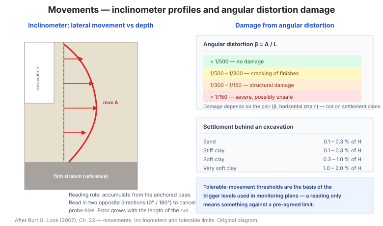

# Chương 23 — Chuyển vị (Movements)

Chương này là **người bạn đồng hành định lượng** của các triết lý quan trắc: nó gom
các **giới hạn chuyển vị** cho móng, tường, mái dốc, cầu đường — và đặc biệt là phần
**chuyển vị trong ống đo nghiêng (inclinometer)**.

**Hình.** Profil chuyển vị ngang đo bằng ống đo nghiêng và phân loại mức độ hư hại theo độ xiên góc và biến dạng ngang.

## 23.1 Các loại chuyển vị

**Bảng 23.1 — Các loại chuyển vị.**

| Loại | Mô tả |
|---|---|
| Lún (settlement) | Dịch chuyển đứng xuống |
| Nâng (heave) | Dịch chuyển đứng lên |
| Dịch ngang (lateral) | Dịch chuyển ngang |
| Xoay (rotation) | Xoay của kết cấu |
| Độ xiên góc (angular distortion) | Chênh lún / khoảng cách |
| Biến dạng ngang (horizontal strain) | Kéo/nén ngang |

**Độ xiên góc (angular distortion)** và **biến dạng ngang** là hai thông số gây hư hại
kết cấu — không phải lún tuyệt đối.

## 23.2 Chuyển vị móng

Bảng của mục này đưa **các thành phần chuyển vị móng** (lún tức thời, cố kết, thứ
cấp) và cách phân biệt chúng.

## 23.3 Lún tức thời đến tổng cộng

Bảng của mục này đưa **hệ số chuyển từ lún tức thời sang lún tổng** theo **loại đất
và thời gian**.

## 23.4 Lún cố kết

Bảng của mục này đưa **công thức lún cố kết**: **s = (Cc/(1+e₀))·H·log((σ′v+Δσ)/σ′v)**
cho sét cố kết thường, với nhánh **Cr** cho sét cố kết trước.

## 23.5 Lún tự trọng điển hình

Bảng của mục này đưa **lún tự trọng (self-weight settlement)** điển hình của đất đắp
và trầm tích — lún xảy ra dưới trọng lượng bản thân, không cần tải ngoài.

## 23.6 Chuyển vị giới hạn cho kết cấu

**Bảng 23.6 — Chuyển vị giới hạn điển hình.**

| Kết cấu | Lún giới hạn |
|---|---|
| Nhà khung thép/bê tông | 25 – 50 mm |
| Nhà tường chịu lực | 25 mm |
| Móng đơn | 25 – 40 mm |
| Sàn công nghiệp | 10 – 25 mm |

## 23.7 Độ xiên góc giới hạn

**Bảng 23.7 — Độ xiên góc giới hạn.**

| Giới hạn | Độ xiên góc |
|---|---|
| Không hư hại | < 1/500 |
| Hư hại nhẹ (nứt tường) | 1/500 – 1/300 |
| Hư hại kết cấu | 1/300 – 1/150 |
| Hư hại nặng / nguy hiểm | > 1/150 |

## 23.8 Quan hệ giữa hư hại với độ xiên góc và biến dạng ngang

Bảng của mục này (theo **Bjerrum, Skempton & MacDonald, Burland**) phân loại **mức
độ hư hại** theo **cặp (độ xiên góc, biến dạng ngang)** — công cụ đánh giá hư hại nhà
lân cận.

## 23.9 Chuyển vị tại tường neo đất

Bảng của mục này đưa **chuyển vị ngang và đứng** của **tường neo đất (soil nail
wall)** theo **chiều cao tường và loại đất** — thường **0,1–0,3% chiều cao**.

## 23.10 Biến dạng dung thứ cho mái dốc và đắp có cốt

Bảng của mục này đưa **biến dạng cho phép** cho **mái dốc đất có cốt và đắp** — cơ sở
thiết kế và quan trắc.

## 23.11 Chuyển vị trong ống đo nghiêng

**Ống đo nghiêng (inclinometer)** đo **profil dịch chuyển ngang theo chiều sâu**. Các
điểm cốt lõi:

**Bảng 23.11 — Đặc trưng ống đo nghiêng.**

| Đặc điểm | Giá trị điển hình |
|---|---|
| Độ chính xác | ± 3 – 6 mm / 30 m |
| Độ phân giải | ± 0,02 mm/m (0,1 mm/500 mm) |
| Khoảng cách đo | 0,5 – 1,0 m |
| Chiều sâu ống | Vượt vùng chuyển vị ≥ 3 – 5 m |
| Ống | Có rãnh dẫn hướng (2 cặp rãnh vuông góc) |

**Quy tắc đọc kết quả:** dịch chuyển **tích lũy** từ điểm neo cố định ở đáy; cần đo
**hai lần (hai chiều 180°)** để loại bỏ sai số thiết bị; **sai số tích lũy** tăng theo
chiều sâu đo.

## 23.12 Chuyển vị chấp nhận trong cầu đường bộ

Bảng của mục này đưa **chuyển vị chấp nhận** cho **cầu đường bộ** theo **loại móng và
loại cầu**.

## 23.13 Độ xiên góc chấp nhận cho cầu đường bộ

Bảng của mục này đưa **độ xiên góc cho phép** cho cầu — khắt khe hơn nhà dân dụng.

## 23.14 Chuyển vị dung thứ cho mái dốc và tường

Bảng của mục này đưa **chuyển vị dung thứ** cho **mái dốc và tường chắn** — cơ sở đặt
**mức kích hoạt quan trắc**.

## 23.15 Lún quan trắc phía sau hố móng

**Bảng 23.15 — Lún phía sau hố móng.**

| Loại đất | Lún cực đại (% chiều sâu đào) |
|---|---|
| Cát | 0,1 – 0,3 |
| Sét cứng | 0,1 – 0,3 |
| Sét mềm | 0,3 – 1,0 |
| Sét rất mềm | 1,0 – 2,0 |

## 23.16 Lún cạnh hố mở theo hệ thống hỗ trợ

Bảng của mục này đưa **mức lún cạnh hố đào** theo **hệ thống chống đỡ** (không chống,
cọc bản, tường ngàm, tường neo).

## 23.17 Chuyển vị dung thứ trong phân tích ổn định mái dốc động đất

Bảng của mục này đưa **chuyển vị cho phép** của mái dốc dưới **động đất** (phân tích
Newmark) — cơ sở quyết định mái dốc có ổn định không.

## 23.18 Chuyển vị của đá

Bảng của mục này đưa **chuyển vị điển hình của khối đá** trong hầm và mái đào.

## 23.19 Độ sâu vệt bánh cho phép

Bảng của mục này đưa **độ sâu vệt bánh (rut depth) cho phép** trên mặt đường — giới
hạn phục vụ.

## 23.20 Mức độ rạn lún theo chức năng đường

Bảng của mục này liên hệ **mức độ vệt bánh** với **chức năng đường** (cao tốc, quốc
lộ, đường đô thị).

## 23.21 Chuyển vị bề mặt tự do cho nhà nhẹ

Bảng của mục này đưa **chuyển vị cho phép** của **nền đất** dưới **nhà nhẹ** — nhà
nhẹ nhạy với sét trương nở.

## 23.22 Chuyển vị bề mặt tự do cho mặt đường

Bảng của mục này đưa **chuyển vị cho phép** của nền đất dưới **mặt đường**.

## 23.23 Biến dạng cho phép cho đường

Bảng của mục này đưa **biến dạng cho phép** của **kết cấu đường** (kéo/nén) trước khi
hư hỏng.

## Ghi nhớ của chương

- **Độ xiên góc và biến dạng ngang** gây hư hại, không phải lún tuyệt đối (mục 23.1,
  23.8).
- **Độ xiên góc > 1/300** gây hư hại kết cấu (mục 23.7).
- **Ống đo nghiêng** (mục 23.11) đo **dịch chuyển ngang theo chiều sâu** — công cụ
  quan trắc then chốt cho hố đào, mái dốc và tường.
- **Lún phía sau hố móng** phụ thuộc mạnh vào **loại đất** — sét mềm có thể lún tới
  **1–2% chiều sâu đào** (mục 23.15).
