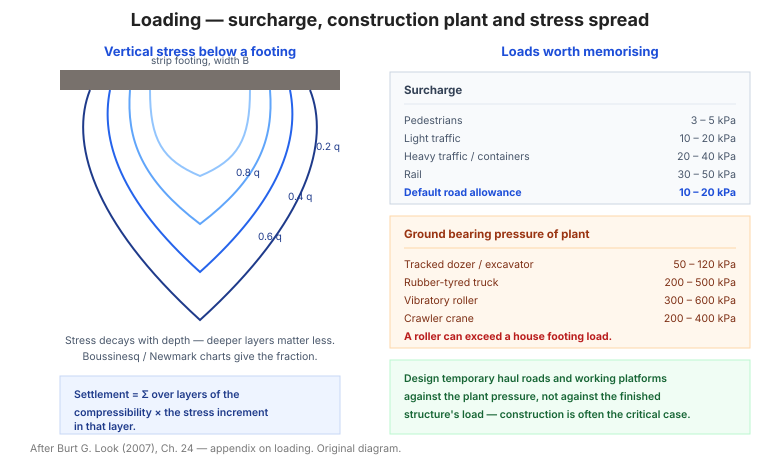

# Chương 24 — Phụ lục: tải trọng (Loading)

Phụ lục này gom các bảng **tải trọng** dùng khi thiết kế: giá trị đặc trưng của vật
rời khối, áp lực chất tải, tải trọng thi công, áp lực nền của thiết bị, và biến thiên
ứng suất đứng trong đất.

**Hình.** Phân bố ứng suất đứng dưới móng theo lý thuyết Boussinesq, áp lực chất tải và áp lực nền của thiết bị thi công.

## 24.1 Giá trị đặc trưng của vật rời khối (bulk solids)

**Bảng 24.1 — Trọng lượng đơn vị của vật liệu rời.**

| Vật liệu | Trọng lượng đơn vị (kN/m³) | Góc nghỉ (°) |
|---|---|---|
| Cát khô | 14 – 18 | 30 – 35 |
| Cát ẩm | 16 – 20 | 35 – 45 |
| Sỏi | 16 – 20 | 35 – 40 |
| Đá dăm | 15 – 20 | 35 – 45 |
| Than | 8 – 12 | 30 – 40 |
| Xi măng (rời) | 13 – 16 | 30 – 40 |
| Ngũ cốc | 7 – 9 | 20 – 30 |

## 24.2 Áp lực chất tải (surcharge pressures)

**Bảng 24.2 — Áp lực chất tải điển hình.**

| Nguồn tải | Áp lực (kPa) |
|---|---|
| Tải người | 3 – 5 |
| Xe con | 5 – 10 |
| Xe tải nhẹ | 10 – 20 |
| Xe tải nặng / container | 20 – 40 |
| Đường sắt | 30 – 50 |
| Đống vật liệu | Theo chiều cao × γ |

Áp lực chất tải thường lấy **10–20 kPa** cho đường giao thông thông thường khi chưa
có số liệu cụ thể.

## 24.3 Tải trọng thi công

**Bảng 24.3 — Tải trọng thi công điển hình.**

| Hạng mục | Tải trọng |
|---|---|
| Vật liệu tập kết | 10 – 30 kPa |
| Giàn giáo | 5 – 10 kPa |
| Cần cẩu (chân) | 100 – 300 kPa |
| Tải động (đầm) | Theo thiết bị |

## 24.4 Áp lực nền của thiết bị thi công

**Bảng 24.4 — Áp lực nền của thiết bị.**

| Thiết bị | Áp lực nền (kPa) |
|---|---|
| Máy ủi bánh xích | 50 – 100 |
| Máy xúc bánh xích | 50 – 120 |
| Xe tải bánh lốp | 200 – 500 |
| Lu rung | 300 – 600 |
| Cần cẩu bánh xích | 200 – 400 |

Áp lực nền của thiết bị quan trọng khi **thiết kế đường tạm, nền công trường và đắp**.

## 24.5 Biến thiên ứng suất đứng

Bảng của mục này đưa **phân bố ứng suất đứng Δσ** theo chiều sâu dưới **móng chữ nhật,
móng băng và tải dạng dải** — dùng cho **tính lún** (lý thuyết Boussinesq, Newmark).

## Ghi nhớ của chương

- **Áp lực chất tải** (mục 24.2) thường lấy **10–20 kPa** cho đường giao thông.
- **Áp lực nền của thiết bị** (mục 24.4) có thể tới **600 kPa** — quan trọng khi thiết
  kế đường tạm và nền công trường.
- **Biến thiên ứng suất đứng** (mục 24.5) là đầu vào của mọi bài toán **tính lún** —
  nhớ rằng ứng suất tắt dần theo chiều sâu, nên lớp đất sâu chịu ảnh hưởng ít hơn.
