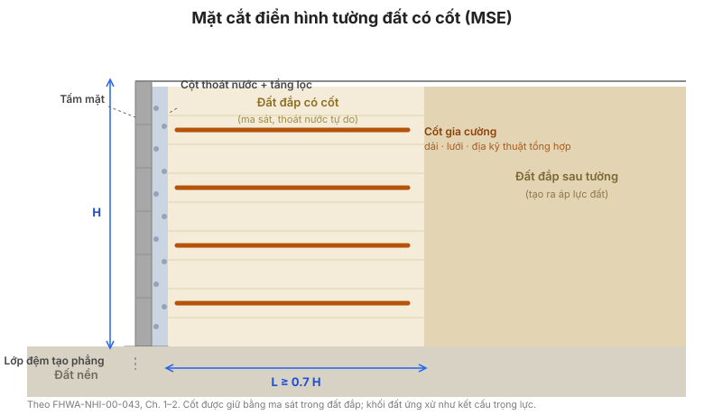

# Chương 4 — Thiết kế Tường MSE

## 4.1 Các phương pháp thiết kế

**Phân tích ứng suất làm việc.** Thiết kế tường MSE là một thủ tục **ứng suất làm
việc** (ứng suất cho phép): cốt được kiểm tra theo cường độ cho phép dài hạn đã giảm,
và kết cấu được kiểm tra theo hệ số an toàn tối thiểu. (Thực hành hiện đại diễn đạt
lại các kiểm tra đó dưới dạng tải trọng–sức kháng; cơ học là như nhau.)

**Phân tích cân bằng giới hạn.** Khối đất có cốt được xem là một **vật thể cứng** cho
ổn định ngoài, và như một chồng lớp cho ổn định trong, với các kiểm tra cân bằng giới
hạn ở mỗi mức.

**Đánh giá biến dạng.** Thiết kế cũng phải dự liệu **biến dạng**: mặt tường nghiêng
ra ngoài và thân tường phình ra một chút khi cốt biến dạng. Sổ tay đưa một đường cong
kinh nghiệm (Hình 10) liên hệ chuyển vị ngang dự kiến trong thi công với chiều cao
tường và loại cốt, để dung sai — đặc biệt với đường ống và kết cấu lân cận — được đặt
một cách thực tế.

**Cốt không dãn được (thép).** Thiết kế dùng mô hình **khối trọng lực liền khối**: áp
lực đất chủ động kiểu Rankine tác dụng lên khối đất có cốt, và **đường lực kéo lớn
nhất** đánh dấu nơi lực kéo trong cốt đạt đỉnh. Hệ số áp lực đất ngang dùng cho ổn
định nội bộ cao hơn giá trị chủ động gần đỉnh tường (một dạng thường dùng là
$K_r = 1.7K_a$ ở vùng trên, giảm về phía giá trị tại chỗ ở dưới), phản ánh sự kìm hãm
mà cốt cứng áp đặt.

**Cốt dãn được (địa kỹ thuật tổng hợp).** Vì cốt biến dạng cùng đất, tải phân bố đều
hơn theo độ sâu và mô hình **nêm neo** được dùng, với hệ số áp lực đất ngang lấy bằng
giá trị chủ động $K_a$ (hoặc cao hơn một chút tùy phương pháp thiết kế).

**Hình.** Mặt cắt ngang điển hình của tường MSE: tấm mặt tường, cột thoát nước và
tầng lọc phía sau mặt tường, các lớp cốt gia cường nằm ngang xuyên qua đất đắp có cốt,
đất lưng tường phía sau vùng có cốt, và đất nền (theo FHWA-NHI-00-043, Ch. 1–2).

## 4.2 Định cỡ cho ổn định ngoài

**a. Xác định hình học tường và thông số đất.** Chiều cao tường, độ nghiêng mặt, chiều
dài cốt, mặt cắt nền, và trọng lượng đơn vị cùng góc ma sát của đất đắp có cốt, đất
lưng tường và đất nền.

**b. Chọn tiêu chí hiệu năng.** Biến dạng mặt tường, lún không đều và độ mở mối nối
có thể chấp nhận.

**c. Định cỡ sơ bộ.** Đặt chiều dài cốt. Một quy tắc khởi đầu thường dùng là
**$L \ge 0.7H$** với chiều dài thực tế tối thiểu (khoảng 2.4 m); sau đó điều chỉnh
chiều dài theo ổn định ngoài.

**d. Áp lực đất cho ổn định ngoài.** Khối đất có cốt chịu **áp lực đất chủ động** từ
đất lưng tường phía sau, cộng mọi tải chất (giao thông, kết cấu) và, nếu thoát nước
không đảm bảo, áp lực **thủy tĩnh**. Hợp lực tác dụng lên mặt sau của khối đất có cốt.

**e. Ổn định trượt.** Kiểm tra rằng ma sát đáy cộng sức kháng bị động phía trước tường
chống lại được lực đẩy ngang:

$$FS_{(trượt)} = \frac{\text{lực ngang chống}}{\text{lực ngang gây trượt}} \ge 1.5$$

**f. Phá hoại sức chịu tải.** Kiểm tra sức chịu tải của nền dưới tải lệch tâm của
khối đất có cốt, và kiểm tra hợp lực nằm trong đáy (không có ứng suất kéo dưới tường):

$$FS_{(sức chịu tải)} \ge 2.0 \quad \text{và} \quad e \le \frac{L}{6}$$

**g. Ổn định tổng thể.** Thực hiện phân tích ổn định mái dốc xuyên qua khối đất có cốt
và nền của nó để xác nhận các mặt trượt sâu có hệ số an toàn đủ (thường $\ge 1.5$).

**h. Tải trọng động đất.** Áp dụng lực quán tính **giả tĩnh** (hệ số động đất ngang
nhân khối lượng) và kiểm tra lại ổn định ngoài; khung Mononobe–Okabe được dùng để hiệu
chỉnh áp lực đất cho trường hợp động đất.

**i. Ước lượng lún.** Ước lượng lún tức thời và lún cố kết của nền, và so với tiêu chí
hiệu năng — đặc biệt khi có kết cấu hoặc đường ống nằm trên tường.

## 4.3 Định cỡ cho ổn định trong

**a. Các mặt trượt tới hạn.** Nhận diện các mặt phá hoại nội bộ tiềm tàng (xuyên qua
khối đất có cốt) và, với mỗi lớp cốt, **chiều dài neo hữu hiệu** $L_e$ phía sau mặt
trượt.

**b. Tính lực kéo lớn nhất trong các lớp cốt.** Với mỗi lớp, lực kéo huy động lớn nhất
là áp lực đất ngang nhân diện tích chịu tải:

$$T_{max} = K_r\ \sigma_v\ S_v$$

trong đó $K_r$ là hệ số áp lực đất ngang, $\sigma_v$ là ứng suất hữu hiệu thẳng đứng
tại lớp đó (kể cả tải chất và tải giao thông), và $S_v$ là khoảng cách đứng của cốt.
Với các phần tử rời (dải, thanh), lực kéo được chia cho số phần tử trên một đơn vị
chiều rộng.

**c. Ổn định trong đối với phá hoại nhổ.** Sức kháng nhổ sẵn có $P_r$ (Chương 3) phải
vượt lực kéo huy động với hệ số an toàn đủ:

$$FS_{(PO)} = \frac{P_r}{T_{max}} \ge 1.5$$

Kiểm tra này đặt **chiều dài cốt** và **khoảng cách**: tăng $L_e$ hoặc giảm $S_v$ cho
đến khi mọi lớp đạt yêu cầu.

**d. Tải trọng động đất.** Cộng gia số động vào lực kéo tĩnh và kiểm tra lại nhổ và
mối nối cho trường hợp động đất.

**e. Cường độ mối nối.** Khi cốt được nối với mặt tường, kiểm tra **mối nối** theo lực
kéo huy động, dùng cường độ mối nối từ thí nghiệm (Phụ lục A):

$$T_{nối} \ge T_{max}\ \cdot\ FS_{nối}$$

**f. Khoảng cách cốt.** Khoảng cách đứng bị giới hạn bởi hệ mặt tường, bởi yêu cầu đầm
chặt và bởi nhu cầu giữ $T_{max}$ của mỗi lớp trong khả năng của nó. Khoảng cách gần
hơn thường làm giảm tải lên mặt tường và chiều dài cốt.

## 4.4 Thiết kế các phần tử mặt tường

**Mặt tường cứng (bê tông, thép, gỗ).** Mặt tường được thiết kế cho áp lực ngang của
đất lưng tường trên diện tích chịu tải của nó, cho tải mối nối từ cốt, và cho tải
cẩu lắp, dựng của chính nó.

**Mặt tường mềm (vải địa kỹ thuật quấn).** Mặt tường chính là cốt được quấn; thiết kế
kiểm tra **cường độ đoạn quấn**, mối nối giữa đoạn quấn với cốt chính, và ổn định của
đất mặt dưới đoạn quấn.

## 4.5 Cấu tạo chi tiết

- **Lan can phòng hộ** — lan can và tải va của nó phải được tường hoặc một phần tử kết
  cấu riêng chịu; đường truyền tải tới cốt phải được nêu rõ.
- **Hệ thống thoát nước** — thiết kế giả định đất đắp thoát nước tự do. Cần cấp cốt
  liệu thoát nước, vải địa kỹ thuật lọc và ống xả, và giữ hệ thoát nước hoạt động suốt
  tuổi thọ thiết kế.
- **Nối tiếp với kết cấu đổ tại chỗ** — mối nối giữa tường MSE và kết cấu cứng (mố
  cầu, cống) phải chấp nhận được chuyển vị không đều.
- **Áp lực thủy tĩnh** — nếu hệ thoát nước có thể bị tắc hoặc đất đắp không thoát nước
  tự do, cộng thêm áp lực thủy tĩnh vào thiết kế, hoặc thiết kế hệ thoát nước sao cho
  không thể bị tắc.
- **Vật cản trong vùng đất có cốt** — đường ống, hố thu và đường dây làm gián đoạn cốt;
  phải thiết kế bố trí cốt và mọi gia cường cục bộ quanh chúng.
- **Chi tiết nội bộ** — mối nối tấm–tấm, gối đỡ, tấm che mối nối, và chi tiết nối cốt
  với mặt tường.

## 4.6 Ví dụ thiết kế — cốt thép dải

Sổ tay giải trọn một tường MSE cốt thép dải: hình học và thông số đất, ổn định ngoài
(trượt, chịu tải, tổng thể), ổn định trong ($T_{max}$, nhổ, mối nối), và kết quả là
kích thước dải, khoảng cách và chiều dài — trước hết bằng tính tay, rồi bằng chương
trình máy tính của FHWA, để hai cách đối chiếu nhau.

## 4.7 Ví dụ thiết kế — cốt địa kỹ thuật tổng hợp

Một ví dụ song song với cốt địa kỹ thuật tổng hợp, dùng mô hình cốt dãn được, các hệ
số giảm do từ biến/hư hại khi thi công/độ bền, và cường độ mối nối địa kỹ thuật tổng
hợp — cũng bằng tính tay và bằng máy tính.

## 4.8 Thiết kế chuẩn tường MSE

Sổ tay cung cấp các **thiết kế chuẩn** — hình học và bố trí cốt đã giải sẵn cho các
chiều cao tường và điều kiện thường gặp — để tường thông thường không phải thiết kế
lại từ đầu. Các thiết kế chuẩn này là cơ sở của phương thức hợp đồng "thiết kế chuẩn"
ở [Chương 8](chapter-08-contracting-specifications.md).

## 4.9 Các điểm then chốt cần ghi nhớ

- Thiết kế theo hai bước: **ổn định ngoài** của khối như vật thể cứng, rồi **ổn định
  trong** của từng lớp cốt.
- Kiểm tra ngoài: **trượt ($\ge 1.5$)**, **chịu tải ($\ge 2.0$)**, **độ lệch tâm
  ($e \le L/6$)** và **ổn định tổng thể ($\ge 1.5$)**.
- Kiểm tra trong: **kéo ($T_{max} = K_r\sigma_v S_v$)**, **nhổ ($FS_{(PO)} \ge 1.5$)**
  và **mối nối**.
- **Chiều dài do sức kháng nhổ quyết định**, không do thói quen — khởi đầu ở
  $L \approx 0.7H$ và điều chỉnh đến khi mọi lớp đạt.
- **Thoát nước và áp lực thủy tĩnh** là quyết định thiết kế, không phải chi tiết
  hiện trường.
